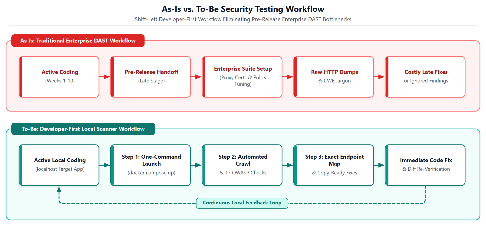
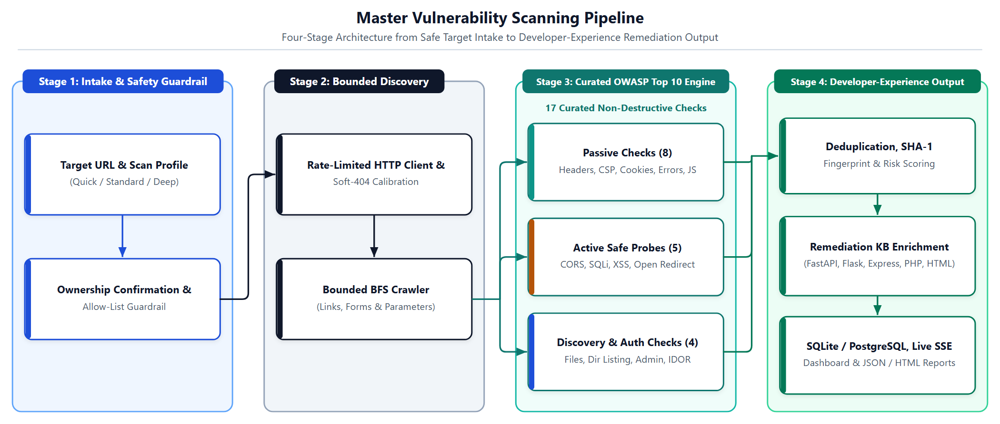
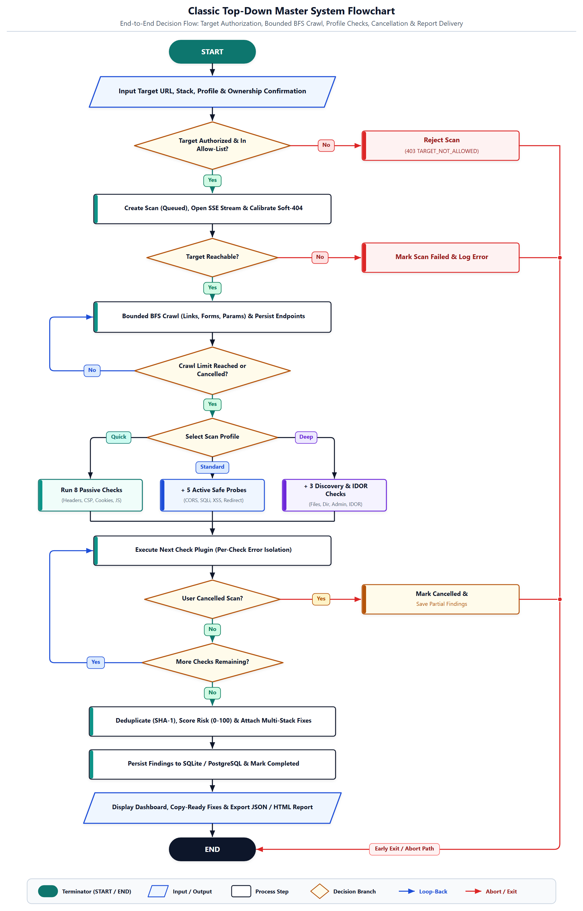

# Chapter 1: Introduction and Scope

## 1.1 Project Background and Motivation

Modern web application development in undergraduate computer science curricula, student capstone projects, and small engineering teams places primary emphasis on rapid feature delivery, functional correctness, and user interface polish. By contrast, dynamic security verification is routinely deferred until final demonstration week or omitted altogether. This deferral runs directly counter to the **Shift-Left** security engineering paradigm formalized in the **NIST Secure Software Development Framework (SSDF, SP 800-218)**, which prescribes integrating automated vulnerability detection and remediation feedback early in the implementation lifecycle, when defects are least costly to correct.

Although the **OWASP Top 10 (2021)** provides a globally recognized taxonomy of critical web application risks—including Broken Access Control (A01), Cryptographic Failures (A02), Injection (A03), Security Misconfiguration (A05), Vulnerable and Outdated Components (A06), and Identification and Authentication Failures (A07)—existing Dynamic Application Security Testing (DAST) platforms are engineered primarily for dedicated security analysts and penetration testers rather than working developers and students. Bridging this gap requires a self-contained, ethically constrained, developer-experience-oriented local vulnerability scanner.

This Software Architecture Document (SAD) defines the system analysis, requirements, architectural views, data and API contracts, ethical safety controls, and empirical benchmarking plan for the graduation project **"Developing a Lightweight OWASP Top 10 Vulnerability Scanner — Tailored for Web Developers and Student Projects (Developer-Experience Focus)"**, prepared in the Department of Cyber Security for the 2026–2027 academic year. The proposed platform combines a Python **FastAPI** backend engine, a rate-limited **Requests + BeautifulSoup4** discovery and probing pipeline, a curated suite of **17 modular OWASP Top 10 (2021) security checks**, an embedded **SQLAlchemy 2.0** persistence layer (defaulting to local **SQLite** in WAL mode with an optional **PostgreSQL 16** Docker Compose profile), and a zero-build **HTML5 + Tailwind CSS + Modular Vanilla JS** developer dashboard. Rather than emitting raw HTTP dumps and abstract CWE taxonomy codes, every finding is pinpointed to its exact route and parameter (for example, `POST /api/login, field: user`), explained in plain developer language, and paired with copy-ready Before/After code fixes across five mainstream web stacks (**FastAPI, Flask, Express, PHP, and HTML**).

---

## 1.2 Problem Statement

Analysis of student web engineering workflows and contemporary DAST tooling reveals three interconnected barriers that inhibit early security adoption:

1. **Early-Stage Security Neglect:** Student teams and junior web developers construct authentication flows, REST endpoints, database queries, and administrative views under compressed academic schedules without automated local security feedback. High-impact defects—such as missing security headers, permissive Cross-Origin Resource Sharing (CORS) policies, reflected Cross-Site Scripting (XSS), error-based SQL Injection (SQLi), insecure session cookies, and exposed backup files—remain undetected until late integration or post-deployment evaluation, when architectural rework is most disruptive.
2. **High Operational and Cognitive Barriers in Enterprise DAST Suites:** Mature security platforms such as **OWASP ZAP** and **Burp Suite** provide extensive penetration-testing capabilities, yet they impose steep operational friction on non-specialist developers. Executing a meaningful scan requires browser proxy chaining, custom TLS root certificate installation, manual scan-policy tuning, and manual triage of hundreds of noisy alerts expressed as raw HTTP transcripts and abstract CWE/WASC codes. Consequently, these suites are rarely used continuously during active local coding.
3. **Absence of Self-Contained, Developer-First Local Scanners:** A clear tooling gap exists between heavyweight enterprise DAST suites and lightweight, ethically bounded local scanners built specifically for education and everyday development. Developers require a tool that launches with a single command (`docker compose up` or a local Python virtual environment), strictly confines probing to authorized local or lab targets, executes curated high-signal checks with minimal false positives, and translates every finding into an immediately actionable code fix.

> [!IMPORTANT]
> **Core Engineering Thesis:** Embedding curated OWASP Top 10 (2021) verification into a zero-configuration local workflow—backed by mandatory allow-list guardrails, exact endpoint/parameter mapping, and copy-ready multi-stack code fixes—substantially lowers setup friction and time-to-first-fix for student developers while preserving detection rigor and ethical safety.

---

## 1.3 Project Aim and Objectives

### 1.3.1 Aim

The aim of this graduation project is to design, implement, and empirically validate a lightweight, ethically bounded, developer-first OWASP Top 10 (2021) web vulnerability scanner that integrates seamlessly into local coding workflows for web developers and university student teams, transforming automated dynamic security findings into exact endpoint coordinates and copy-ready multi-stack remediation guidance.

### 1.3.2 Objectives

To achieve the stated aim, the project establishes seven measurable engineering and academic objectives:

1. **Zero-Configuration Local Deployment (`O1`):** Deliver a self-contained platform launchable in under three minutes via a single `docker compose up` command (with default SQLite persistence and an optional `--profile postgres` mode) as well as a native Python 3.11+/3.12 virtual environment, requiring zero proxy or TLS certificate setup.
2. **Defense-in-Depth Ethical Scope Guardrail (`O2`):** Enforce a hardcoded local/private allow-list, pre-request DNS resolution and IP range verification, manual same-origin redirect checks, destructive-route denylisting, rate limiting (default 10 req/s), a hard 2,000-request cap, and explicit ownership confirmation so unauthorized external scanning and target damage are technically prevented.
3. **Bounded Attack-Surface Discovery (`O3`):** Implement a configurable Breadth-First Search (BFS) crawler using `Requests` and `BeautifulSoup4` (`lxml`) with Soft-404 calibration to extract same-origin URLs, HTTP methods, query parameters, HTML forms, and client-side script references across `Quick`, `Standard`, and `Deep` profiles.
4. **Curated 17-Check Modular Plugin Engine (`O4`):** Construct a decoupled `BaseCheck` plugin registry implementing 17 high-impact OWASP Top 10 (2021) checks (8 Passive, 5 Active Safe, 3 Discovery, and 1 Deep Auth heuristic) with per-check error isolation, in-process `ThreadPoolExecutor` execution, cooperative cancellation, and live Server-Sent Events (SSE) progress streaming.
5. **Actionable Developer-Experience Remediation (`O5`):** Map every vulnerability to its exact HTTP method, normalized endpoint, and input field, enriching it via a structured remediation knowledge base (`kb.json`) with plain-language explanations and copy-ready Before/After code snippets for FastAPI, Flask, Express, PHP, and HTML.
6. **Interactive Dashboard, Diff Tracking, and Exportable Reporting (`O6`):** Provide a responsive HTML5 + Tailwind CSS + Modular Vanilla JS + Chart.js dashboard featuring severity and OWASP visualizations, finding triage (`open`, `fixed`, `false_positive`, `accepted`), deterministic SHA-1 fingerprint scan comparison (`New`, `Fixed`, `Unchanged`), and offline-safe JSON and standalone HTML report exports.
7. **Rigorous Empirical Benchmarking (`O7`):** Validate detection accuracy, crawler coverage, and developer usability against a deterministic local `VulnBench` ground-truth suite (targeting Recall >= 80%, Precision >= 85%, and 0 false positives on clean control routes), supplemented by real-world evaluation on **DVWA** and **OWASP Juice Shop**.

---

## 1.4 Positioning Matrix

Table 1.1 contrasts conventional enterprise DAST suites against the proposed lightweight scanner across the five positioning dimensions defined in the graduation project proposal.

| Positioning Dimension | Enterprise Suites (OWASP ZAP / Burp Suite) | Proposed Lightweight Scanner |
| :--- | :--- | :--- |
| **Target Audience** | Security analysts, penetration testers, and dedicated AppSec teams | Web developers, computer science students, and capstone project teams |
| **Setup & Configuration** | Multi-step installation requiring browser proxy chaining, custom TLS root certificates, heavy JVM/desktop footprint, and manual policy tuning | Zero-configuration local startup via one command (`docker compose up`) alongside native Python `venv` execution |
| **Vulnerability Check Scope** | Exhaustive rule sets (hundreds of active and passive checks) prone to long runtimes, noise, and alert fatigue | Curated, high-impact **OWASP Top 10 (2021)** baseline (**17 modular checks** across Passive, Active Safe, Discovery, and Deep Auth) |
| **Reporting & Remediation Experience** | Raw HTTP request/response dumps, abstract CWE/WASC jargon, and generic textbook remediation notes | Exact endpoint and parameter mapping (`POST /api/login, field: user`), plain-language root-cause summary, and copy-ready **Before/After** code fixes (FastAPI, Flask, Express, PHP, HTML) |
| **Workflow Integration** | Late-stage security gate executed shortly before release or during infrequent audits | Continuous local verification during active coding with SHA-1 fingerprint diffing (`New` / `Fixed` / `Unchanged`) |

---

## 1.5 Stakeholders, User Personas, and Team Structure

### 1.5.1 Stakeholders

Table 1.2 identifies the academic and technical stakeholders who govern, operate, or evaluate the system.

| Stakeholder Group | Representative Role | Core Interest in the System |
| :--- | :--- | :--- |
| **Project Supervisor** | **Dr. Samar** (Department of Cyber Security) | Guides research direction, reviews formal SAD deliverables, verifies alignment with OWASP Top 10 and NIST SSDF standards, and oversees defense readiness. |
| **Primary End Users** | Undergraduate Web Developers & Capstone Student Teams | Require rapid, low-friction local vulnerability checks and clear code-level remediation during active software development. |
| **Instructional Reviewers** | Capstone Team Leads & Course Lab Instructors | Need standardized scan summaries, triage trails, and before/after diff views to assess student security hygiene across milestones. |
| **Academic Examination Committee** | Department of Cyber Security Examiners | Evaluate architectural rigor, formal traceability, ethical anti-abuse guardrails, and reproducible empirical Precision/Recall benchmarks. |
| **Engineering Development Team** | Seven-Member Graduation Project Team | Responsible for architecture design, greenfield implementation, unit/integration testing, testbench construction, and documentation. |

### 1.5.2 User Personas

Table 1.3 profiles the three operational personas whose workflows drive the functional requirements in Chapter 2.

| Persona | Technical Profile | Primary Goals | Key Pain Points Addressed | Primary System Touchpoints |
| :--- | :--- | :--- | :--- | :--- |
| **Student Web Developer** *(Primary Actor)* | Undergraduate building a web app in FastAPI, Flask, Express, or PHP on `localhost` | Detect OWASP flaws early during coding, understand root causes clearly, and apply verified patches quickly | Intimidated by ZAP/Burp proxy setup; confused by raw HTTP dumps; constrained by tight course deadlines | One-command launch, Scan Launcher, Live SSE Progress, Actionable Code Fix Modal, Scan Comparison |
| **Team Lead / Capstone Instructor** *(Secondary Actor)* | Project lead or lab instructor tracking weekly milestones and grading security compliance | Verify remediation progress across iterations, review triaged findings, and collect standardized security evidence | Difficulty auditing whether students tested local builds; inconsistent manual security checklists | Severity & OWASP Dashboard Charts, Triage Controls, Compare Scans Diff, JSON/HTML Reports |
| **Academic Supervisor / Examiner** *(Evaluation Stakeholder)* | Cyber Security faculty reviewing thesis documentation and empirical benchmark validity | Inspect formal architecture views, verify non-destructive ethical guardrails, and audit Precision/Recall metrics | Unverified scanner claims lacking ground-truth datasets or repeatable evaluation scripts | Formal SAD Book & 18 Figures, `VulnBench` / DVWA / Juice Shop testbench, `scripts/evaluate.py` |

### 1.5.3 Project Team Roles and Work Breakdown

The project is executed by a seven-member team supervised by **Dr. Samar**. Table 1.4 maps each team member to a well-defined architectural ownership domain aligned with the greenfield system decomposition.

| Team Member | Student ID | Primary Role | Owned Architecture Modules & Deliverables |
| :--- | :--- | :--- | :--- |
| **Ahmed Ashraf Ammar** | `235204` | Team Lead & Core Backend Architect | FastAPI application architecture (`backend/app/main.py`, `config.py`), REST/SSE API orchestration, in-process `ThreadPoolExecutor` & cancellation registry, and SAD integration. |
| **Islam Mohammed** | `235164` | Discovery & Safety Guardrail Engineer | Mandatory `ScopeGuardrail` (allow-list, DNS rebinding & redirect verification), rate-limited `SafeHTTPClient`, bounded BFS crawler, and Soft-404 calibration. |
| **Abdelrhman Mohamed AbdEl-latif** | `235216` | Active & Injection Checks Engineer | Active Safe OWASP checks (`cors_misconfig`, `sqli_error_based`, `sqli_boolean_diff`, `xss_reflected`, `open_redirect`) and Deep Auth `idor_heuristic` check. |
| **Ahmed Waleed Mokthar** | `235052` | Passive & Discovery Checks Engineer | Passive checks (`missing_security_headers`, `weak_csp`, `server_banner_leak`, `verbose_error_pages`, `insecure_cookies`, `insecure_transport`, `csrf_missing_token`, `outdated_js_components`) and Discovery checks (`sensitive_files`, `directory_listing`, `forced_browsing_admin`). |
| **Mohamed Waleed Mokthar** | `235051` | Persistence, Diff & Reporting Engineer | SQLAlchemy 2.0 3NF ORM schema (`PROJECTS`, `SCANS`, `ENDPOINTS`, `FINDINGS`), SQLite WAL / PostgreSQL profile support, SHA-1 fingerprinting, scan comparison diff, and JSON/Jinja2 HTML report exporter. |
| **Mohamed Ibrahim Elsayed** | `235401` | Frontend & Developer-Experience Engineer | HTML5 + Tailwind CSS + Modular Vanilla JS dashboard (6 views), Chart.js visualizations, live SSE client, multi-stack Remediation KB (`kb.json`), and Actionable Code Fix Modal. |
| **Ali Ibrahim Elsayed** | `235332` | DevOps, QA & Empirical Benchmarking Engineer | Docker / Docker Compose packaging, `docker-compose.testbench.yml`, local deterministic `VulnBench` + `ground_truth.json`, automated `pytest` suite, and `scripts/evaluate.py` benchmarking on DVWA and OWASP Juice Shop. |

---

## 1.6 Explicit Scope Boundaries (In-Scope vs. Out-of-Scope)

Explicitly delineating project boundaries prevents scope creep and ensures that every delivered capability is thoroughly tested, safe, and empirically verifiable. Table 1.5 specifies the In-Scope and Out-of-Scope boundaries.

| Architectural Area | In-Scope (Delivered by This Project) | Out-of-Scope (Explicitly Excluded) |
| :--- | :--- | :--- |
| **Target Surface & Crawling** | HTTP/HTTPS web apps running locally (`localhost`, `127.0.0.1`, RFC1918 private LAN, Docker testbench services); bounded BFS HTML/link/form/parameter crawler with Soft-404 calibration | Public internet scanning, unauthorized external domains, native iOS/Android mobile applications, thick desktop clients, and headless Chromium SPA execution |
| **Vulnerability Detection** | **17 curated OWASP Top 10 (2021) checks** spanning A01, A02, A03, A05, A06, and A07 implemented via a 1-file `BaseCheck` plugin registry | Exhaustive enterprise DAST rule sets (time-based blind/out-of-band SQLi, DOM-XSS browser instrumentation, GraphQL/gRPC fuzzing, static source-code SAST) |
| **Safety & Probing Policy** | Strictly non-destructive proof-of-detection probes; hardcoded allow-list + DNS rebinding check; 10 req/s rate limit; 2,000 request cap; logout/delete route denylist; ownership confirmation | Active exploitation, payload weaponization, automated data exfiltration, credential brute-forcing, denial-of-service stress testing, and OS/network port scanning |
| **Developer Experience & Persistence** | Zero-build HTML5 + Tailwind CSS + Vanilla JS + Chart.js dashboard; live SSE telemetry; finding triage (`open`, `fixed`, `false_positive`, `accepted`); SHA-1 scan comparison; 5-stack code fixes; JSON & standalone HTML reports; SQLite default + PostgreSQL profile | Multi-tenant SaaS IAM/RBAC, commercial issue-tracker connectors (Jira/Slack), distributed Redis/Celery worker clusters, and external cloud SaaS hosting |
| **Empirical Validation** | Automated evaluation against deterministic local `VulnBench` (`testbench/ground_truth.json`) via `scripts/evaluate.py`, plus real-world validation on **DVWA** and **OWASP Juice Shop** | Commercial vulnerability benchmark licensing and live production penetration testing |

---

## 1.7 Project Assumptions, Constraints, and Research Questions

### 1.7.1 Architectural Assumptions

1. **Authorized Local Execution:** The user operates the scanner exclusively against locally hosted development applications, private laboratory networks, or intentionally vulnerable testbench containers (`VulnBench`, DVWA, OWASP Juice Shop).
2. **Standard Runtime Availability:** Target developer workstations run Windows 10/11, macOS, or Linux with either Docker Desktop / Docker Engine or Python 3.11+/3.12 installed.
3. **Server-Rendered & Hybrid HTTP Responses:** Most student web applications built with FastAPI, Flask, Express, or PHP expose discoverable HTML links, forms, or documented HTTP routes reachable without a headless JavaScript browser engine.

### 1.7.2 Engineering Constraints

1. **Zero-Infrastructure Simplicity:** The core runtime must avoid mandatory external brokers or daemons (such as Redis, RabbitMQ, or Celery); background execution must run within a bounded in-process `ThreadPoolExecutor` paired with local SQLite (WAL mode) by default.
2. **Offline Self-Containment:** Core scanning, persistence, and report generation must operate cleanly in offline or air-gapped laboratory environments without external SaaS APIs or cloud dependencies.
3. **Resource Envelope:** Local container execution must remain lightweight (steady-state memory <= 512 MB RAM) so developers can run both their target web application and the scanner simultaneously on standard student laptops.

### 1.7.3 Research Questions

The project's design and empirical evaluation in Chapter 6 are structured around five formal Research Questions (`RQ-1` through `RQ-5`):

| ID | Research Question | Primary Evaluation Evidence |
| :--- | :--- | :--- |
| **RQ-1** | Can a zero-configuration Dockerized local scanner reduce developer setup and onboarding time to under three minutes compared with conventional proxy-based DAST suites? | Quantitative onboarding timing and OWASP ZAP usability rubric (Section 6.5). |
| **RQ-2** | What Precision, Recall, and F1-Score can a curated 17-check OWASP Top 10 (2021) plugin engine achieve against a deterministic ground-truth testbench while maintaining zero false positives on clean control routes? | Automated `scripts/evaluate.py` execution against `VulnBench` (`testbench/ground_truth.json`, Section 6.2–6.4). |
| **RQ-3** | How effectively does a defense-in-depth Scope Guardrail (hardcoded allow-list, DNS resolution check, redirect verification, rate limiter, and request cap) prevent accidental out-of-scope or destructive scanning? | Automated guardrail negative test suite and verification scenarios `TC-01`–`TC-04` (Chapters 5 & 6). |
| **RQ-4** | Does mapping findings to exact endpoints/parameters with plain-language explanations and copy-ready five-stack Before/After code fixes improve remediation clarity over raw HTTP/CWE reports? | Qualitative developer-experience comparison rubric vs. OWASP ZAP baseline (Section 6.5). |
| **RQ-5** | What coverage and performance trade-offs emerge across `Quick`, `Standard`, and `Deep` profiles when scanning server-rendered applications (`VulnBench`, DVWA) versus client-side Single-Page Applications (OWASP Juice Shop)? | Multi-target latency/coverage benchmarks and Threats-to-Validity analysis (Section 6.4 & 6.6). |

---

## 1.8 System Workflow Overview

The scanner operationalizes a streamlined **three-step developer workflow** that integrates security verification directly into active local development:

1. **Step 1 — One-Command Local Launch:** The developer launches the scanner via `docker compose up` (or runs Uvicorn inside a native Python virtual environment). The FastAPI service starts on port `8000`, initializes the embedded SQLite database in WAL mode automatically (or connects to PostgreSQL under `--profile postgres`), and serves the web dashboard with zero proxy or certificate configuration.
2. **Step 2 — Automated Crawl and Curated OWASP Probing:** The developer registers a local project URL (for example, `http://host.docker.internal:5050` or `http://localhost:5050`), confirms ownership authorization, selects a scan profile (`Quick`, `Standard`, or `Deep`), and initiates the scan. After the Scope Guardrail validates the allow-list and resolved IP addresses, the bounded BFS crawler discovers reachable endpoints, query parameters, and HTML forms, and the modular engine runs the curated OWASP checks while streaming live status updates over Server-Sent Events (SSE).
3. **Step 3 — Dashboard Review, Code-Fix Application, and Diff Verification:** The developer reviews prioritized findings organized by severity and OWASP category, opens the Actionable Code Fix Modal to inspect the exact vulnerable endpoint and field alongside plain-language guidance and copy-ready framework snippets (FastAPI, Flask, Express, PHP, or HTML), applies the patch locally, and runs a follow-up scan to confirm that the finding transitions to `Fixed` in the SHA-1 fingerprint diff view.

*Figure 1: Comparison of the late-stage enterprise DAST workflow (As-Is) against the proposed continuous local developer-first workflow (To-Be). Diagram source: [01_as_is_vs_to_be.mmd](../diagrams/01_as_is_vs_to_be.mmd).*

*Figure 2: Four-stage master execution pipeline from target intake and safety guardrail enforcement through bounded discovery, curated 17-check execution, and developer-experience output generation. Diagram source: [02_master_scanner_pipeline.mmd](../diagrams/02_master_scanner_pipeline.mmd).*

Complementing the four-stage architectural pipeline above, Figure 19 presents the classic ISO 5807 top-down decision-flow representation of the entire system, making explicit every runtime branch condition, bounded loop termination criterion, profile-driven check selection, and cooperative cancellation path from initial target submission through final report delivery.

*Figure 19: Classic top-down master system flowchart illustrating end-to-end target authorization, reachability validation, bounded BFS crawling, profile-driven OWASP check execution, cancellation handling, risk scoring, and developer report delivery. (Mermaid source: [19_master_system_flowchart.mmd](../diagrams/19_master_system_flowchart.mmd))*

---

## 1.9 Definitions and Glossary

Table 1.6 standardizes the domain terminology, security acronyms, and architectural concepts referenced throughout this Software Architecture Document.

| Term / Acronym | Definition |
| :--- | :--- |
| **Allow-list** | An explicit, deny-by-default list of permitted target hostnames and private IP ranges (`localhost`, `127.0.0.1`, `host.docker.internal`, RFC1918 private networks, and local testbench services `dvwa`, `juice-shop`, `vulnbench`). Requests resolving outside this boundary are blocked prior to transmission. |
| **Attack Surface** | The enumerated set of reachable entry points exposed by a target web application—comprising normalized URL paths, HTTP methods (`GET`/`POST`), query parameters, HTML form inputs, and HTTP headers—discovered by the bounded BFS crawler. |
| **BFS (Breadth-First Search)** | Level-order graph traversal algorithm used by the web crawler to discover pages systematically up to a profile-configured depth (`max_depth`) and page budget (`max_pages`), preventing infinite traversal loops. |
| **CORS (Cross-Origin Resource Sharing)** | HTTP header policy (`Access-Control-Allow-Origin`, `Access-Control-Allow-Credentials`) controlling cross-origin browser reads; overly permissive reflection with credentials enables unauthorized cross-site data access. |
| **CSP (Content-Security-Policy)** | Security response header restricting trusted script, style, and frame origins to mitigate XSS and content-injection attacks. |
| **CSRF (Cross-Site Request Forgery)** | Vulnerability occurring when state-changing `POST` forms omit an unpredictable anti-CSRF token, enabling cross-site forged requests using an authenticated user's session cookie. |
| **CWE (Common Weakness Enumeration)** | Standardized software weakness taxonomy (e.g., `CWE-89` SQL Injection, `CWE-79` XSS) linked to findings for academic reference alongside plain-language explanations. |
| **DAST (Dynamic Application Security Testing)** | Black-box testing technique that probes a running web application over HTTP/HTTPS to identify runtime misconfigurations and injection vulnerabilities without static source-code analysis. |
| **Fingerprint** | A deterministic **SHA-1** digest computed from `(check_id, normalized_url, http_method, parameter_name)` that stably identifies a finding across repeated scans to classify changes as `New`, `Fixed`, or `Unchanged`. |
| **IDOR (Insecure Direct Object Reference)** | Access control vulnerability (OWASP A01) where modifying a predictable object identifier in a request exposes unauthorized records belonging to another user. |
| **MoSCoW** | Requirements prioritization scale classifying requirements into **Must**, **Should**, **Could**, and **Won't** have within the target project scope. |
| **NIST SSDF (SP 800-218)** | National Institute of Standards and Technology Secure Software Development Framework defining core practices (`PO`, `PS`, `PW`, `RV`) for integrating security early across the software lifecycle. |
| **OWASP Top 10 (2021)** | Industry-standard taxonomy cataloging the ten most critical web application security risk categories (`A01`–`A10`), providing the conceptual foundation for the scanner's 17 curated checks. |
| **Soft-404** | Server behavior in which non-existent routes return HTTP `200 OK` (such as a fallback error template or SPA shell) rather than `404 Not Found`. Calibrating against random nonexistent paths suppresses false positives in discovery checks. |
| **SQLi (SQL Injection)** | Injection flaw (OWASP A03) caused by concatenating untrusted user input into SQL statements; detected non-destructively via error-signature matching and boolean-differential probing. |
| **SSE (Server-Sent Events)** | Lightweight unidirectional HTTP streaming mechanism (`text/event-stream`) used by `GET /api/scans/{id}/stream` to deliver real-time crawl progress, check execution updates, and live finding counts to the dashboard. |
| **Triage** | Developer review process assigning each finding one of four lifecycle states (`open`, `fixed`, `false_positive`, `accepted`), automatically excluding `false_positive` entries from the scan risk score. |
| **WAL (Write-Ahead Logging)** | SQLite concurrency mode (`PRAGMA journal_mode=WAL`) enabling concurrent background worker writes and FastAPI dashboard/SSE reads without database locking errors. |
| **XSS (Cross-Site Scripting)** | Injection flaw (OWASP A03) in which untrusted input is reflected into HTML responses without context-aware encoding; detected safely via benign unique canary tokens. |

---

## 1.10 Chapter Summary

This chapter established the motivation, problem statement, formal aim and objectives, competitive positioning, stakeholder and team structure, explicit scope boundaries, research questions, and end-to-end developer workflow for the Lightweight OWASP Top 10 Vulnerability Scanner. Anchored in Shift-Left engineering and NIST SSDF principles, the proposed architecture directly resolves the setup friction and alert-comprehension barriers of enterprise DAST suites by pairing a zero-configuration local Docker/Python runtime and mandatory ethical guardrails with 17 curated OWASP checks and copy-ready five-stack remediation fixes. Chapter 2 translates these objectives and stakeholder needs into a formal System Requirements Specification comprising functional requirements, measurable non-functional requirements, use cases, and full requirements traceability.
