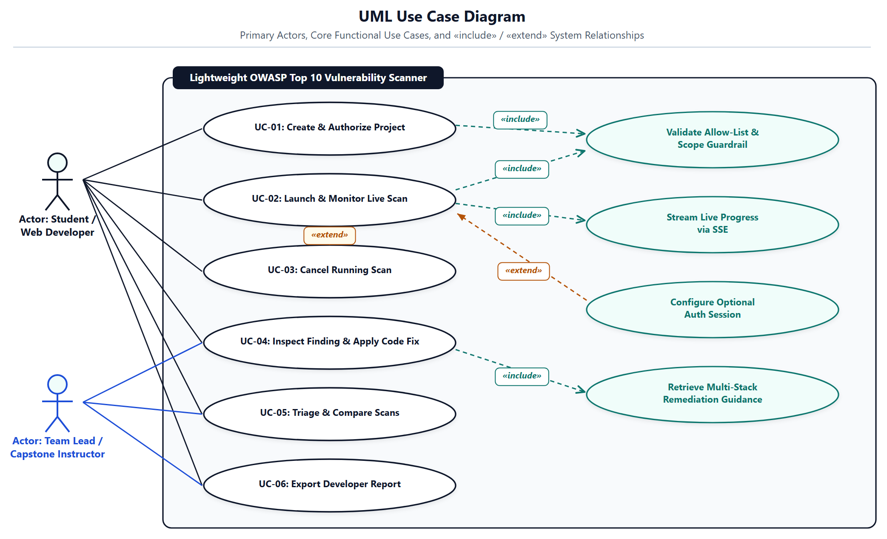

# Chapter 2: System Requirements Specification

## 2.1 Functional Requirements Catalogue

The functional requirements define all externally observable behaviors of the Lightweight OWASP Top 10 Vulnerability Scanner across project registration, ethical scope enforcement, bounded web crawling, curated OWASP Top 10 (2021) vulnerability detection, live progress streaming, developer remediation guidance, triage, and reporting. Table 2.1 specifies `FR-01` through `FR-15` using MoSCoW prioritization and objective acceptance criteria.

| ID | Requirement | Category | MoSCoW Priority | Acceptance Criterion |
| :--- | :--- | :--- | :--- | :--- |
| **FR-01** | **Project Creation and Explicit Ownership Confirmation** — The system shall allow a developer to register a target web project (`name`, `base_url`, optional `description`, and `ownership_confirmed` boolean) and shall reject creation unless ownership confirmation is explicitly asserted. | Project Management & Ethics | **Must** | `POST /api/projects` returns HTTP `201 Created` when `ownership_confirmed=true` and `base_url` is valid; returns HTTP `422` or `400` if `ownership_confirmed=false` or URL syntax is malformed. |
| **FR-02** | **Mandatory Allow-List and Scope Guardrail Enforcement** — The system shall validate every target URL, pre-request resolved DNS IP address, and HTTP redirect destination against a hardcoded local/private allow-list (`localhost`, `127.0.0.1`, `host.docker.internal`, RFC1918 private networks, `dvwa`, `juice-shop`, `vulnbench`) before transmitting any outbound probe. | Safety & Scope Control | **Must** | Attempting to register or scan a public internet host (e.g., `https://example.com`) or a hostname resolving to a public IP is rejected with HTTP `403`/`400` and zero outbound scan requests transmitted. |
| **FR-03** | **Configurable Scan Profiles (`Quick`, `Standard`, `Deep`)** — The system shall support three predefined scan profiles governing crawl depth, page budget, and enabled checks: `Quick` (passive checks and shallow crawl), `Standard` (passive, active safe, and discovery checks), and `Deep` (all 17 checks including `idor_heuristic` with expanded crawl budget). | Scan Configuration | **Must** | Submitting `POST /api/projects/{id}/scans` with `profile` in `{quick, standard, deep}` configures the corresponding `max_depth`, `max_pages`, and check set, persisted on the scan record. |
| **FR-04** | **Bounded BFS Web Crawler and Attack-Surface Discovery** — The system shall crawl same-origin HTML pages using Breadth-First Search up to profile limits, extracting normalized URLs, HTTP methods, query parameters, HTML `<form>` fields, and script tags while skipping destructive/logout routes and calibrating Soft-404 responses. | Discovery Engine | **Must** | Crawling `VulnBench` enumerates all seeded links, query endpoints, and `POST` form fields within the configured page cap without leaving the target origin or invoking `/logout` or `/delete` paths. |
| **FR-05** | **Curated 17-Check OWASP Top 10 (2021) Engine** — The system shall execute 17 modular vulnerability checks across Passive (8: `missing_security_headers`, `weak_csp`, `server_banner_leak`, `verbose_error_pages`, `insecure_cookies`, `insecure_transport`, `csrf_missing_token`, `outdated_js_components`), Active Safe (5: `cors_misconfig`, `sqli_error_based`, `sqli_boolean_diff`, `xss_reflected`, `open_redirect`), Discovery (3: `sensitive_files`, `directory_listing`, `forced_browsing_admin`), and Deep Auth (1: `idor_heuristic`). | Vulnerability Detection | **Must** | Each check subclasses `BaseCheck`, executes under per-check exception isolation, maps to an OWASP Top 10 (2021) category and CWE ID, and detects its corresponding seeded vulnerability on `VulnBench`. |
| **FR-06** | **Real-Time Scan Progress Streaming via SSE** — The system shall push live scan lifecycle transitions (`queued` -> `crawling` -> `scanning` -> `completed`), completion percentage, active check identifier, discovered endpoint count, and live finding count over Server-Sent Events (`GET /api/scans/{id}/stream`). | Live Telemetry | **Must** | Connecting an `EventSource` client to `/api/scans/{id}/stream` receives ordered JSON SSE events during execution and closes cleanly upon reaching a terminal state (`completed`, `failed`, or `cancelled`). |
| **FR-07** | **Cooperative Mid-Scan Cancellation** — The system shall allow a developer to cancel any `queued`, `crawling`, or `scanning` scan via `POST /api/scans/{id}/cancel`, signaling a `threading.Event` cancellation flag to halt further HTTP probes while preserving findings already stored. | Scan Lifecycle Control | **Must** | Calling `POST /api/scans/{id}/cancel` on a running scan transitions status to `cancelled` within 5 seconds, halts outbound probing, and emits a terminal cancellation SSE event. |
| **FR-08** | **Exact Endpoint, Method, and Parameter Finding Mapping** — Every persisted finding shall record exact location coordinates: HTTP method, normalized endpoint path, affected parameter/header/field (e.g., `POST /api/login, field: user`), confidence level, and redacted non-sensitive proof-of-detection evidence. | Developer Experience | **Must** | Every finding returned by `GET /api/scans/{id}/findings` includes non-empty `endpoint_url`, `http_method`, `parameter` (when input-bound), `evidence`, `owasp_category`, `cwe_id`, and `severity`. |
| **FR-09** | **Plain-Language Explanations and Multi-Stack Copy-Ready Code Fixes** — The system shall enrich every finding from `backend/scanner/remediation/kb.json` with a jargon-free summary, root-cause explanation, impact description, and copy-ready **Before/After** code fixes for **FastAPI, Flask, Express, PHP, and HTML**. | Remediation Guidance | **Must** | Opening any finding in the Actionable Code Fix Modal displays plain-language guidance and interactive framework tabs with one-click clipboard copy for vulnerable ("Before") and patched ("After") code blocks. |
| **FR-10** | **Interactive Severity and OWASP Dashboard Charts** — The system shall provide a responsive web dashboard displaying the computed risk score (`min(100, 10*critical + 6*high + 3*medium + 1*low)`), severity breakdown charts, OWASP Top 10 category distribution charts, and filterable findings/endpoints tables. | Visualization & UI | **Must** | Dashboard loads at `GET /` with zero frontend build step, renders live Chart.js visualizations from REST API data, and filters findings by severity, OWASP category, check ID, and triage status. |
| **FR-11** | **Scan History Persistence and Fingerprint-Based Comparison** — The system shall persist historical scans in SQLAlchemy (SQLite default / PostgreSQL profile) and compute deterministic **SHA-1** finding fingerprints to compare any two scans of a project into `New`, `Fixed`, and `Unchanged` groups. | Regression Tracking | **Must** | `GET /api/scans/{id}/compare?baseline={other_id}` accurately partitions findings into `new`, `fixed`, and `unchanged` collections alongside the risk-score delta after a code patch and re-scan. |
| **FR-12** | **JSON and Standalone HTML Report Export** — The system shall export any finished scan as structured JSON (`GET /api/scans/{id}/report?format=json`) and as a self-contained, printable HTML report (`format=html`) rendered via auto-escaped Jinja2 templates including executive metrics and code fixes. | Reporting & Portability | **Must** | Downloaded JSON conforms to the documented report schema; downloaded HTML renders cleanly offline in a browser with no broken assets and properly escaped finding evidence. |
| **FR-13** | **Finding Triage and Lifecycle Status Management** — The system shall allow developers and instructors to update a finding's status (`open`, `fixed`, `false_positive`, `accepted`) with optional rationale notes via `PATCH /api/findings/{id}`, automatically recalculating the scan risk score to exclude `false_positive` entries. | Workflow & Governance | **Should** | Marking a finding `false_positive` persists across page reloads, records the triage note/timestamp, and immediately updates the parent scan's risk score. |
| **FR-14** | **Optional Authenticated Scanning (Cookie, Bearer, DVWA Helper)** — The system shall accept optional per-scan target authentication credentials (raw `Cookie` header, `Authorization: Bearer` token, or automated DVWA form-login helper) held strictly in volatile memory during the scan and never persisted in plaintext to the database. | Authenticated Discovery | **Should** | Supplying session cookies, a Bearer token, or DVWA credentials enables discovery and scanning of protected routes (e.g., DVWA `/vulnerabilities/sqli/`) while leaving database tables free of credential secrets. |
| **FR-15** | **Curated Check Catalog Discovery API** — The system shall expose a read-only `GET /api/checks` endpoint listing every registered `BaseCheck` plugin with its `check_id`, title, execution phase (`passive`, `active`, `discovery`, `deep`), OWASP category, CWE ID, default severity, and scan profile membership. | Transparency & Extensibility | **Should** | `GET /api/checks` returns HTTP `200 OK` enumerating all 17 active checks and automatically includes any newly added single-file `BaseCheck` module upon startup. |

---

## 2.2 Non-Functional Requirements

Table 2.2 establishes nine measurable non-functional requirements (`NFR-01` through `NFR-09`) governing usability, runtime performance, ethical safety, self-security, portability, extensibility, reliability, empirical accuracy, and maintainability.

| ID | Quality Attribute | Requirement Statement | Target Metric / Verification Method |
| :--- | :--- | :--- | :--- |
| **NFR-01** | **Usability and Zero-Config Onboarding** | A student developer with Docker installed shall be able to start the scanner, register a local project, and launch a first scan with zero proxy setup, zero TLS certificate installation, and zero manual configuration edits. | Time from repository clone to first live scan **< 3 minutes** via `docker compose up`, validated during Phase 6 usability evaluation. |
| **NFR-02** | **Performance and Resource Bounds** | Local scans shall execute fast enough for iterative coding while remaining well within standard student laptop resource budgets. | On local `VulnBench` (~15–25 routes): `Quick` **<= 30 s**, `Standard` **<= 120 s**, `Deep` **<= 300 s**; steady-state memory **<= 512 MB RAM**; bounded in-process `ThreadPoolExecutor` worker pool. |
| **NFR-03** | **Mandatory Safety, Ethics, and Non-Destructive Probing** | The scanner shall prevent unauthorized external scanning, avoid target overload, and execute strictly non-destructive proof-of-detection probes. | Hardcoded allow-list + pre-request DNS (`socket.getaddrinfo`) + `ipaddress` validation; manual same-origin redirect verification; default rate limit **10 req/s**; hard cap **2,000 requests/scan**; logout/delete route denylist; verified by dedicated guardrail tests. |
| **NFR-04** | **Scanner Self-Security** | The scanner backend and dashboard shall adhere to OWASP defensive coding standards so the tool itself introduces no local security exposure. | Strict Pydantic v2 validation; security headers middleware (`X-Content-Type-Options`, `X-Frame-Options`, `Referrer-Policy`, `Content-Security-Policy`); non-root Docker user (`scanner`); parameterized SQLAlchemy 2.0 queries; Jinja2 auto-escaping and safe DOM text insertion (`textContent`). |
| **NFR-05** | **Portability and Dual Runtime Support** | The platform shall run identically across Windows 10/11, macOS, and Linux via Docker Compose and natively inside a Python 3.11+/3.12 virtual environment. | Verified `docker compose up` (default SQLite + optional `--profile postgres` PostgreSQL 16 service, `host.docker.internal` host-gateway) and native `uvicorn backend.app.main:app` startup. |
| **NFR-06** | **Extensibility and Plugin Modularity** | Adding a new OWASP security check shall require authoring only a single Python module subclassing `BaseCheck` and adding its remediation entry to `kb.json`, without editing core orchestration code. | Dynamic plugin auto-registry discovers `BaseCheck` subclasses at startup; verified by a unit test loading a mock check without modifying `ScanOrchestrator`. |
| **NFR-07** | **Reliability and Per-Check Error Isolation** | An unhandled exception, malformed HTML response, or HTTP timeout in any individual check or route shall be isolated and shall never crash the scan worker or abort remaining checks. | Each check runs inside isolated `try/except` handling with explicit connect/read timeouts; SQLite WAL mode prevents read/write lock contention during concurrent SSE streaming. |
| **NFR-08** | **Detection Accuracy and Empirical Benchmark Targets** | The curated 17-check engine shall achieve strong detection recall while maintaining high precision and zero false-positive noise on clean control routes. | Automated `scripts/evaluate.py` against `VulnBench` (`testbench/ground_truth.json`) achieves **Recall >= 80%**, **Precision >= 85%**, and **0 false positives** on clean control routes; supplementary evaluation on DVWA and OWASP Juice Shop. |
| **NFR-09** | **Maintainability and Automated Verification** | The repository shall maintain strict separation between the FastAPI web layer (`backend/app/`) and the pure scanner engine (`backend/scanner/`), verified by automated tests and static linting. | Automated `pytest` suite covering unit, guardrail, crawler, check, REST/SSE API, and E2E integration tests passes with zero failures and zero `ruff` lint errors. |

---

## 2.3 System Use Case Diagram

Figure 3 models the system boundary, external actors (`Student / Web Developer` and `Team Lead / Capstone Instructor`), six core use cases (`UC-01` through `UC-06`), and UML `«include»` and `«extend»` behavioral relationships.

*Figure 3: System Use Case Diagram depicting system actors, primary use cases (UC-01 through UC-06), mandatory include dependencies, and optional authentication and cancellation extensions. Diagram source: [03_use_case_diagram.mmd](../diagrams/03_use_case_diagram.mmd).*

---

## 2.4 Detailed Use Case Specifications

The six primary use cases illustrated in Figure 3 are specified below to define preconditions, nominal interaction flows, exception handling, postconditions, and requirement links.

### UC-01: Create and Authorize Project

| Field | Specification |
| :--- | :--- |
| **Use Case ID & Name** | `UC-01`: Create and Authorize Project |
| **Primary Actor** | Student / Web Developer |
| **Secondary Actors** | None (Scope Guardrail invoked internally) |
| **Description** | The developer registers a local or testbench web application as a scannable project and explicitly confirms authorization to test the target. |
| **Preconditions** | The scanner web service (`http://localhost:8000`) is running and reachable; the target application URL is known. |
| **Trigger** | The developer clicks **New Project** in the dashboard or sends `POST /api/projects`. |
| **Main Success Scenario** | **1.** The developer enters project `name`, target `base_url` (e.g., `http://host.docker.internal:5050`), and optional `description`. **2.** The developer checks the mandatory ownership confirmation box affirming authorization to test the local/lab target. **3.** The frontend sends `POST /api/projects` with `ownership_confirmed: true`. **4.** FastAPI validates the payload schema via Pydantic v2. **5.** The Scope Guardrail verifies URL scheme (`http`/`https`), host allow-list membership, and resolved IP safety (`«include» Validate Allow-List & Scope Guardrail`). **6.** The system persists the new `Project` record in SQLAlchemy and returns HTTP `201 Created`. **7.** The dashboard displays the newly registered project card ready for scanning. |
| **Alternative & Exception Flows** | **A1 — Ownership Unchecked:** The frontend prevents submission; direct API requests with `ownership_confirmed: false` are rejected with HTTP `422 Unprocessable Entity`. **A2 — Target Outside Allow-List:** The Scope Guardrail detects a public domain or non-allowlisted IP and returns HTTP `403 Forbidden` with an ethical-use explanation; no project is created. **A3 — Malformed URL:** Pydantic validation returns HTTP `422` detailing the invalid URL format. |
| **Postconditions** | A validated `Project` record exists in the database and is eligible for scan execution. |
| **Related Requirements** | `FR-01`, `FR-02`, `NFR-01`, `NFR-03`, `NFR-04` |

### UC-02: Launch and Monitor Live Scan

| Field | Specification |
| :--- | :--- |
| **Use Case ID & Name** | `UC-02`: Launch and Monitor Live Scan |
| **Primary Actor** | Student / Web Developer |
| **Secondary Actors** | Target Local Web Application |
| **Description** | The developer selects a scan profile (`Quick`, `Standard`, or `Deep`), optionally provides session credentials, initiates an asynchronous scan, and monitors live progress in the browser. |
| **Preconditions** | The target project exists (`UC-01`); the target local application is running and listening on its configured port. |
| **Trigger** | The developer clicks **Start Scan** in the Scan Launcher view or sends `POST /api/projects/{id}/scans`. |
| **Main Success Scenario** | **1.** The developer selects a scan profile (`Quick`, `Standard`, or `Deep`) and optionally configures Cookie/Bearer/DVWA credentials (`«extend» Configure Optional Auth Session`). **2.** The frontend sends `POST /api/projects/{id}/scans`. **3.** The Scope Guardrail re-validates target URL and DNS resolution (`«include» Validate Allow-List & Scope Guardrail`). **4.** The backend inserts a `Scan` row with status `queued`, registers a `threading.Event` cancel handle, submits execution to the bounded `ThreadPoolExecutor`, and returns HTTP `202 Accepted`. **5.** The dashboard opens an `EventSource` stream on `GET /api/scans/{id}/stream` (`«include» Stream Live Progress via SSE`). **6.** The worker transitions through `crawling` and `scanning`: calibrating Soft-404, crawling links/forms via bounded BFS, running profile checks inside isolated `try/except` blocks, enriching findings from `kb.json`, computing SHA-1 fingerprints and risk score, and persisting `Endpoint` and `Finding` rows. **7.** The dashboard updates the progress bar, active check label, discovered endpoint tally, and severity counters in real time. **8.** Upon completion, scan status becomes `completed`, the SSE stream closes cleanly, and the dashboard loads the Findings Explorer. |
| **Alternative & Exception Flows** | **A1 — Target Unreachable:** Initial connectivity check fails; the scan transitions to `failed` with an actionable hint (e.g., verify `host.docker.internal` or target port). **A2 — Single Check Exception:** The orchestrator logs the fault, isolates the failure, and continues executing remaining checks. **A3 — Request Cap Reached:** Reaching 2,000 requests halts further probing cleanly, persists collected findings, and marks the scan `completed` with a cap-reached notice. **A4 — Developer Cancels:** Invokes `UC-03` (`«extend»`). |
| **Postconditions** | Completed `Scan`, discovered `Endpoint` records, enriched `Finding` rows, and calculated risk score are persisted in the database. |
| **Related Requirements** | `FR-02`, `FR-03`, `FR-04`, `FR-05`, `FR-06`, `FR-08`, `FR-14`, `NFR-02`, `NFR-03`, `NFR-07` |

### UC-03: Cancel Running Scan

| Field | Specification |
| :--- | :--- |
| **Use Case ID & Name** | `UC-03`: Cancel Running Scan |
| **Primary Actor** | Student / Web Developer |
| **Secondary Actors** | None |
| **Description** | The developer terminates an active or queued scan cleanly without discarding endpoints and findings already persisted. |
| **Preconditions** | A scan exists in state `queued`, `crawling`, or `scanning`. |
| **Trigger** | The developer clicks **Cancel Scan** in the Live SSE Progress view or sends `POST /api/scans/{id}/cancel`. |
| **Main Success Scenario** | **1.** The frontend sends `POST /api/scans/{id}/cancel`. **2.** The API retrieves the scan's active `threading.Event` handle from the cancellation registry and sets the event. **3.** The crawler loop and check orchestrator observe `cancel_event.is_set()` prior to the next HTTP request or check invocation and exit cleanly. **4.** The worker flushes already-collected findings, computes the partial risk score, updates scan status to `cancelled` with a `finished_at` timestamp, and emits a terminal `cancelled` SSE event. **5.** The dashboard displays the `Cancelled` badge and enables inspection of partial findings. |
| **Alternative & Exception Flows** | **A1 — Already Terminal:** If the scan has already entered `completed`, `failed`, or `cancelled`, the API returns HTTP `409 Conflict` indicating the terminal state. |
| **Postconditions** | Outbound scan traffic ceases within 5 seconds; the scan is stored as `cancelled` with partial findings retained. |
| **Related Requirements** | `FR-06`, `FR-07`, `NFR-07` |

### UC-04: Inspect Finding and Apply Code Fix

| Field | Specification |
| :--- | :--- |
| **Use Case ID & Name** | `UC-04`: Inspect Finding and Apply Code Fix |
| **Primary Actor** | Student / Web Developer |
| **Secondary Actors** | Team Lead / Capstone Instructor |
| **Description** | The actor filters findings on the dashboard, inspects exact endpoint and parameter coordinates, reviews the plain-language explanation, and copies a framework-matched Before/After code fix. |
| **Preconditions** | At least one scan has generated findings (`UC-02`). |
| **Trigger** | The actor selects a finding row in the Findings and Endpoints Explorer view. |
| **Main Success Scenario** | **1.** The actor filters findings by severity (`critical`/`high`/`medium`/`low`), OWASP Top 10 category, or triage status (`GET /api/scans/{id}/findings`). **2.** The actor selects a finding row (e.g., `SQL Injection (Error-Based)` on `POST /api/login, field: user`). **3.** The frontend requests full finding details and remediation guidance (`«include» Retrieve Multi-Stack Remediation Guidance`) via `GET /api/findings/{id}`. **4.** The Actionable Code Fix Modal displays exact HTTP method, normalized endpoint, parameter/header, redacted proof-of-detection evidence, plain-language root-cause summary, and framework tabs (**FastAPI, Flask, Express, PHP, HTML**). **5.** The developer selects the matching framework tab, compares the vulnerable **Before** snippet against the secure **After** snippet, and clicks **Copy Fix**. **6.** The developer applies the patch directly in the local codebase. |
| **Alternative & Exception Flows** | **A1 — Stack Not Listed:** The developer consults the generic HTTP/HTML or closest backend framework snippet alongside the plain-language explanation and CWE/OWASP reference. **A2 — Malicious Target Evidence:** All target response excerpts are inserted strictly via safe DOM text nodes (`textContent`), preventing stored XSS inside the scanner UI. |
| **Postconditions** | The developer identifies the exact vulnerable field and obtains a copy-ready remediation patch for local implementation. |
| **Related Requirements** | `FR-08`, `FR-09`, `FR-10`, `FR-15`, `NFR-04` |

### UC-05: Triage and Compare Scans

| Field | Specification |
| :--- | :--- |
| **Use Case ID & Name** | `UC-05`: Triage and Compare Scans |
| **Primary Actor** | Student / Web Developer |
| **Secondary Actors** | Team Lead / Capstone Instructor |
| **Description** | The actor updates finding triage statuses (`open`, `fixed`, `false_positive`, `accepted`) and compares two scans of the same project via SHA-1 fingerprints to verify remediation progress. |
| **Preconditions** | A project has at least one scan (for triage) or at least two completed scans (for comparison). |
| **Trigger** | The actor updates a finding status control or selects two scans in the **Compare Scans** view. |
| **Main Success Scenario** | **1.** To triage a finding, the actor chooses a new status (`fixed`, `false_positive`, `accepted`, or `open`), enters an optional justification note, and submits `PATCH /api/findings/{id}`. **2.** The backend validates the status enum, persists the update, recalculates the parent scan's risk score excluding `false_positive` entries, and returns the updated record and score. **3.** After patching code locally and executing a follow-up scan (`UC-02`), the actor opens **Compare Scans** and chooses a baseline scan and target scan. **4.** The frontend invokes `GET /api/scans/{id}/compare?baseline={other_id}`. **5.** The backend matches SHA-1 fingerprints between both scans and returns partitioned `New`, `Fixed`, and `Unchanged` finding sets alongside the risk-score delta. **6.** The dashboard renders resolved `Fixed` items, newly introduced `New` regressions, and persistent `Unchanged` findings clearly. |
| **Alternative & Exception Flows** | **A1 — Cross-Project Comparison Attempt:** If the two scan IDs belong to different projects, the API returns HTTP `400 Bad Request`. **A2 — Invalid Status Enum:** Pydantic rejects unrecognized triage values with HTTP `422 Unprocessable Entity`. |
| **Postconditions** | Triage decisions are persisted, risk scores reflect triaged reality, and remediation progress between iterations is objectively verified. |
| **Related Requirements** | `FR-10`, `FR-11`, `FR-13`, `NFR-04` |

### UC-06: Export Developer Report

| Field | Specification |
| :--- | :--- |
| **Use Case ID & Name** | `UC-06`: Export Developer Report |
| **Primary Actor** | Student / Web Developer |
| **Secondary Actors** | Team Lead / Capstone Instructor |
| **Description** | The actor exports scan summary metrics, discovered endpoints, findings, triage notes, and multi-stack remediation guidance as a structured JSON file or standalone printable HTML report. |
| **Preconditions** | The target scan exists in a terminal state (`completed` or `cancelled`). |
| **Trigger** | The actor clicks **Export JSON** or **Export HTML** on the dashboard or requests `GET /api/scans/{id}/report?format={json|html}`. |
| **Main Success Scenario** | **1.** The actor selects either `JSON` (for archival or automated evaluation) or `HTML` (for academic submission and PDF printing). **2.** The frontend requests `GET /api/scans/{id}/report?format=json` or `format=html`. **3.** The backend loads scan metadata, risk score, severity/OWASP tallies, endpoints, and enriched findings from SQLAlchemy. **4.** For `json`, the backend serializes the structured Pydantic report payload with `Content-Disposition: attachment`. **5.** For `html`, the backend renders a self-contained Jinja2 report template with strict auto-escaping, inline print styles, executive summary, finding cards, and Before/After code snippets. **6.** The browser downloads the report cleanly for offline review, milestone grading, or printing. |
| **Alternative & Exception Flows** | **A1 — Scan Still Active:** Requesting a report while status is `queued`, `crawling`, or `scanning` returns HTTP `409 Conflict` advising the user to wait or cancel first. **A2 — Unsupported Format:** Any `format` value outside `{json, html}` returns HTTP `400`/`422`. |
| **Postconditions** | A complete, accurate, safely escaped JSON or standalone HTML report file is delivered to the user's workstation. |
| **Related Requirements** | `FR-08`, `FR-09`, `FR-12`, `NFR-04` |

---

## 2.5 Requirements Traceability Matrix

Table 2.3 provides full forward and backward traceability linking every functional requirement (`FR-01` through `FR-15`) to its corresponding Use Cases, Architecture Components (Chapters 3 and 4), primary API/UI surfaces, and automated verification tests (Chapter 6).

| Req ID | Requirement Summary | Use Case(s) | Architecture Component(s) | Primary API / UI Surface | Verification Test(s) |
| :--- | :--- | :--- | :--- | :--- | :--- |
| **FR-01** | Project creation & ownership confirmation | `UC-01` | FastAPI Projects Router, Pydantic v2 Schemas, SQLAlchemy `Project` ORM | `POST /api/projects`, Projects Dashboard View | `test_projects_api.py::test_create_project_requires_ownership` (`TC-01`) |
| **FR-02** | Mandatory allow-list & DNS/redirect scope guardrail | `UC-01`, `UC-02` | `ScopeGuardrail` (`backend/scanner/guardrail.py`), `SafeHTTPClient` | `POST /api/projects`, `POST /api/projects/{id}/scans` | `test_guardrail.py` (`TC-02`, `TC-03`, `TC-04`) |
| **FR-03** | Configurable scan profiles (`Quick`, `Standard`, `Deep`) | `UC-02` | `ScanProfile` Config, `ScanOrchestrator`, `CheckRegistry` | `POST /api/projects/{id}/scans`, Scan Launcher View | `test_orchestrator.py::test_profile_check_selection` (`TC-05`) |
| **FR-04** | Bounded BFS web crawler & Soft-404 calibration | `UC-02` | `BFSCrawler` (`BeautifulSoup4` + `lxml`), `Soft404Calibrator` | `GET /api/scans/{id}/endpoints`, Endpoints Explorer | `test_crawler.py` (`TC-06`) |
| **FR-05** | Curated 17-check OWASP Top 10 (2021) engine | `UC-02` | `BaseCheck` Plugin Registry (`backend/scanner/checks/*`), `ScanOrchestrator` | `GET /api/scans/{id}/findings`, `GET /api/checks` | `test_checks_*.py` + `scripts/evaluate.py` (`TC-07`, `TC-08`) |
| **FR-06** | Real-time scan progress streaming via SSE | `UC-02`, `UC-03` | In-Process `ThreadPoolExecutor`, SSE Event Broker, FastAPI `StreamingResponse` | `GET /api/scans/{id}/stream`, Live SSE Progress View | `test_scans_sse.py::test_sse_progress_stream_lifecycle` (`TC-09`) |
| **FR-07** | Cooperative mid-scan cancellation | `UC-03` | Cancellation Registry (`threading.Event`), `ScanOrchestrator` | `POST /api/scans/{id}/cancel`, Live Progress Cancel Button | `test_scans_api.py::test_cancel_running_scan` (`TC-10`) |
| **FR-08** | Exact endpoint, method & parameter finding mapping | `UC-02`, `UC-04`, `UC-06` | `RawFinding` / `EnrichedFinding` Models, SQLAlchemy `Finding` ORM | `GET /api/scans/{id}/findings`, Findings Explorer View | `test_findings_api.py::test_finding_coordinates` (`TC-07`) |
| **FR-09** | Plain-language explanation & 5-stack copy-ready code fixes | `UC-04`, `UC-06` | Remediation Enricher + `backend/scanner/remediation/kb.json` | `GET /api/findings/{id}`, Actionable Code Fix Modal | `test_remediation_kb.py` (`TC-11`) |
| **FR-10** | Interactive severity & OWASP dashboard charts | `UC-04`, `UC-05` | Risk Scorer, Modular Vanilla JS + Tailwind CSS + Chart.js Frontend | `GET /`, `GET /api/scans/{id}`, Dashboard View | `test_health.py::test_dashboard_served` + `test_scans_api.py` (`TC-12`) |
| **FR-11** | Scan history & SHA-1 fingerprint comparison (`New`/`Fixed`/`Unchanged`) | `UC-05` | Fingerprint Engine (SHA-1), Scan Diff Service, SQLAlchemy Persistence | `GET /api/scans/{id}/compare?baseline={other_id}`, Compare Scans View | `test_compare_scans.py::test_new_fixed_unchanged_diff` (`TC-13`) |
| **FR-12** | JSON & standalone HTML report export | `UC-06` | Report Generator (`Jinja2` auto-escaped template + JSON serializer) | `GET /api/scans/{id}/report?format={json\|html}`, Export Controls | `test_reports_api.py` (`TC-14`) |
| **FR-13** | Finding triage (`open`/`fixed`/`false_positive`/`accepted`) & score update | `UC-05` | Findings Router, Risk Score Recalculator, SQLAlchemy `Finding` ORM | `PATCH /api/findings/{id}`, Triage Controls | `test_findings_api.py::test_triage_updates_risk_score` (`TC-13`) |
| **FR-14** | Optional authenticated scanning (Cookie, Bearer, DVWA helper) | `UC-02` | `SafeHTTPClient` Auth Injector, In-Memory Scan Auth Context | `POST /api/projects/{id}/scans` (`auth` payload), Launcher Auth Panel | `test_auth_scanning.py` (`TC-15`) |
| **FR-15** | Curated check catalog discovery API | `UC-04` | `CheckRegistry` Auto-Discovery, Checks Metadata Router | `GET /api/checks`, Dashboard Check Info View | `test_checks_api.py::test_list_all_17_registered_checks` (`TC-05`) |

---

## 2.6 Chapter Summary

This chapter established the complete System Requirements Specification for the Lightweight OWASP Top 10 Vulnerability Scanner. Fifteen prioritized functional requirements (`FR-01` through `FR-15`) and nine measurable non-functional requirements (`NFR-01` through `NFR-09`) codify the operational, safety, usability, accuracy, and extensibility expectations of the platform. The System Use Case Diagram (Figure 3), six detailed use case specifications (`UC-01` through `UC-06`), and the bidirectional Requirements Traceability Matrix ensure that every developer workflow and faculty evaluation criterion is directly linked to concrete architectural components and automated verification suites. Chapter 3 builds upon this specification by detailing the multi-view software architecture, data flow trust boundaries, deployment topology, behavioral lifecycles, and object-oriented plugin structure.
