# Chapter 3: Software Architecture and Multi-View Design

This chapter presents the multi-view architectural design of the **Lightweight OWASP Top 10 Vulnerability Scanner — Tailored for Web Developers and Student Projects**. Grounded in IEEE Std 42010 and the C4 architectural modeling methodology, the system is specified across structural views (C4 Levels 1 through 3 and an object-oriented UML class view), data-flow views (DFD Levels 0 and 1 with explicit trust boundaries), a deployment and networking view (Docker Compose and isolated testbench topology), and dynamic behavioral views (sequence diagrams, a finite state machine, and a cross-component swimlane activity model). Every architectural boundary is engineered to satisfy the project's Developer-Experience (DevEx) mandate: zero-configuration local execution, non-destructive safety guarantees, real-time telemetry, and stack-specific remediation guidance.

---

## 3.1 Architectural Style and Design Principles

The system implements a **Four-Layer Modular Monolith with a Pure Decoupled Scanning Engine** paired with an **In-Process Asynchronous Execution Model**. Rather than introducing distributed runtime dependencies (such as external message brokers like Redis or RabbitMQ, distributed Celery worker clusters, or client-side Node.js bundler toolchains), the architecture consolidates four distinct logical layers—(1) Presentation Layer (HTML5, Tailwind CSS, Modular Vanilla JS, and Chart.js), (2) Application and API Layer (FastAPI, Pydantic v2, Uvicorn, and SSE streaming), (3) Pure Scanning Engine Layer (`backend/scanner/`), and (4) Persistence Layer (SQLAlchemy 2.0 with SQLite WAL default and optional PostgreSQL 16)—into a single lightweight container or native Python virtual environment. Table 3.1 maps the core architectural principles to their concrete implementation mechanisms and satisfied Non-Functional Requirements (NFRs).

### Table 3.1: Core Architectural Principles and Design Mechanisms

| Design Principle | Concrete Implementation Mechanism | Primary Quality Attribute / NFR Satisfied |
| :--- | :--- | :--- |
| **Zero-Friction Local Deployment** | Single-command `docker compose up` startup with native Python 3.11+/3.12 `venv` parity; SQLite WAL default (`sqlite:///./data/scanner.db`) and optional PostgreSQL 16 via `--profile postgres`. | **NFR-01** (Usability under 3-minute setup), **NFR-05** (Portability) |
| **Pure Decoupled Scanner Engine** | `backend/scanner/` consists exclusively of pure Python modules (`requests`, `BeautifulSoup4`, `lxml`, standard library) with zero imports from FastAPI, Uvicorn, or SQLAlchemy. Communication with the API layer occurs strictly through typed dataclasses and callback hooks. | **NFR-06** (Extensibility), **NFR-09** (Maintainability and isolated unit testing) |
| **Single-File Plugin Auto-Registry** | Each vulnerability check subclasses `BaseCheck` (or a specialized category base) and registers automatically via `CheckRegistry`. Introducing a new OWASP check requires one Python module and a matching entry in `kb.json`. | **NFR-06** (Extensibility) |
| **In-Process Bounded Worker and SSE** | FastAPI dispatches scan jobs to a bounded `concurrent.futures.ThreadPoolExecutor` coordinated with an in-memory `threading.Event` cancellation registry and Server-Sent Events (`GET /api/scans/{id}/stream`), eliminating external broker complexity. | **NFR-01** (Operational simplicity), **NFR-02** (Responsiveness and live telemetry) |
| **Per-Check Fault Isolation** | Each of the 17 vulnerability checks executes inside a guarded `try/except` boundary in `ScanOrchestrator`. A target timeout or parsing exception in one plugin emits a non-fatal `check_warning` SSE event while subsequent checks continue uninterrupted. | **NFR-07** (Reliability and graceful degradation) |
| **Defense-in-Depth Scope Guardrail** | All outbound HTTP traffic traverses `SafeHttpClient` and `ScopeGuardrail`, enforcing local/testbench host allow-lists, pre-request DNS IP validation, manual same-origin redirects, destructive route denylists, a 10 req/s rate limit, and a 2,000-request cap. | **NFR-03** (Mandatory Safety and Ethical Operation) |
| **SPA-Free Developer Dashboard** | The frontend utilizes HTML5, Tailwind CSS, Modular Vanilla JS (ES Modules), and Chart.js served directly by FastAPI, eliminating Node.js build dependencies while delivering six structured developer workflows. | **NFR-01** (Zero-configuration build), **NFR-04** (Reduced attack surface) |

---

## 3.2 C4 Level 1 — System Context

The C4 Level 1 System Context view defines the system boundary between the vulnerability scanner, its human stakeholders, and the external web applications and output artifacts with which it exchanges data. By design, the scanner operates solely within the developer's local workstation or an isolated academic testbench network rather than as an open internet-facing service.

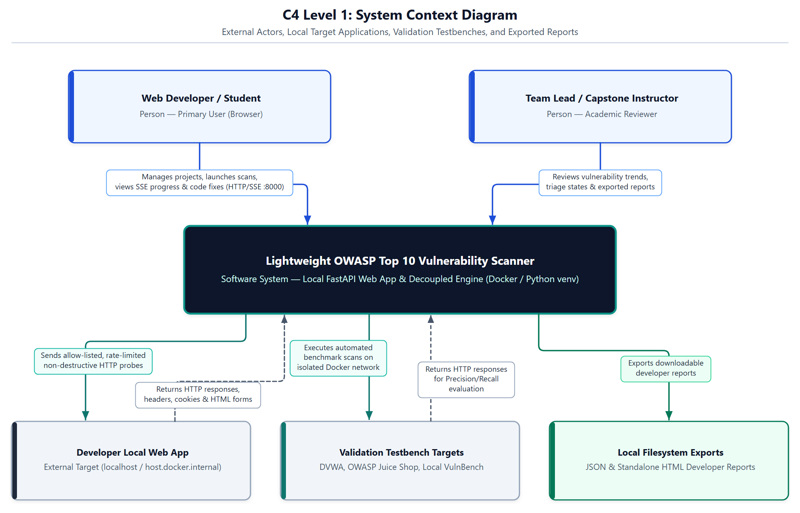

*Figure 4: C4 Level 1 — System Context Diagram (Source: [04_c4_l1_context.mmd](../diagrams/mmd/04_c4_l1_context.mmd)).*

### Table 3.2: System Context Actors and External Systems

| Entity | Classification | Interaction Protocol | Responsibilities and Operational Constraints |
| :--- | :--- | :--- | :--- |
| **Web Developer / Student** | Primary Human Actor | HTTP / SSE (`localhost:8000`) | Registers local projects, confirms target ownership, launches Quick/Standard/Deep scans, monitors live SSE progress, inspects exact endpoint/parameter mappings, applies copy-ready code fixes, triages findings, and compares scan history. |
| **Team Lead / Capstone Instructor** | Secondary Human Actor | HTTP (`localhost:8000`) and Offline Reports | Audits project security posture, reviews developer triage decisions (`fixed`, `false_positive`, `accepted`), and evaluates standalone HTML and JSON deliverables. |
| **Developer Local Web App** | Authorized Target System | HTTP/HTTPS (Scoped, <= 10 req/s) | Student or developer application hosted on `localhost`, `127.0.0.1`, or via `host.docker.internal`, subjected strictly to non-destructive crawling and safe proof-of-detection checks. |
| **Validation Testbench Targets** | Authorized Benchmark Systems | Docker Bridge HTTP (`testbench_net`) | Containerized DVWA, OWASP Juice Shop, and local deterministic VulnBench instances utilized for reproducible Precision, Recall, and regression benchmarking. |
| **Local Filesystem Exports** | External Output Sink | Browser Download / Local Volume | Portable, self-contained HTML developer reports and structured JSON audit bundles stored locally for grading or continuous integration archiving. |

---

## 3.3 C4 Level 2 — Container Architecture

Decomposing the scanner system into logical containers and runtime units demonstrates how the browser presentation tier, FastAPI control plane, in-process background worker pool, pure scanner engine, remediation knowledge base, report generator, and SQLAlchemy persistence layer collaborate within a self-contained footprint.

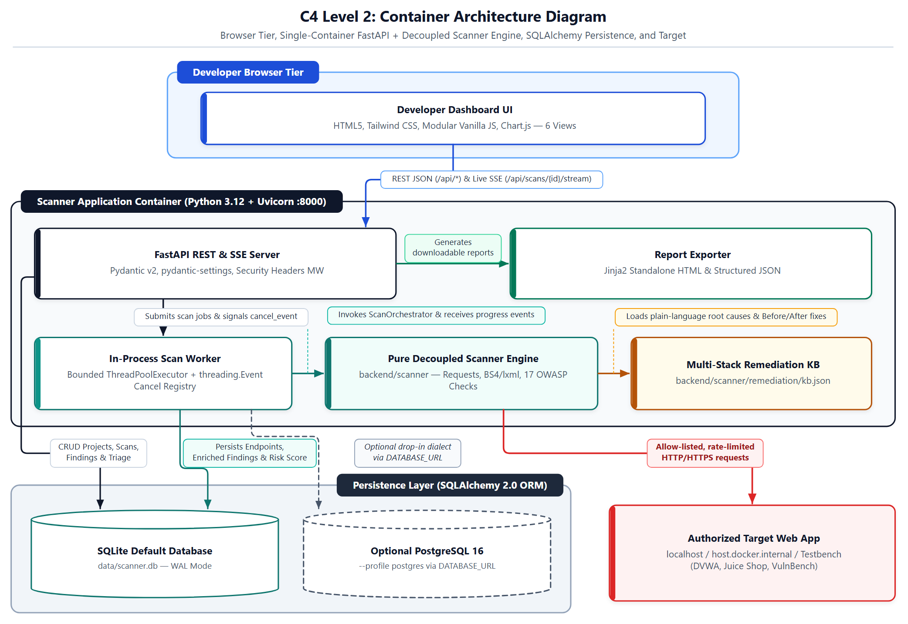

*Figure 5: C4 Level 2 — Container Architecture Diagram (Source: [05_c4_l2_containers.mmd](../diagrams/mmd/05_c4_l2_containers.mmd)).*

### Table 3.3: Container and Runtime Subsystem Specifications

| Container / Subsystem | Technology Stack | Primary Responsibilities |
| :--- | :--- | :--- |
| **Developer Dashboard UI** | HTML5, Tailwind CSS, Modular Vanilla JS (ES Modules), Chart.js | Implements six dedicated views: (1) Projects and Overview Dashboard (risk trend and OWASP distribution charts), (2) Scan Launcher (profile selection, optional auth configuration, and mandatory ownership confirmation), (3) Live SSE Progress Monitor (phase stepper, live finding feed, and Cancel control), (4) Findings and Endpoints Explorer (multi-facet filtering), (5) Actionable Code Fix Modal (exact endpoint/parameter badge, plain-language root cause, and tabbed FastAPI/Flask/Express/PHP/HTML Before/After snippets), and (6) Compare Scans and Export View (New/Fixed/Unchanged diffing and JSON/HTML export). |
| **FastAPI REST and SSE Server** | Python 3.12, FastAPI, Uvicorn, Pydantic v2, `pydantic-settings` | Exposes typed `/api/*` REST routes, enforces strict schema validation, injects scanner self-security headers (`CSP`, `X-Frame-Options`, `X-Content-Type-Options`, `Referrer-Policy`), serves static dashboard assets at `/`, and streams real-time scan telemetry via Server-Sent Events. |
| **In-Process Scan Worker** | Python stdlib `ThreadPoolExecutor`, `threading.Event`, per-scan `queue.Queue` | Executes scans off the ASGI event loop in a bounded thread pool (default `max_workers=2` to preserve local workstation resources), manages cooperative cancellation flags keyed by `scan_id`, and relays engine events to active SSE subscribers. |
| **Pure Decoupled Scanner Engine** | Python 3.12, `requests.Session`, `BeautifulSoup4`, `lxml` | Performs Soft-404 baseline calibration, breadth-first crawling, guardrail validation, execution of all 17 curated OWASP Top 10 checks, SHA-1 deduplication, remediation enrichment, and weighted risk scoring. |
| **Multi-Stack Remediation KB** | Versioned JSON (`backend/scanner/remediation/kb.json`) | Maps each canonical `check_id` to plain-language root causes, verification steps, and copy-ready Before/After code fixes across **FastAPI**, **Flask**, **Express**, **PHP**, and **HTML**. |
| **Report Exporter** | Jinja2 (strict autoescaping) and JSON serializer | Produces portable, standalone HTML developer reports and machine-readable JSON audit exports directly from persisted scan records. |
| **Persistence Layer** | SQLAlchemy 2.0 ORM (SQLite WAL default / optional `psycopg` PostgreSQL 16) | Persists projects, scans, discovered endpoints, findings, SHA-1 fingerprints, and triage history with strict foreign-key integrity and dialect-agnostic schema portability. |

---

## 3.4 C4 Level 3 — Scanner Engine Component Architecture

Inspecting the internal structure of the pure `backend/scanner/` package reveals four cohesive sub-pipelines that convert an authorized target URL into deduplicated, remediation-enriched findings: (1) Orchestration and Safety Controls, (2) Attack Surface Discovery, (3) the 17-Check Plugin Auto-Registry, and (4) Enrichment and Risk Scoring.

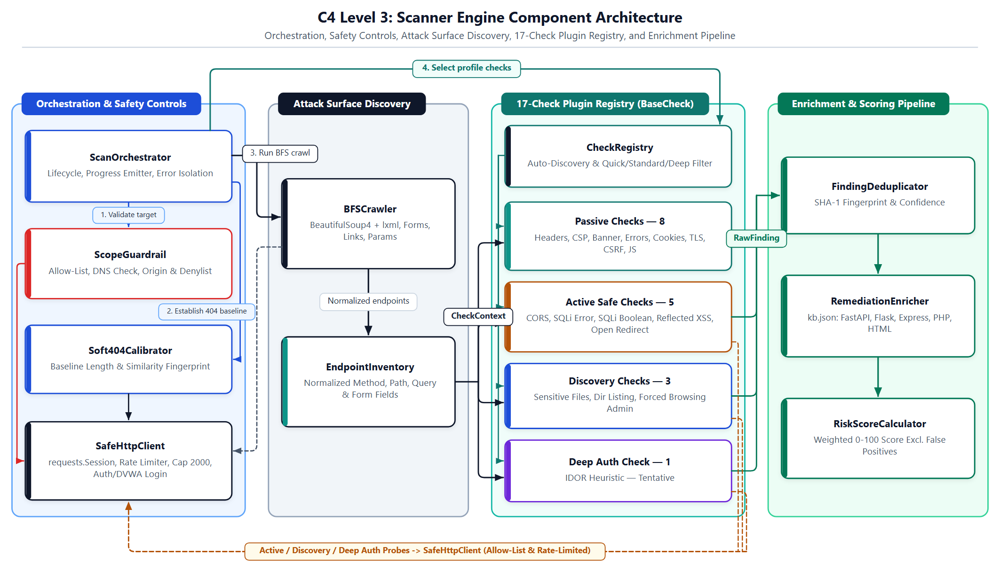

*Figure 6: C4 Level 3 — Scanner Engine Component Architecture (Source: [06_c4_l3_scanner_components.mmd](../diagrams/mmd/06_c4_l3_scanner_components.mmd)).*

### Table 3.4: Internal Scanner Engine Component Specifications

| Component | Module Path | Key Algorithmic and Engineering Responsibilities |
| :--- | :--- | :--- |
| **`ScanOrchestrator`** | `backend/scanner/orchestrator.py` | Coordinates the four-stage scan lifecycle (pre-flight calibration, BFS crawl, fault-isolated check execution, and enrichment/scoring), polls `cancel_event`, enforces scan time budgets, and emits structured progress callbacks. |
| **`ScopeGuardrail`** | `backend/scanner/safety/guardrail.py` | Restricts outbound targets to allow-listed hosts (`localhost`, `127.0.0.1`, `host.docker.internal`, RFC1918 private ranges, `dvwa`, `juice-shop`, `vulnbench`), executes pre-request DNS resolution (`socket.getaddrinfo`) verified via `ipaddress` to mitigate DNS rebinding, validates same-origin redirects manually, and blocks destructive paths (`/logout`, `/signout`, `/delete`, `/remove`). |
| **`SafeHttpClient`** | `backend/scanner/http_client.py` | Encapsulates `requests.Session` with token-bucket rate limiting (default `10 req/s`), a hard per-scan cap (`2,000` requests), bounded connect/read timeouts, `allow_redirects=False` manual redirect inspection, transient Cookie/Bearer header injection, and optional automated DVWA login bootstrapping. |
| **`Soft404Calibrator`** | `backend/scanner/soft404.py` | Issues 2–3 randomized nonexistent path probes (e.g., `/__devscan_not_found_<uuid>`) prior to discovery checks to capture baseline status codes, normalized response lengths, and structural similarity signatures, eliminating false positives on custom 200-OK error handlers and single-page applications. |
| **`BFSCrawler` and `EndpointInventory`** | `backend/scanner/crawler.py` | Executes breadth-first traversal bounded by profile depth and page limits (Quick: depth 1 / 25 pages; Standard: depth 3 / 100 pages; Deep: depth 4 / 200 pages), parsing `<a href>`, `<form action/method/input>`, `<script src>`, and query strings via `BeautifulSoup4` + `lxml`, while normalizing paths and deduplicating routes. |
| **`CheckRegistry`** | `backend/scanner/checks/registry.py` | Auto-discovers all `BaseCheck` subclasses across passive (8), active-safe (5), discovery (3), and deep-auth (1) packages, filters applicable checks by scan profile (`quick`, `standard`, `deep`), and supplies live metadata to `GET /api/checks`. |
| **`FindingDeduplicator`** | `backend/scanner/enrichment/dedup.py` | Computes canonical SHA-1 fingerprints over `(check_id, http_method, normalized_path, parameter_name)` so duplicate detections across multiple crawl paths collapse cleanly while retaining the highest-confidence evidence excerpt. |
| **`RemediationEnricher`** | `backend/scanner/enrichment/remediation.py` | Joins each `RawFinding` with `backend/scanner/remediation/kb.json`, attaching plain-language root-cause narratives, verification steps, and stack-specific Before/After code fixes prioritized according to the project's `framework_hint`. |
| **`RiskScoreCalculator`** | `backend/scanner/enrichment/scoring.py` | Computes the bounded `0–100` scan risk score (`min(100, 10*critical + 6*high + 3*medium + 1*low)`), strictly excluding findings triaged as `false_positive`. |

---

## 3.5 Data Flow Diagrams (DFD Level 0 and Level 1 with Trust Boundaries)

Explicit data-flow modeling establishes how untrusted client inputs and untrusted target HTTP responses are validated, sanitized, and isolated across trust boundaries throughout the scan lifecycle.

### 3.5.1 DFD Level 0 — System Context Data Flow

At Level 0, the entire scanner is represented as Process `0.0`, exchanging configuration, live telemetry, and reports with the developer while exchanging scoped, rate-limited HTTP traffic with the authorized local or testbench target application.

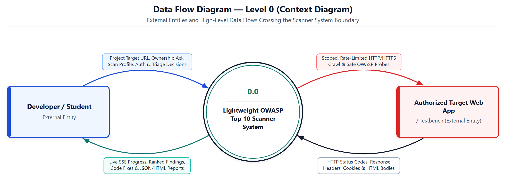

*Figure 7: Data Flow Diagram Level 0 — System Context (Source: [07_dfd_l0_context.mmd](../diagrams/mmd/07_dfd_l0_context.mmd)).*

### 3.5.2 DFD Level 1 — Internal Processes and Trust Boundaries

Level 1 decomposes Process `0.0` into six internal processes (`1.0` through `6.0`) and three logical data stores (`D1` Projects and Scans, `D2` Endpoints and Findings, and `D3` Remediation KB) partitioned across three explicit Trust Boundaries: **TB1 (Developer Browser)**, **TB2 (Scanner Application Process)**, and **TB3 (Target Network Perimeter)**.

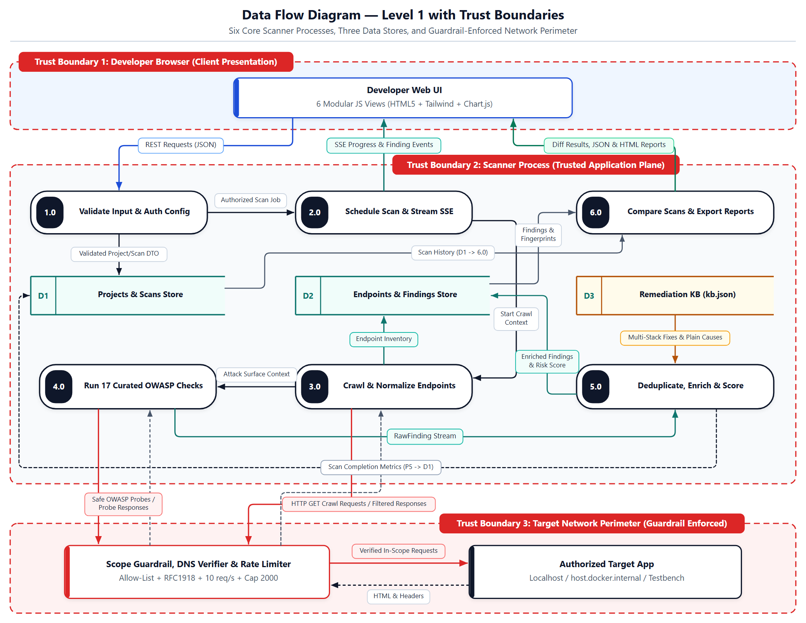

*Figure 8: Data Flow Diagram Level 1 — Internal Processes and Trust Boundaries (Source: [08_dfd_l1_trust_boundaries.mmd](../diagrams/mmd/08_dfd_l1_trust_boundaries.mmd)).*

### Table 3.5: Trust Boundary Threat Mitigation Matrix

| Trust Boundary Crossing | Identified Threat | Enforced Architectural Control |
| :--- | :--- | :--- |
| **TB1 -> TB2** (Browser to FastAPI) | Malformed payloads, Server-Side Request Forgery (SSRF) targeting unauthorized hosts, and stored XSS via project names or triage notes. | Strict Pydantic v2 schema validation, mandatory `ownership_confirmed=true` check, `ScopeGuardrail` allow-list pre-validation, parameterized SQLAlchemy ORM queries, and output encoding in DOM rendering and Jinja2 templates. |
| **TB2 -> TB3** (Scanner to Target Network) | Out-of-scope scanning of external internet infrastructure, DNS rebinding bypasses, local target overload, or accidental state deletion. | Pre-request `socket.getaddrinfo` resolution checked against private/loopback IP ranges, manual same-origin redirect verification, destructive/logout path denylist, 10 req/s rate limit, 2,000-request cap, and strictly non-destructive proof-of-detection payloads. |
| **TB3 -> TB2** (Target Responses to Scanner) | Malicious or malformed HTML/JavaScript reflected from target applications executing inside the scanner UI or exported HTML reports. | Response body truncation, sanitized evidence snippet extraction (<= 500 chars), strict `Content-Security-Policy` headers on the scanner web application, and mandatory HTML entity escaping across all UI views and report templates. |
| **TB2 Internal Data Stores (D1–D3)** | Persistence of transient authentication credentials (session cookies or Bearer tokens) in scan configuration logs. | Session credentials reside strictly in volatile worker memory for the duration of a single scan; `SCANS.config_snapshot` records only redacted configuration metadata (e.g., `auth_mode: "bearer"`). |

---

## 3.6 Deployment and Network Topology View

To support both everyday student development and repeatable empirical benchmarking, the deployment architecture defines two modular Docker Compose topologies alongside a zero-Docker native Python `venv` mode:

1. **Core Local Stack (`docker-compose.yml`):** Provisions the non-root `scanner` container (`python:3.12-slim`, Uvicorn bound to port `8000`) backed by a named `scanner_data` volume storing the SQLite WAL database (`/app/data/scanner.db`). Declaring `extra_hosts: ["host.docker.internal:host-gateway"]` enables seamless host-loopback reachability across Windows, macOS, and Linux so developers can scan locally running apps (e.g., `http://host.docker.internal:5000`). Activating `--profile postgres` attaches an optional PostgreSQL 16 service (`postgres_data` volume) configured through `DATABASE_URL`.
2. **Validation Testbench Stack (`docker-compose.testbench.yml`):** Provisions three intentionally vulnerable targets bound exclusively to host loopback (`127.0.0.1`) on an isolated `testbench_net` bridge network: **DVWA** (`vulnerables/web-dvwa:latest` on `127.0.0.1:8080:80`), **OWASP Juice Shop** (`bkimminich/juice-shop:latest` on `127.0.0.1:3000:3000`), and the local deterministic **VulnBench** (`127.0.0.1:5050:5050`).

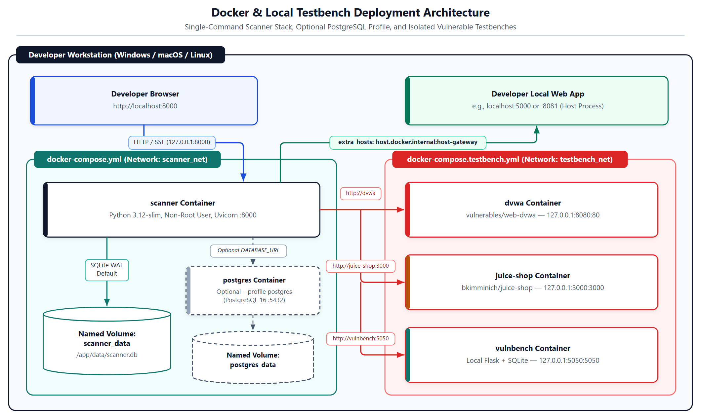

*Figure 9: Docker Compose Deployment and Network Topology (Source: [09_docker_deployment.mmd](../diagrams/mmd/09_docker_deployment.mmd)).*

### Table 3.6: Supported Deployment Profiles

| Deployment Mode | Startup Command | Database Engine | Target Reachability | Intended Operational Scenario |
| :--- | :--- | :--- | :--- | :--- |
| **Default Docker (Recommended)** | `docker compose up --build` | SQLite WAL (`scanner_data` volume) | `host.docker.internal:<port>` and Docker service names | Everyday local development and student capstone testing (< 3-minute setup) |
| **Docker + PostgreSQL Profile** | `docker compose --profile postgres up --build` | PostgreSQL 16 (`postgres_data` volume) | Same as Default Docker | Multi-project persistence validation and relational dialect verification |
| **Testbench Evaluation Stack** | `docker compose -f docker-compose.yml -f docker-compose.testbench.yml up` | SQLite WAL or PostgreSQL 16 | `http://dvwa`, `http://juice-shop:3000`, `http://vulnbench:5050` | Automated Precision, Recall, and regression benchmarking |
| **Native Python Virtual Env** | `uvicorn backend.app.main:app --port 8000` | SQLite WAL (`./data/scanner.db`) | Direct `http://127.0.0.1:<port>` and `http://localhost:<port>` | Workstations without Docker Desktop or interactive IDE debugging |

---

## 3.7 Behavioral and Dynamic Views

Static component boundaries alone do not guarantee responsive UI updates, safe user-initiated cancellation, or runtime resilience against unstable student applications. The four behavioral views below specify exact interaction sequences, fault-isolation boundaries, finite state transitions, and cross-component activity flows.

### 3.7.1 End-to-End Scan Lifecycle Sequence

Upon receiving `POST /api/projects/{id}/scans`, FastAPI validates the request schema and target allow-list, persists a `queued` scan record, submits execution to the bounded `ThreadPoolExecutor`, and immediately returns `202 Accepted`. The browser connects to `GET /api/scans/{id}/stream` via `EventSource` to receive real-time phase transitions, crawl counts, enriched finding summaries, and final risk-score completion telemetry.

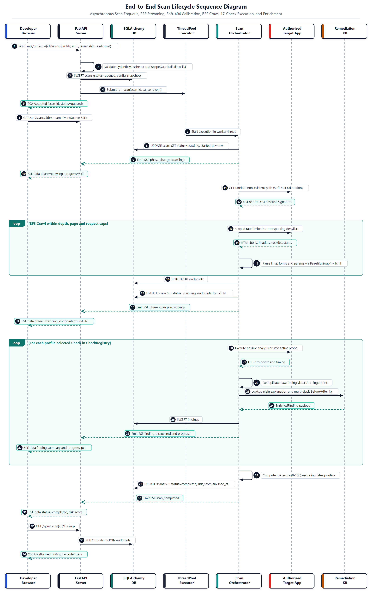

*Figure 10: End-to-End Scan Lifecycle Sequence Diagram (Source: [10_scan_lifecycle_sequence.mmd](../diagrams/mmd/10_scan_lifecycle_sequence.mmd)).*

### 3.7.2 Scan Cancellation and Per-Check Error Isolation Sequence

Web applications under active student development frequently exhibit unhandled 500 errors, hung database queries, or mid-scan restarts. Figure 11 specifies two essential runtime resilience patterns: (1) **Per-Check Error Isolation**, wrapping every plugin invocation inside a structured `try/except` boundary that emits a non-fatal `check_warning` SSE event without aborting the scan, and (2) **Cooperative User Cancellation**, allowing `POST /api/scans/{id}/cancel` to signal a per-scan `threading.Event` so the orchestrator halts probing gracefully, preserves all previously committed findings, recomputes a partial risk score, and transitions the scan to `cancelled`.

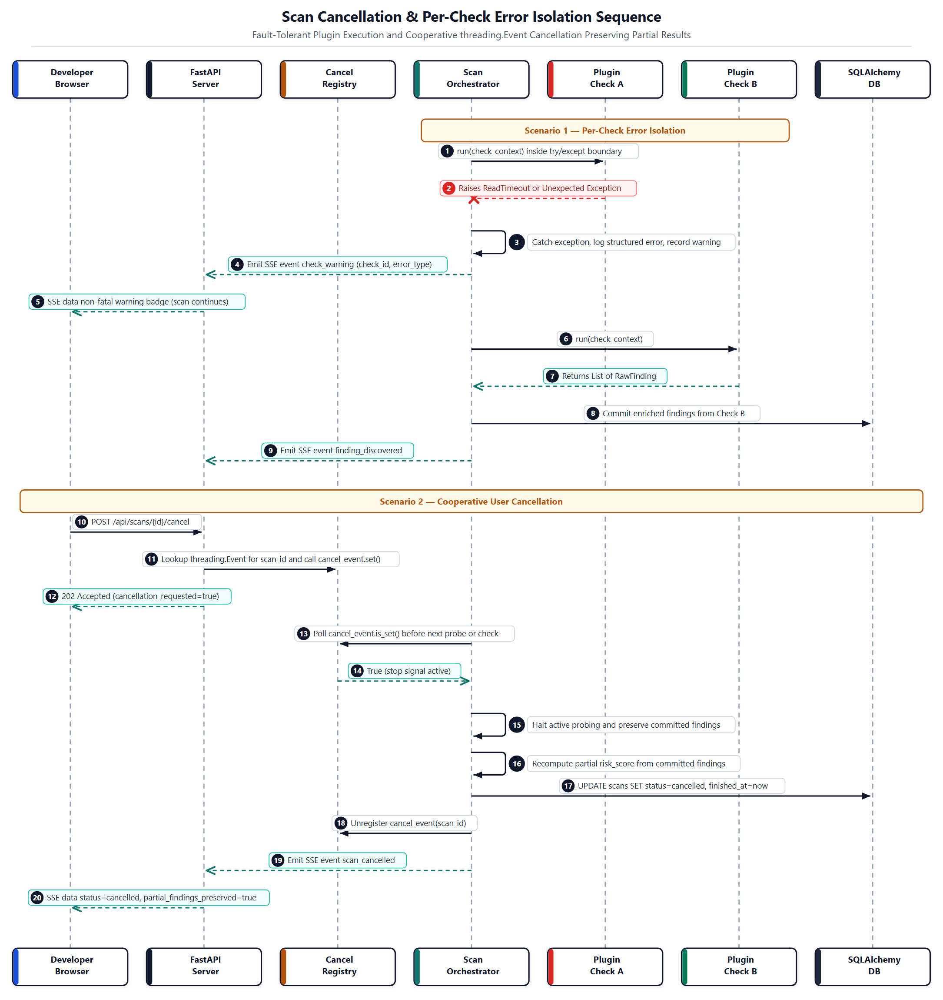

*Figure 11: Scan Cancellation and Per-Check Error Isolation Sequence (Source: [11_cancel_error_isolation_sequence.mmd](../diagrams/mmd/11_cancel_error_isolation_sequence.mmd)).*

### 3.7.3 Scan Execution Lifecycle State Machine

Every scan row in `SCANS` adheres to a deterministic six-state finite state machine (`queued`, `crawling`, `scanning`, `completed`, `failed`, `cancelled`). Terminal states (`completed`, `cancelled`, `failed`) are immutable once persisted, guaranteeing consistent historical trends and deterministic cross-scan diff comparisons.

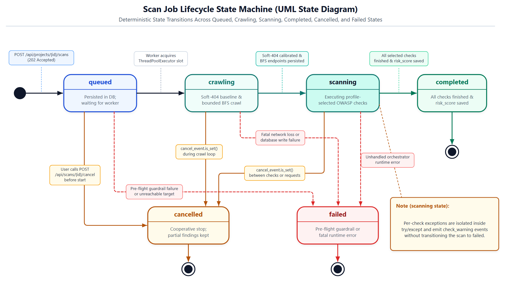

*Figure 12: Scan Execution Lifecycle State Machine (Source: [12_scan_state_machine.mmd](../diagrams/mmd/12_scan_state_machine.mmd)).*

### Table 3.7: Scan Lifecycle State Transition and Invariant Specification

| State | Terminal? | Entry Condition | Persisted Fields Updated | Permitted Outgoing Transitions |
| :--- | :--- | :--- | :--- | :--- |
| **`queued`** | No | Valid `POST /api/projects/{id}/scans` accepted | `status='queued'`, `progress_pct=0`, `created_at` | `crawling`, `cancelled`, `failed` |
| **`crawling`** | No | Worker thread begins `ScanOrchestrator` execution | `status='crawling'`, `started_at`, `current_phase='crawling'` | `scanning`, `cancelled`, `failed` |
| **`scanning`** | No | Soft-404 calibration and BFS endpoint inventory committed | `status='scanning'`, `endpoints_found`, `current_phase=<check_id>` | `completed`, `cancelled`, `failed` |
| **`completed`** | Yes | All profile-selected checks executed | `status='completed'`, `progress_pct=100`, `risk_score`, severity counts, `finished_at` | None |
| **`cancelled`** | Yes | Cooperative `cancel_event` observed by orchestrator | `status='cancelled'`, partial `risk_score` and counts preserved, `finished_at` | None |
| **`failed`** | Yes | Unrecoverable pre-flight, connectivity, or persistence error | `status='failed'`, sanitized `error_message`, `finished_at` | None |

### 3.7.4 Cross-Component Swimlane Activity View

The swimlane activity diagram coordinates responsibilities across all four operational lanes—Developer, FastAPI API, Scanner Engine, and Database and Remediation KB—illustrating the continuous iterative local security workflow (configure, scan, monitor, remediate, re-scan, compare, and export).

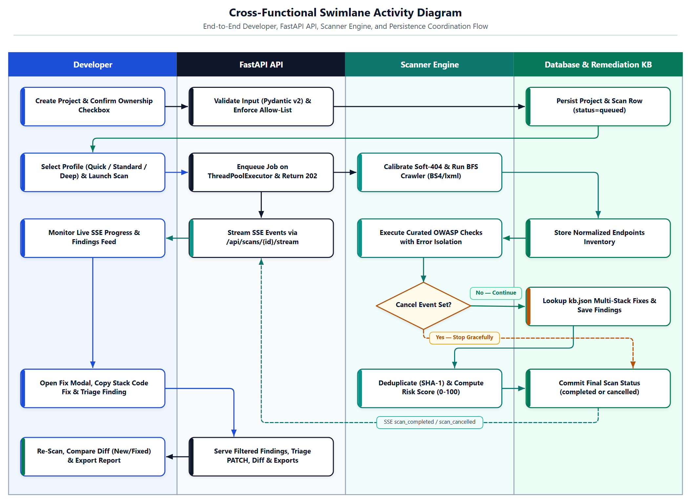

*Figure 13: Cross-Component Swimlane Activity Diagram (Source: [13_swimlane_activity.mmd](../diagrams/mmd/13_swimlane_activity.mmd)).*

---

## 3.8 Static Object-Oriented View — Scanner Plugin Class Diagram

To satisfy **NFR-06 (Extensibility)** without coupling detection logic to orchestration or database persistence, the check subsystem applies the Strategy and Template Method design patterns around the abstract `BaseCheck` interface. Four intermediate abstract classes (`PassiveCheck`, `ActiveSafeCheck`, `DiscoveryCheck`, and `DeepAuthCheck`) encapsulate category-specific utilities—such as header/body analysis, safe non-destructive probe dispatching, Soft-404 wordlist filtering, and authenticated object-identifier comparison—while keeping each of the 17 concrete checks isolated in a single self-contained Python file.

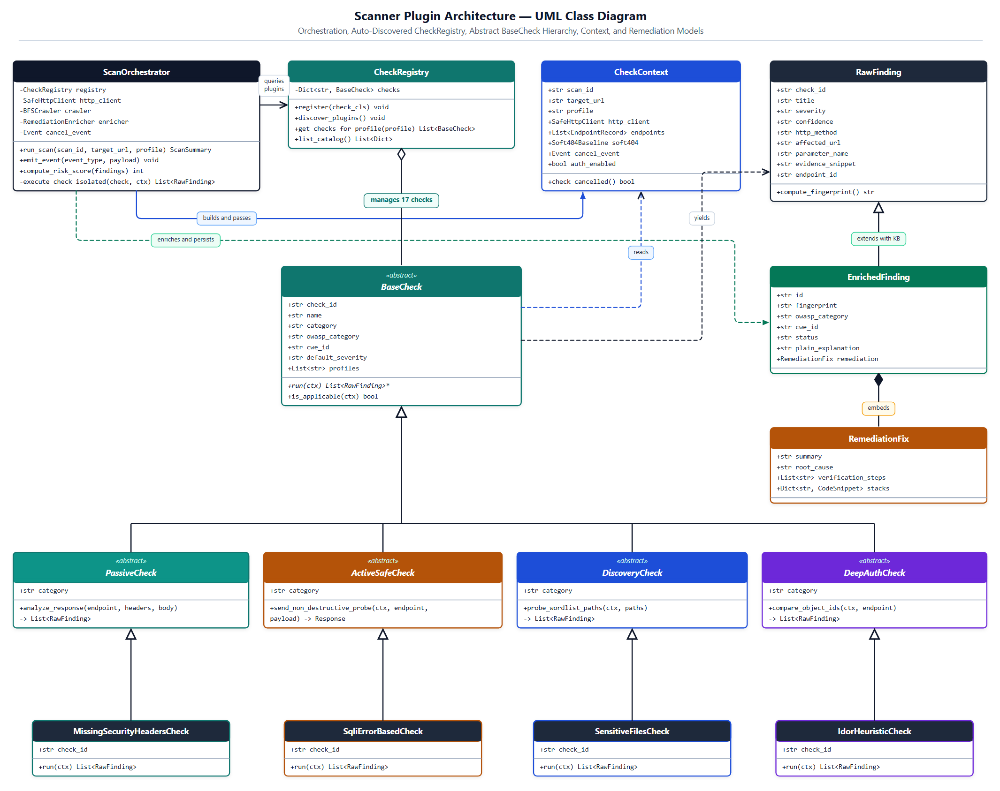

*Figure 14: Scanner Plugin Architecture Class Diagram (Source: [14_scanner_plugin_class_diagram.mmd](../diagrams/mmd/14_scanner_plugin_class_diagram.mmd)).*

### Single-File Plugin Authoring Contract

Extending the scanner with a new OWASP detection check requires zero modifications to `ScanOrchestrator`, API routers, or database models:

1. **Module Creation:** Create one Python file under `backend/scanner/checks/{passive|active|discovery|deep_auth}/<check_id>.py` subclassing `PassiveCheck`, `ActiveSafeCheck`, `DiscoveryCheck`, or `DeepAuthCheck`.
2. **Metadata Declaration:** Define canonical class attributes: `check_id`, `name`, `owasp_category`, `cwe_id`, `default_severity`, and `profiles` (e.g., `["standard", "deep"]`).
3. **Isolated Execution Contract:** Implement `run(ctx: CheckContext) -> list[RawFinding]`, checking `ctx.check_cancelled()` between probes, routing all HTTP traffic exclusively through `ctx.http_client`, and returning `RawFinding` instances populated with exact `http_method`, `affected_url`, `parameter_name`, and sanitized `evidence_snippet`.
4. **Knowledge Base Registration:** Append a matching key to `backend/scanner/remediation/kb.json` containing a plain-language root cause, verification steps, and Before/After code snippets for FastAPI, Flask, Express, PHP, and HTML. Upon startup, `CheckRegistry.discover_plugins()` automatically registers the plugin and publishes its metadata through `GET /api/checks`.

---

## 3.9 Chapter Summary

This chapter established the complete multi-view software architecture of the Lightweight OWASP Top 10 Vulnerability Scanner across C4 Levels 1–3, DFD Levels 0–1 with explicit trust boundaries, Docker Compose and testbench deployment topologies, runtime sequence and state-machine specifications, cross-component swimlane workflows, and the `BaseCheck` plugin object model. By combining a four-layer modular monolith, a pure decoupled scanning engine (`backend/scanner/`), an in-process bounded `ThreadPoolExecutor` with cooperative `threading.Event` cancellation and SSE streaming, and a single-file plugin auto-registry, the architecture fulfills its zero-configuration local usability goals without compromising fault isolation, safety guardrails, or long-term extensibility. Chapter 4 builds directly upon these structural and behavioral seams to specify the 3NF relational schema, deterministic scoring and deduplication formulas, REST/SSE API contracts, and multi-stack remediation knowledge base.
