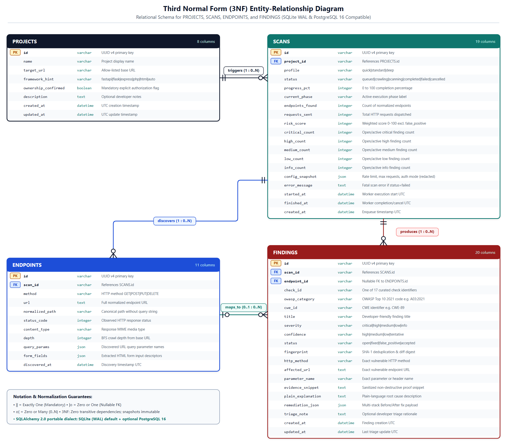

# Chapter 4: Data Model, REST/SSE API, and Remediation Knowledge Base Design

This chapter specifies the relational data persistence model, Third Normal Form (3NF) integrity rules, deterministic risk scoring and deduplication algorithms, REST and Server-Sent Events (SSE) API contracts, the curated 17-check OWASP Top 10 (2021) catalogue, and the developer-centric multi-stack Remediation Knowledge Base (`kb.json`). All persistence and interface definitions are engineered to maintain minimal local operational overhead—defaulting to SQLite in Write-Ahead Logging (WAL) mode with drop-in PostgreSQL 16 compatibility via SQLAlchemy 2.0—while delivering exact endpoint/parameter mappings and copy-ready code fixes to web developers and student teams.

---

## 4.1 Third Normal Form (3NF) Entity-Relationship Diagram

The relational database schema comprises four core entities—`PROJECTS`, `SCANS`, `ENDPOINTS`, and `FINDINGS`—normalized to **Third Normal Form (3NF)**:

- **First Normal Form (1NF):** Every table defines an immutable UUID v4 primary key (`id`) and atomic relational columns with zero repeating groups. Semi-structured auxiliary payloads that are not queried as relational child tables (`query_params`, `form_fields`, `config_snapshot`, `remediation_json`) are stored in typed JSON columns natively supported by both SQLite (`JSON1`) and PostgreSQL 16 (`JSONB`/`JSON`).
- **Second Normal Form (2NF):** Because every primary key is a single-column surrogate UUID, partial key dependencies are structurally impossible.
- **Third Normal Form (3NF):** Non-key attributes depend exclusively on their owning entity's primary key with zero transitive dependencies across entities: project metadata resides solely on `PROJECTS`, scan execution telemetry on `SCANS`, crawled attack surface metadata on `ENDPOINTS`, and vulnerability detections plus triage states on `FINDINGS`.
- **Controlled Materialized Rollups on `SCANS`:** The summary metrics `risk_score`, `endpoints_found`, and `critical_count` through `info_count` on `SCANS` are explicitly documented derived rollups recalculated atomically inside the same database transaction upon scan completion, cancellation, or finding triage updates. This design preserves strict consistency while enabling O(1) dashboard loading and historical trend rendering.



*Figure 15: Third Normal Form (3NF) Entity-Relationship Diagram (Source: [15_erd_3nf.mmd](../diagrams/15_erd_3nf.mmd)).*

### Table 4.1: Entity Relationships and Referential Integrity Rules

| Relationship | Cardinality | Foreign Key and Cascade Policy | Architectural Rationale |
| :--- | :--- | :--- | :--- |
| `PROJECTS` -> `SCANS` | `1 : 0..*` | `scans.project_id -> projects.id ON DELETE CASCADE` | Removing a project cleanly purges all associated historical scans, endpoints, and findings without leaving orphaned rows. |
| `SCANS` -> `ENDPOINTS` | `1 : 0..*` | `endpoints.scan_id -> scans.id ON DELETE CASCADE` | Each scan preserves an immutable point-in-time snapshot of the target application's discovered attack surface. |
| `SCANS` -> `FINDINGS` | `1 : 0..*` | `findings.scan_id -> scans.id ON DELETE CASCADE` | Findings are scoped strictly to the originating scan run to guarantee deterministic historical diff comparisons. |
| `ENDPOINTS` -> `FINDINGS` | `0..1 : 0..*` | `findings.endpoint_id -> endpoints.id ON DELETE SET NULL` | Nullable foreign key accommodates target-wide or wordlist-discovered checks (e.g., `sensitive_files`, `insecure_transport`) that may not map to a crawled link while parameter and form checks reference their exact `ENDPOINTS` row. |

---

## 4.2 Complete Relational Data Dictionary

All ORM entities are implemented using **SQLAlchemy 2.0** `DeclarativeBase` and typed `Mapped[...]` declarations so an identical codebase executes seamlessly against both **SQLite** (default `sqlite:///./data/scanner.db` initialized with `PRAGMA journal_mode=WAL; PRAGMA foreign_keys=ON; PRAGMA busy_timeout=5000`) and **PostgreSQL 16** (enabled via `--profile postgres` and `DATABASE_URL`). Tables 4.2 through 4.5 provide the complete column-level data dictionary.

### Table 4.2: Data Dictionary — `projects`

| Column | SQLAlchemy 2.0 Type | SQLite Type | PostgreSQL 16 Type | Constraints | Description |
| :--- | :--- | :--- | :--- | :--- | :--- |
| `id` | `String(36)` | `VARCHAR(36)` | `VARCHAR(36)` | `PRIMARY KEY` | UUID v4 unique project identifier. |
| `name` | `String(120)` | `VARCHAR(120)` | `VARCHAR(120)` | `NOT NULL` | Human-readable project display name (e.g., `"Capstone E-Shop API"`). |
| `target_url` | `String(512)` | `VARCHAR(512)` | `VARCHAR(512)` | `NOT NULL` | Normalized base URL validated against `ScopeGuardrail` allow-list. |
| `framework_hint` | `String(32)` | `VARCHAR(32)` | `VARCHAR(32)` | `NOT NULL, DEFAULT 'auto'` | Preferred stack tab in Fix Modal (`fastapi`, `flask`, `express`, `php`, `html`, `auto`). |
| `ownership_confirmed` | `Boolean` | `BOOLEAN` | `BOOLEAN` | `NOT NULL, CHECK (ownership_confirmed = 1)` | Mandatory explicit developer authorization confirmation flag. |
| `description` | `Text` | `TEXT` | `TEXT` | `NULLABLE` | Optional course, sprint, or architecture notes. |
| `created_at` | `DateTime(timezone=True)` | `DATETIME` | `TIMESTAMPTZ` | `NOT NULL, DEFAULT utcnow` | Project creation timestamp (UTC). |
| `updated_at` | `DateTime(timezone=True)` | `DATETIME` | `TIMESTAMPTZ` | `NOT NULL, DEFAULT utcnow` | Last modification timestamp (UTC). |

### Table 4.3: Data Dictionary — `scans`

| Column | SQLAlchemy 2.0 Type | SQLite Type | PostgreSQL 16 Type | Constraints | Description |
| :--- | :--- | :--- | :--- | :--- | :--- |
| `id` | `String(36)` | `VARCHAR(36)` | `VARCHAR(36)` | `PRIMARY KEY` | UUID v4 unique scan identifier. |
| `project_id` | `String(36)` | `VARCHAR(36)` | `VARCHAR(36)` | `FK -> projects.id (CASCADE), NOT NULL, INDEX` | Owning project foreign key. |
| `profile` | `String(16)` | `VARCHAR(16)` | `VARCHAR(16)` | `NOT NULL, CHECK IN ('quick','standard','deep')` | Selected crawl depth and active-check execution profile. |
| `status` | `String(16)` | `VARCHAR(16)` | `VARCHAR(16)` | `NOT NULL, INDEX, CHECK IN ('queued','crawling','scanning','completed','failed','cancelled')` | Current lifecycle state machine value. |
| `progress_pct` | `Integer` | `INTEGER` | `INTEGER` | `NOT NULL, DEFAULT 0, CHECK (0..100)` | Completion percentage broadcast over SSE. |
| `current_phase` | `String(64)` | `VARCHAR(64)` | `VARCHAR(64)` | `NOT NULL, DEFAULT 'queued'` | Active execution phase or running check identifier. |
| `endpoints_found` | `Integer` | `INTEGER` | `INTEGER` | `NOT NULL, DEFAULT 0` | Count of unique normalized endpoints discovered by `BFSCrawler`. |
| `requests_sent` | `Integer` | `INTEGER` | `INTEGER` | `NOT NULL, DEFAULT 0` | Cumulative HTTP requests dispatched within the 2,000-request cap. |
| `risk_score` | `Integer` | `INTEGER` | `INTEGER` | `NOT NULL, DEFAULT 0, CHECK (0..100)` | Bounded weighted risk score excluding `false_positive` findings. |
| `critical_count` | `Integer` | `INTEGER` | `INTEGER` | `NOT NULL, DEFAULT 0` | Count of active (non-`false_positive`) Critical findings. |
| `high_count` | `Integer` | `INTEGER` | `INTEGER` | `NOT NULL, DEFAULT 0` | Count of active High findings. |
| `medium_count` | `Integer` | `INTEGER` | `INTEGER` | `NOT NULL, DEFAULT 0` | Count of active Medium findings. |
| `low_count` | `Integer` | `INTEGER` | `INTEGER` | `NOT NULL, DEFAULT 0` | Count of active Low findings. |
| `info_count` | `Integer` | `INTEGER` | `INTEGER` | `NOT NULL, DEFAULT 0` | Count of active Info findings. |
| `config_snapshot` | `JSON` | `JSON` | `JSONB / JSON` | `NOT NULL, DEFAULT '{}'` | Redacted execution settings (`rate_limit_rps`, `max_requests`, `auth_mode`, `max_depth`); raw secrets are never persisted. |
| `error_message` | `Text` | `TEXT` | `TEXT` | `NULLABLE` | Sanitized fatal error description populated exclusively when `status='failed'`. |
| `started_at` | `DateTime(timezone=True)` | `DATETIME` | `TIMESTAMPTZ` | `NULLABLE` | Worker execution start timestamp (UTC). |
| `finished_at` | `DateTime(timezone=True)` | `DATETIME` | `TIMESTAMPTZ` | `NULLABLE` | Completion, cancellation, or failure timestamp (UTC). |
| `created_at` | `DateTime(timezone=True)` | `DATETIME` | `TIMESTAMPTZ` | `NOT NULL, INDEX, DEFAULT utcnow` | Scan enqueue timestamp (UTC). |

### Table 4.4: Data Dictionary — `endpoints`

| Column | SQLAlchemy 2.0 Type | SQLite Type | PostgreSQL 16 Type | Constraints | Description |
| :--- | :--- | :--- | :--- | :--- | :--- |
| `id` | `String(36)` | `VARCHAR(36)` | `VARCHAR(36)` | `PRIMARY KEY` | UUID v4 unique endpoint identifier. |
| `scan_id` | `String(36)` | `VARCHAR(36)` | `VARCHAR(36)` | `FK -> scans.id (CASCADE), NOT NULL, INDEX` | Owning scan foreign key. |
| `method` | `String(10)` | `VARCHAR(10)` | `VARCHAR(10)` | `NOT NULL` | Uppercase HTTP verb (`GET`, `POST`, `PUT`, `DELETE`). |
| `url` | `Text` | `TEXT` | `TEXT` | `NOT NULL` | Full normalized endpoint URL. |
| `normalized_path` | `String(512)` | `VARCHAR(512)` | `VARCHAR(512)` | `NOT NULL, INDEX` | Canonical path with collapsed duplicate slashes and standardized trailing slash. |
| `status_code` | `Integer` | `INTEGER` | `INTEGER` | `NULLABLE` | HTTP status code returned during crawl discovery. |
| `content_type` | `String(128)` | `VARCHAR(128)` | `VARCHAR(128)` | `NULLABLE` | Normalized MIME media type (e.g., `text/html`, `application/json`). |
| `depth` | `Integer` | `INTEGER` | `INTEGER` | `NOT NULL, DEFAULT 0` | Breadth-first crawl hop count from base URL. |
| `query_params` | `JSON` | `JSON` | `JSONB / JSON` | `NOT NULL, DEFAULT '[]'` | Extracted URL query parameter names. |
| `form_fields` | `JSON` | `JSON` | `JSONB / JSON` | `NOT NULL, DEFAULT '[]'` | Extracted HTML form input descriptors (`[{"name": "user", "type": "text"}]`). |
| `discovered_at` | `DateTime(timezone=True)` | `DATETIME` | `TIMESTAMPTZ` | `NOT NULL, DEFAULT utcnow` | Endpoint discovery timestamp (UTC). |

### Table 4.5: Data Dictionary — `findings`

| Column | SQLAlchemy 2.0 Type | SQLite Type | PostgreSQL 16 Type | Constraints | Description |
| :--- | :--- | :--- | :--- | :--- | :--- |
| `id` | `String(36)` | `VARCHAR(36)` | `VARCHAR(36)` | `PRIMARY KEY` | UUID v4 unique finding identifier. |
| `scan_id` | `String(36)` | `VARCHAR(36)` | `VARCHAR(36)` | `FK -> scans.id (CASCADE), NOT NULL, INDEX` | Owning scan foreign key. |
| `endpoint_id` | `String(36)` | `VARCHAR(36)` | `VARCHAR(36)` | `FK -> endpoints.id (SET NULL), NULLABLE, INDEX` | Optional reference to the discovered `endpoints` row. |
| `check_id` | `String(64)` | `VARCHAR(64)` | `VARCHAR(64)` | `NOT NULL, INDEX` | Canonical identifier of one of the 17 curated plugins. |
| `owasp_category` | `String(16)` | `VARCHAR(16)` | `VARCHAR(16)` | `NOT NULL, INDEX` | OWASP Top 10 (2021) category code (e.g., `A03:2021`). |
| `cwe_id` | `String(16)` | `VARCHAR(16)` | `VARCHAR(16)` | `NOT NULL` | Common Weakness Enumeration identifier (e.g., `CWE-89`, `CWE-79`). |
| `title` | `String(200)` | `VARCHAR(200)` | `VARCHAR(200)` | `NOT NULL` | Concise developer-oriented finding title. |
| `severity` | `String(16)` | `VARCHAR(16)` | `VARCHAR(16)` | `NOT NULL, INDEX, CHECK IN ('critical','high','medium','low','info')` | Severity classification. |
| `confidence` | `String(16)` | `VARCHAR(16)` | `VARCHAR(16)` | `NOT NULL, CHECK IN ('high','medium','low','tentative')` | Detection certainty (`tentative` designated for `idor_heuristic`). |
| `status` | `String(16)` | `VARCHAR(16)` | `VARCHAR(16)` | `NOT NULL, DEFAULT 'open', INDEX, CHECK IN ('open','fixed','false_positive','accepted')` | Developer triage lifecycle state. |
| `fingerprint` | `String(40)` | `VARCHAR(40)` | `VARCHAR(40)` | `NOT NULL, INDEX` | 40-character lowercase SHA-1 hex digest for deduplication and diffing. |
| `http_method` | `String(10)` | `VARCHAR(10)` | `VARCHAR(10)` | `NOT NULL` | Exact HTTP verb where the vulnerability manifested. |
| `affected_url` | `Text` | `TEXT` | `TEXT` | `NOT NULL` | Exact vulnerable endpoint URL. |
| `parameter_name` | `String(128)` | `VARCHAR(128)` | `VARCHAR(128)` | `NULLABLE` | Exact vulnerable query parameter, form field, cookie, or HTTP header name. |
| `evidence_snippet` | `Text` | `TEXT` | `TEXT` | `NOT NULL` | Sanitized, truncated (<= 500 characters) proof-of-detection excerpt. |
| `plain_explanation` | `Text` | `TEXT` | `TEXT` | `NOT NULL` | Plain-language root cause and impact explanation tailored for developers. |
| `remediation_json` | `JSON` | `JSON` | `JSONB / JSON` | `NOT NULL` | Embedded multi-stack Before/After code fixes and verification steps loaded from `kb.json`. |
| `triage_note` | `Text` | `TEXT` | `TEXT` | `NULLABLE` | Optional developer justification recorded during triage. |
| `created_at` | `DateTime(timezone=True)` | `DATETIME` | `TIMESTAMPTZ` | `NOT NULL, DEFAULT utcnow` | Finding creation timestamp (UTC). |
| `updated_at` | `DateTime(timezone=True)` | `DATETIME` | `TIMESTAMPTZ` | `NOT NULL, DEFAULT utcnow` | Most recent triage modification timestamp (UTC). |

### Table 4.6: Composite Indexes and Uniqueness Constraints

| Index Name | Table and Columns | Performance and Integrity Role |
| :--- | :--- | :--- |
| `uq_findings_scan_fingerprint` | `findings (scan_id, fingerprint)` — `UNIQUE` | Enforces intra-scan deduplication at the persistence tier. |
| `ix_findings_scan_severity_status` | `findings (scan_id, severity, status)` | Accelerates Findings Explorer filtering and atomic risk-score recalculation. |
| `ix_scans_project_created` | `scans (project_id, created_at DESC)` | Optimizes project scan history listings and latest-scan overview queries. |
| `uq_endpoints_scan_method_path` | `endpoints (scan_id, method, normalized_path)` — `UNIQUE` | Guarantees a strictly deduplicated attack-surface inventory per scan. |

### Deterministic Risk Score and Deduplication Formulas

#### 1. Scan Risk Score Formula (0–100 Bounded)

To provide an intuitive, bounded security posture metric that updates immediately as vulnerabilities are remediated or dismissed as false positives, the scan risk score is defined as:

```text
risk_score = min(100, 10 * N_critical + 6 * N_high + 3 * N_medium + 1 * N_low)
```

where `N_critical`, `N_high`, `N_medium`, and `N_low` denote the number of findings in the scan whose triage `status != 'false_positive'`. Findings classified as `info` carry weight `0` so purely informational hardening notes do not distort the risk indicator. Whenever a triage update executes via `PATCH /api/findings/{finding_id}`, the application service atomically recomputes `risk_score` and the severity rollup counts on the parent `SCANS` record.

#### 2. Finding Fingerprint Formula (SHA-1)

To guarantee deterministic intra-scan deduplication and accurate cross-scan regression comparisons (`New`, `Fixed`, `Unchanged`) across successive coding iterations, every finding is assigned a canonical 40-character SHA-1 digest:

```text
fingerprint = SHA1(
    lower(check_id) + "|" +
    upper(http_method) + "|" +
    normalized_path + "|" +
    lower(parameter_name or "")
)
```

Hashing the canonical structural tuple `(check_id, http_method, normalized_path, parameter_name)` rather than volatile query values or timestamps ensures that an identical vulnerability observed across two separate scans yields the exact same fingerprint, supporting precise set-theoretic diffing:

- **New Findings:** `Fingerprints(target_scan) - Fingerprints(baseline_scan)`
- **Fixed Findings:** `Fingerprints(baseline_scan) - Fingerprints(target_scan)`
- **Unchanged Findings:** `Fingerprints(baseline_scan) ∩ Fingerprints(target_scan)`

---

## 4.3 REST and SSE API Specification

All API routes are version-scoped under the `/api` prefix, serialize payloads using Pydantic v2 schemas (`application/json` by default, with `text/event-stream` for SSE and `text/html` for standalone reports), and publish an interactive OpenAPI 3.1 specification at `/api/docs`. Table 4.7 enumerates the complete REST and SSE interface contract.

### Table 4.7: Complete REST and SSE Endpoint Catalogue

| Domain | Method and Path | Success Status | Request Parameters / Body | Response Summary |
| :--- | :--- | :--- | :--- | :--- |
| **Health** | `GET /api/health` | `200 OK` | None | Returns `{"status": "ok", "version": "0.1.0", "database": {"dialect": "sqlite\|postgresql", "status": "up"}}`. |
| **Projects** | `POST /api/projects` | `201 Created` | JSON: `name`, `target_url`, `framework_hint`, `ownership_confirmed: true`, `description?` | Validates target against `ScopeGuardrail` and creates project; returns `403` for out-of-scope targets or `422` if `ownership_confirmed` is false. |
| **Projects** | `GET /api/projects` | `200 OK` | Query: `limit?`, `offset?` | Returns paginated project list enriched with latest scan status and `risk_score`. |
| **Projects** | `GET /api/projects/{project_id}` | `200 OK` | Path: `project_id` | Returns full project record, scan summary history, and risk-score trend series. |
| **Projects** | `PATCH /api/projects/{project_id}` | `200 OK` | JSON: partial `name`, `framework_hint`, `description` | Updates mutable project metadata (`target_url` edits re-run allow-list validation). |
| **Projects** | `DELETE /api/projects/{project_id}` | `204 No Content` | Path: `project_id` | Deletes the project and cascades removal of associated scans, endpoints, and findings. |
| **Scans** | `POST /api/projects/{project_id}/scans` | `202 Accepted` | JSON: `profile` (`quick\|standard\|deep`), `auth?` (`none\|cookie\|bearer\|dvwa_login` + transient credentials), `rate_limit_rps?`, `max_requests?` | Enqueues job on `ThreadPoolExecutor`, returning `{scan_id, status: "queued", stream_url}`. |
| **Scans** | `GET /api/projects/{project_id}/scans` | `200 OK` | Path: `project_id`; Query: `status?` | Lists project scans ordered newest-first with severity rollups and execution duration. |
| **Scans** | `GET /api/scans/{scan_id}` | `200 OK` | Path: `scan_id` | Returns complete scan detail, progress metrics, severity counts, OWASP distribution, and `risk_score`. |
| **Scans** | `POST /api/scans/{scan_id}/cancel` | `202 Accepted` | Path: `scan_id` | Triggers `cancel_event.set()` in the cancellation registry; returns `409 Conflict` if scan is already terminal. |
| **SSE Live** | `GET /api/scans/{scan_id}/stream` | `200 OK` (`text/event-stream`) | Path: `scan_id` | Streams real-time SSE phase changes, progress metrics, warnings, finding summaries, and terminal status events. |
| **Endpoints** | `GET /api/scans/{scan_id}/endpoints` | `200 OK` | Query: `method?`, `path_contains?`, `status_code?` | Lists discovered attack-surface endpoints with extracted query parameters and HTML form fields. |
| **Findings** | `GET /api/scans/{scan_id}/findings` | `200 OK` | Query: `severity?`, `owasp_category?`, `status?`, `check_id?`, `q?` | Returns filtered findings ordered by severity (`critical` through `info`) with location mapping badges. |
| **Findings** | `GET /api/findings/{finding_id}` | `200 OK` | Path: `finding_id` | Returns complete finding detail including sanitized evidence, plain explanation, and multi-stack `remediation_json`. |
| **Triage** | `PATCH /api/findings/{finding_id}` | `200 OK` | JSON: `status` (`open\|fixed\|false_positive\|accepted`), `triage_note?` | Persists triage transition and atomically recalculates parent scan `risk_score` and severity counts. |
| **Compare** | `GET /api/projects/{project_id}/compare` | `200 OK` | Query: `baseline_scan_id`, `target_scan_id` | Executes fingerprint set diff returning `summary` (`risk_delta`, counts) plus `new_findings`, `fixed_findings`, and `unchanged_findings`. |
| **Reports** | `GET /api/scans/{scan_id}/report.json` | `200 OK` (`application/json`) | Path: `scan_id` | Exports complete structured JSON audit bundle (project metadata, scan metrics, endpoints, findings, code fixes). |
| **Reports** | `GET /api/scans/{scan_id}/report.html` | `200 OK` (`text/html`) | Path: `scan_id` | Exports standalone, self-contained HTML developer report rendered via Jinja2 with strict autoescaping. |
| **Catalog** | `GET /api/checks` | `200 OK` | Query: `category?`, `profile?` | Returns live metadata for all 17 registered `BaseCheck` plugins from `CheckRegistry`. |

### Standard Error Envelope

All `4xx` and `5xx` error responses conform to a uniform structured JSON envelope so frontend modules can render actionable inline error notifications deterministically:

```json
{
  "error": {
    "code": "TARGET_OUT_OF_SCOPE",
    "message": "Target host 'example.com' is blocked by the local-only Scope Guardrail.",
    "details": {
      "target_url": "https://example.com",
      "allowed_hosts": ["localhost", "127.0.0.1", "host.docker.internal", "dvwa", "juice-shop", "vulnbench"],
      "hint": "Use a local development server or an isolated testbench container."
    }
  }
}
```

### Table 4.8: Standard HTTP Error Status Code Mapping

| HTTP Status | Canonical Error Code | Triggering Condition |
| :--- | :--- | :--- |
| `400 Bad Request` | `INVALID_SCAN_COMPARISON` | Comparing scans belonging to distinct projects or scans not in a comparable state. |
| `403 Forbidden` | `TARGET_OUT_OF_SCOPE` / `OWNERSHIP_NOT_CONFIRMED` | Target violates `ScopeGuardrail` allow-list/DNS check, or `ownership_confirmed` is `false`. |
| `404 Not Found` | `RESOURCE_NOT_FOUND` | Referenced `project_id`, `scan_id`, or `finding_id` does not exist. |
| `409 Conflict` | `SCAN_ALREADY_TERMINAL` | Cancellation requested for a scan already in `completed`, `cancelled`, or `failed` state. |
| `422 Unprocessable Entity` | `VALIDATION_ERROR` | Pydantic v2 validation error (invalid enum value, malformed URL, or missing required field). |
| `429 Too Many Requests` | `WORKER_POOL_SATURATED` | Active concurrent scan requests exceed the configured local worker pool queue capacity. |
| `500 Internal Server Error` | `INTERNAL_SERVER_ERROR` | Unexpected runtime exception (full stack trace logged server-side; sanitized response returned to client). |

### Server-Sent Events (SSE) Stream Specification (`GET /api/scans/{scan_id}/stream`)

The SSE route emits `Content-Type: text/event-stream`, `Cache-Control: no-cache`, and `X-Accel-Buffering: no`. If a client attaches to an already-terminal scan, the endpoint immediately sends the terminal state event and closes the stream cleanly. Table 4.9 documents the exact SSE event catalogue.

### Table 4.9: SSE Stream Event Catalogue and Wire Payloads

| SSE Event Name | Emission Trigger | Example JSON `data` Payload |
| :--- | :--- | :--- |
| `phase_change` | Scan state advances (`queued` -> `crawling` -> `scanning`) | `{"scan_id": "a1b2...", "status": "crawling", "phase": "crawling", "progress_pct": 5, "timestamp": "2026-10-15T10:00:02Z"}` |
| `progress` | Crawl batch or check execution updates progress | `{"scan_id": "a1b2...", "progress_pct": 48, "current_check": "sqli_error_based", "endpoints_found": 24, "requests_sent": 182}` |
| `finding_discovered` | Deduplicated, enriched finding persisted to database | `{"scan_id": "a1b2...", "finding_id": "f9e8...", "check_id": "sqli_error_based", "severity": "critical", "title": "Error-Based SQL Injection", "location": "POST /api/login · field: user"}` |
| `check_warning` | Isolated plugin encounters timeout or non-fatal exception | `{"scan_id": "a1b2...", "check_id": "xss_reflected", "warning": "ReadTimeout on /slow-endpoint (skipped endpoint, scan continuing)"}` |
| `heartbeat` | Periodic keep-alive emitted every 15 seconds while idle | `{"scan_id": "a1b2...", "ts": "2026-10-15T10:00:15Z"}` |
| `scan_completed` | Terminal success (stream flushes and closes) | `{"scan_id": "a1b2...", "status": "completed", "risk_score": 42, "counts": {"critical": 1, "high": 3, "medium": 4, "low": 2, "info": 1}}` |
| `scan_cancelled` | Terminal cooperative cancellation (stream closes) | `{"scan_id": "a1b2...", "status": "cancelled", "partial_findings_preserved": true, "risk_score": 16}` |
| `scan_failed` | Terminal unrecoverable error (stream closes) | `{"scan_id": "a1b2...", "status": "failed", "error": "Target unreachable during pre-flight check"}` |

---

## 4.4 Curated 17-Check Catalog and Developer Remediation JSON Schema

To maximize signal-to-noise ratio for student and web-developer projects, the scanner implements **17 high-impact, curated OWASP Top 10 (2021) checks** partitioned across four execution categories: **8 Passive**, **5 Active Safe**, **3 Discovery**, and **1 Deep Auth (Tentative)**. Table 4.10 specifies every check's taxonomy, default severity, profile inclusion, and non-destructive detection method.

### Table 4.10: Curated 17-Check OWASP Top 10 (2021) Detection Catalogue

| # | `check_id` | Category | OWASP Top 10 (2021) | CWE | Default Severity | Profiles | Non-Destructive Detection Mechanism |
| :-: | :--- | :--- | :--- | :--- | :--- | :--- | :--- |
| 1 | `missing_security_headers` | Passive | A05:2021 Security Misconfiguration | CWE-693 | Medium | Quick, Standard, Deep | Inspects crawled HTML responses for absent `X-Content-Type-Options`, `X-Frame-Options` (or `frame-ancestors`), `Referrer-Policy`, and `Strict-Transport-Security` (when HTTPS). |
| 2 | `weak_csp` | Passive | A05:2021 Security Misconfiguration | CWE-693 | Medium | Quick, Standard, Deep | Parses `Content-Security-Policy` headers for absent `default-src`/`script-src` directives or permissive tokens (`'unsafe-inline'`, `'unsafe-eval'`, wildcard `*`). |
| 3 | `server_banner_leak` | Passive | A05:2021 Security Misconfiguration | CWE-200 | Low | Quick, Standard, Deep | Flags version-disclosing `Server`, `X-Powered-By`, or `X-AspNet-Version` response headers (e.g., `Werkzeug/3.0.1 Python/3.12`). |
| 4 | `verbose_error_pages` | Passive | A05:2021 Security Misconfiguration | CWE-209 | Medium | Quick, Standard, Deep | Scans response bodies for unhandled framework stack traces (Python Traceback, Node/Express stack, PHP Fatal/Notice, raw SQL errors, or Werkzeug debuggers). |
| 5 | `insecure_cookies` | Passive | A02:2021 Cryptographic Failures | CWE-614 | Medium | Quick, Standard, Deep | Inspects `Set-Cookie` headers on session-oriented cookies for missing `HttpOnly`, `SameSite`, or `Secure` (over HTTPS) flags. |
| 6 | `insecure_transport` | Passive | A02:2021 Cryptographic Failures | CWE-319 | Low / Medium | Quick, Standard, Deep | Detects unencrypted HTTP login/password forms or mixed-content active script loads while noting local development exceptions for `localhost`. |
| 7 | `csrf_missing_token` | Passive | A01:2021 Broken Access Control | CWE-352 | Medium | Quick, Standard, Deep | Analyzes state-changing HTML `POST` forms (excluding search forms) for missing hidden CSRF tokens (`csrf_token`, `_csrf`, `authenticity_token`) combined with non-`Strict` session cookies. |
| 8 | `outdated_js_components` | Passive | A06:2021 Vulnerable and Outdated Components | CWE-1104 | Medium / High | Quick, Standard, Deep | Extracts versioned client-side JavaScript library references from `<script src>` paths and headers (e.g., jQuery, Bootstrap, AngularJS, Lodash), evaluating versions via `packaging.version` against a curated vulnerability manifest. |
| 9 | `cors_misconfig` | Active Safe | A05:2021 Security Misconfiguration | CWE-942 | High | Standard, Deep | Dispatches a benign synthetic `Origin: https://evil.example.test` header and checks whether `Access-Control-Allow-Origin` echoes the untrusted origin, particularly alongside `Access-Control-Allow-Credentials: true`. |
| 10 | `sqli_error_based` | Active Safe | A03:2021 Injection | CWE-89 | Critical | Standard, Deep | Submits harmless syntax-breaking characters (`'`, `"`, `' OR '1'='1`) into query parameters and form fields, matching DBMS-specific error signatures (SQLite, MySQL, PostgreSQL, MSSQL, Oracle) absent from the baseline response. |
| 11 | `sqli_boolean_diff` | Active Safe | A03:2021 Injection | CWE-89 | High | Standard, Deep | Evaluates response length and structural similarity differentials across benign true (`' AND 1=1--`) versus false (`' AND 1=2--`) boolean probes relative to a stable baseline, avoiding destructive writes or `SLEEP()` delays. |
| 12 | `xss_reflected` | Active Safe | A03:2021 Injection | CWE-79 | High | Standard, Deep | Injects a unique inert canary token delimited by harmless HTML characters (e.g., `devscan<x7f>"'probe`) and checks whether it reflects unescaped in an executable HTML or attribute context without executing browser scripts. |
| 13 | `open_redirect` | Active Safe | A01:2021 Broken Access Control | CWE-601 | Medium | Standard, Deep | Probes redirect-oriented parameters (`next`, `redirect`, `return_to`, `url`) with an inert external canary URL (`https://redirect-check.example.test`) and inspects raw `3xx Location` headers under `allow_redirects=False`. |
| 14 | `sensitive_files` | Discovery | A05:2021 Security Misconfiguration | CWE-538 | High | Standard, Deep | Probes a compact, high-signal set of inadvertently exposed developer artifacts (`/.env`, `/.git/HEAD`, `/config.php.bak`, `/backup.sql`, `/swagger.json`) filtered through `Soft404Calibrator` and strict content validators (e.g., `ref: refs/heads/`). |
| 15 | `directory_listing` | Discovery | A05:2021 Security Misconfiguration | CWE-548 | Low / Medium | Standard, Deep | Evaluates crawled parent directory paths for enabled web-server auto-index pages (`Index of /`, `Parent Directory`). |
| 16 | `forced_browsing_admin` | Discovery | A01:2021 Broken Access Control | CWE-425 | High | Standard, Deep | Probes common administrative and diagnostic endpoints (`/admin`, `/admin/users`, `/debug`, `/phpinfo.php`) filtered through `Soft404Calibrator` to detect unauthenticated `200 OK` exposure without a login redirect. |
| 17 | `idor_heuristic` | Deep Auth | A01:2021 Broken Access Control | CWE-639 | High (Confidence: `tentative`) | Deep | Active only when authentication is enabled: identifies sequential numeric object identifiers in routes or query parameters (e.g., `/api/orders/101`), probes an adjacent ID (`102`), and flags non-403/404 distinct-body responses as **tentative** for manual developer confirmation. |

### Developer Remediation Knowledge Base (`backend/scanner/remediation/kb.json`) Schema

Every enriched finding returned by `GET /api/findings/{finding_id}` and displayed in the Dashboard Actionable Code Fix Modal combines exact location telemetry (`POST /api/login · field: user`), a sanitized proof-of-detection snippet, a plain-language root-cause summary, verification steps, and copy-ready Before/After code fixes across all five supported developer stacks (**FastAPI**, **Flask**, **Express**, **PHP**, and **HTML**). Listing 4.1 presents a complete concrete JSON payload conforming to this schema.

#### Listing 4.1: Concrete Enriched Finding and Multi-Stack Remediation JSON Payload

```json
{
  "id": "f9e8d7c6-5432-41ab-9cde-1234567890ab",
  "scan_id": "a1b2c3d4-1111-4222-8333-abcdef012345",
  "endpoint_id": "e4f5a6b7-9999-4888-8777-fedcba987654",
  "check_id": "sqli_error_based",
  "owasp_category": "A03:2021",
  "cwe_id": "CWE-89",
  "title": "Error-Based SQL Injection in Login Form",
  "severity": "critical",
  "confidence": "high",
  "status": "open",
  "fingerprint": "9f2c7b1e4a8d3c5f0b6e1a2d4c8e7f901234abcd",
  "location_badge": "POST /api/login · field: user",
  "http_method": "POST",
  "affected_url": "http://host.docker.internal:5050/api/login",
  "parameter_name": "user",
  "evidence_snippet": "HTTP 500 Internal Server Error matched SQLite syntax signature: 'sqlite3.OperationalError: unrecognized token' after submitting single-quote probe in form field 'user'.",
  "plain_explanation": "The backend inserts the 'user' form input directly into a SQL query string using string concatenation or f-strings. When an attacker submits a quote character, the database interprets the input as SQL syntax rather than literal data, enabling authentication bypass or unauthorized data extraction.",
  "remediation": {
    "summary": "Replace string-concatenated SQL with parameterized queries (bound parameters) or ORM query builders so user input is always treated strictly as data.",
    "root_cause": "Untrusted user input from POST /api/login (field: user) is interpolated directly into an executable SQL statement without parameterization.",
    "verification_steps": [
      "Replace raw string formatting in the /api/login database query with parameterized placeholders.",
      "Submit a single quote (') in the 'user' field manually and confirm the endpoint returns 401 Unauthorized rather than a 500 SQL error.",
      "Re-run a Standard scan and verify 'sqli_error_based' moves to the Fixed column in Compare Scans."
    ],
    "stacks": {
      "fastapi": {
        "label": "Python (FastAPI + SQLAlchemy 2.0)",
        "before": "query = text(f\"SELECT * FROM users WHERE username = '{payload.user}'\")\nrow = db.execute(query).fetchone()",
        "after": "stmt = select(User).where(User.username == payload.user)\nrow = db.execute(stmt).scalar_one_or_none()"
      },
      "flask": {
        "label": "Python (Flask + sqlite3)",
        "before": "cursor.execute(f\"SELECT id, password_hash FROM users WHERE username = '{request.form['user']}'\")",
        "after": "cursor.execute(\"SELECT id, password_hash FROM users WHERE username = ?\", (request.form[\"user\"],))"
      },
      "express": {
        "label": "Node.js (Express + pg / mysql2)",
        "before": "const sql = `SELECT id, password_hash FROM users WHERE username = '${req.body.user}'`;\nconst result = await db.query(sql);",
        "after": "const sql = 'SELECT id, password_hash FROM users WHERE username = $1';\nconst result = await db.query(sql, [req.body.user]);"
      },
      "php": {
        "label": "PHP (PDO Prepared Statements)",
        "before": "$stmt = $pdo->query(\"SELECT id, password_hash FROM users WHERE username = '\" . $_POST['user'] . \"'\");",
        "after": "$stmt = $pdo->prepare('SELECT id, password_hash FROM users WHERE username = :user');\n$stmt->execute(['user' => $_POST['user']]);"
      },
      "html": {
        "label": "HTML / Frontend Input Hardening (Defense-in-Depth)",
        "before": "<input type=\"text\" name=\"user\">",
        "after": "<!-- Always enforce parameterized queries on the backend; add client validation only as UX defense-in-depth -->\n<input type=\"text\" name=\"user\" maxlength=\"64\" pattern=\"[A-Za-z0-9_.@-]+\" required>"
      }
    }
  },
  "triage_note": null,
  "created_at": "2026-10-15T10:01:14Z",
  "updated_at": "2026-10-15T10:01:14Z"
}
```

---

## 4.5 Chapter Summary

This chapter defined the complete data, interface, and remediation specifications governing the scanner's backend and frontend subsystems. The 3NF relational schema (`PROJECTS`, `SCANS`, `ENDPOINTS`, `FINDINGS`) provides dialect-portable persistence across SQLite WAL and PostgreSQL 16 while supporting O(1) risk-score rollups and deterministic SHA-1 fingerprint diffing (`New`, `Fixed`, `Unchanged`). The REST and SSE API contract establishes uniform Pydantic v2 error envelopes, real-time progress telemetry, finding triage, and self-contained HTML/JSON reporting. Finally, the curated 17-check OWASP Top 10 (2021) catalogue and multi-stack `kb.json` remediation schema translate raw vulnerability detections into precise endpoint/parameter locations and copy-ready Before/After fixes across FastAPI, Flask, Express, PHP, and HTML. Chapter 5 builds upon these interfaces to detail mandatory scope guardrails, scanner self-security controls, risk management, and formal Architecture Decision Records (ADRs).
