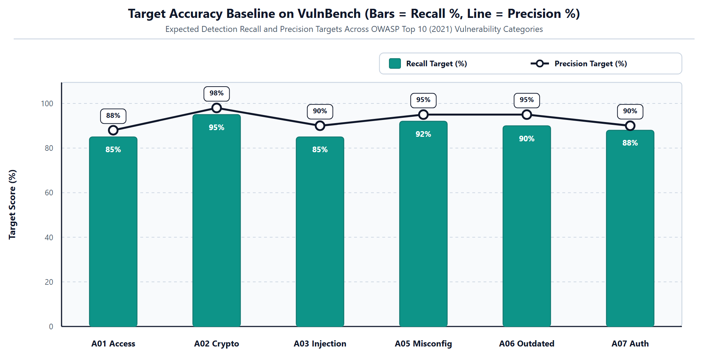
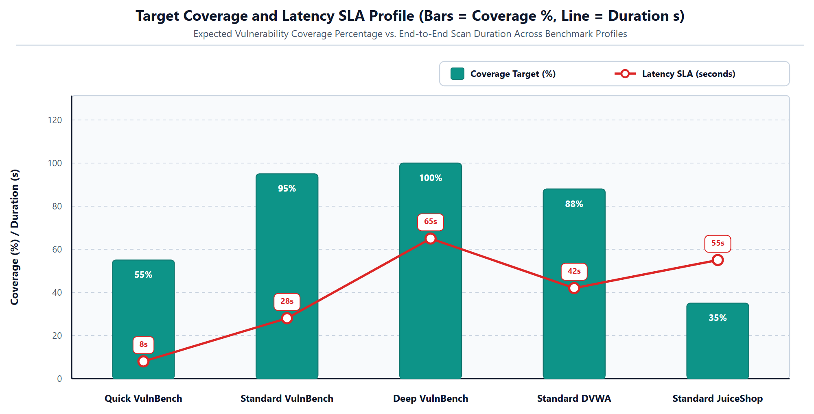

# Chapter 6: Validation Strategy, Benchmarking, and Developer-Experience Evaluation

## 6.1 Validation Objectives and Testbench Architecture

To confirm empirically that the proposed scanner satisfies its detection accuracy (`NFR-08`), performance (`NFR-02`), ethical safety (`NFR-03`), reliability (`NFR-07`), and developer-experience (`NFR-01`) targets, Phase 6 executes a reproducible evaluation suite against a **three-tier containerized testbench** defined in `docker-compose.testbench.yml`.

All testbench services operate on an isolated Docker bridge network (`testbench_net`) and bind host-exposed ports strictly to loopback (`127.0.0.1`), guaranteeing that intentionally vulnerable targets remain inaccessible from external network interfaces.

| Tier | Target Application | Container Image / Stack | Local Binding | Authentication Mode Tested | Primary Validation Objective |
|---|---|---|---|---|---|
| **Tier 1 (Deterministic Ground Truth)** | **`VulnBench`** (Custom Local Micro-Application) | `./testbench/vulnbench` (Python Flask + SQLite) | `127.0.0.1:5050` | Anonymous + Session Cookie (`FR-14`) | Deterministic TP/FP/FN measurement across all **17 curated OWASP checks** (1 seeded vulnerability per check) plus **hardened clean control routes** verifying `0` false positives (`NFR-08`). |
| **Tier 2 (Classic Server-Rendered Target)** | **DVWA** (Damn Vulnerable Web Application) [10] | `vulnerables/web-dvwa:latest` (PHP + Apache + MySQL) | `127.0.0.1:8080` | DVWA Form Login + `security=low` / `medium` cookie | Independent external validation on a standard academic server-rendered application; verifies authenticated BFS HTML form crawling, SQLi/XSS/CSRF/header detection, and logout-route denylist stability. |
| **Tier 3 (Modern SPA Target)** | **OWASP Juice Shop** [11] | `bkimminich/juice-shop:latest` (Node.js + Express + Angular) | `127.0.0.1:3000` | Anonymous + Optional Bearer JWT | Validates Soft-404 baseline calibration against SPA catch-all `index.html` routing, tests CORS/header/outdated-JS checks, and quantifies non-headless SPA crawler coverage boundaries. |

### 6.1.1 Design of `VulnBench` Clean Control Routes

Measuring recall without negative test controls can conceal noisy heuristics that flag secure endpoints indiscriminately. Consequently, `VulnBench` pairs its 17 seeded vulnerable routes with a hardened `/clean/*` control suite implementing OWASP secure coding guidance [5]:

- `/clean/search` — Parameterized SQLite query (`?` placeholders) and Jinja2 auto-escaped rendering (must trigger `0` SQLi and `0` XSS findings).
- `/clean/profile` — Emits strict security headers (`Content-Security-Policy`, `X-Content-Type-Options`, `X-Frame-Options`, `Referrer-Policy`), `HttpOnly`/`SameSite=Lax` cookies, and validated anti-CSRF tokens on state-changing `POST` forms.
- `/clean/redirect` — Enforces an internal redirect allow-list rejecting arbitrary external destinations (must trigger `0` `open_redirect` findings).
- `/clean/soft404/<path>` — Returns a styled HTTP `200 OK` "Page Not Found" HTML page for unknown paths, verifying that Soft-404 baseline fingerprinting suppresses false hits in `sensitive_files`, `directory_listing`, and `forced_browsing_admin`.

---

## 6.2 Quantitative Evaluation Metrics and Acceptance Gates

All quantitative experiments evaluate six standardized metrics. Let `TP` denote True Positives (seeded vulnerabilities correctly identified), `FP` denote False Positives (reported findings not corresponding to any ground-truth vulnerability), and `FN` denote False Negatives (seeded vulnerabilities missed by the engine).

### 6.2.1 Mathematical Metric Definitions

```text
Precision            = TP / (TP + FP)

Recall (TPR)         = TP / (TP + FN)

F1-Score             = 2 * (Precision * Recall) / (Precision + Recall)

Clean-Control FPR    = FP_clean / N_clean_checks

Route Coverage (%)   = (|Routes_Discovered ∩ Routes_Expected| / |Routes_Expected|) * 100

Scan Duration (s)    = t_completed - t_started
```

### 6.2.2 Formal Quantitative Acceptance Gates (`NFR-02`, `NFR-07`, `NFR-08`)

| Metric | Target Environment | Mandatory Pass Gate | Stretch Goal | Governing Requirement |
|---|---|---|---|---|
| **Overall Recall** | `VulnBench` (`Deep` profile) | `>= 80.0%` (`>= 14 / 17` checks) | `>= 90.0%` (`>= 16 / 17` checks) | `NFR-08` |
| **Overall Precision** | `VulnBench` (`Deep` profile) | `>= 85.0%` | `>= 92.0%` | `NFR-08` |
| **Overall F1-Score** | `VulnBench` (`Deep` profile) | `>= 82.0%` | `>= 91.0%` | `NFR-08` |
| **Clean-Control False Positives** | `VulnBench` `/clean/*` routes | `0` FPs (`0.0%` FPR) | `0` FPs (`0.0%` FPR) | `NFR-08` |
| **Quick Scan Duration** | `VulnBench` (`Quick` profile) | `<= 15 s` | `<= 10 s` | `NFR-02` |
| **Standard Scan Duration** | `VulnBench` (`Standard` profile) | `<= 45 s` | `<= 30 s` | `NFR-02` |
| **Deep Scan Duration** | `VulnBench` (`Deep` profile) | `<= 90 s` | `<= 65 s` | `NFR-02` |
| **Per-Check Unhandled Crash Rate** | All 3 testbench targets | `0%` (isolated via `try/except`) | `0%` | `NFR-07` |

---

## 6.3 Automated Evaluation Pipeline (`scripts/evaluate.py`)

Empirical benchmarking is automated via `scripts/evaluate.py` and driven by a version-controlled ground-truth specification at `testbench/ground_truth.json`, ensuring repeatable regression checks during development and transparent auditing during graduation defense.

### 6.3.1 Canonical Finding Matching Tuple

Both expected ground-truth items and scanner output findings are normalized into a canonical 4-tuple prior to set comparison:

```text
MatchKey = (check_id, method, normalized_path, parameter)
```

- `check_id`: Exact plugin identifier from the 17-check catalog (for example, `sqli_error_based`, `xss_reflected`, `missing_security_headers`).
- `method`: Uppercase HTTP verb (`GET`, `POST`, etc.).
- `normalized_path`: URL path component with query strings stripped and trailing slashes normalized (preserving `/` for the application root).
- `parameter`: Specific query parameter, form field, cookie, or header name (normalized to lowercase; empty string `""` for endpoint-level passive or discovery findings).

Matching on all four attributes prevents inflated accuracy scores where a check detects the correct vulnerability class on an incorrect endpoint or parameter.

### 6.3.2 Ground-Truth Manifest Schema (`testbench/ground_truth.json`)

```json
{
  "target": "vulnbench",
  "base_url": "http://127.0.0.1:5050",
  "expected_routes": [
    "/",
    "/vuln/sqli-error",
    "/vuln/sqli-boolean",
    "/vuln/xss-reflected",
    "/vuln/open-redirect",
    "/vuln/cors",
    "/vuln/csrf-form",
    "/vuln/cookies",
    "/vuln/error-trace",
    "/vuln/outdated-js",
    "/vuln/admin",
    "/vuln/orders/101",
    "/clean/search",
    "/clean/profile",
    "/clean/redirect"
  ],
  "expected_findings": [
    {
      "check_id": "sqli_error_based",
      "owasp_category": "A03",
      "method": "GET",
      "normalized_path": "/vuln/sqli-error",
      "parameter": "id"
    },
    {
      "check_id": "xss_reflected",
      "owasp_category": "A03",
      "method": "GET",
      "normalized_path": "/vuln/xss-reflected",
      "parameter": "q"
    },
    {
      "check_id": "open_redirect",
      "owasp_category": "A01",
      "method": "GET",
      "normalized_path": "/vuln/open-redirect",
      "parameter": "next"
    }
  ],
  "clean_control_paths": [
    "/clean/search",
    "/clean/profile",
    "/clean/redirect"
  ]
}
```

### 6.3.3 Automated Pipeline Execution Steps

1. **Provision Testbench:** Launch `VulnBench` (and optionally `DVWA` and `OWASP Juice Shop`) via `docker compose -f docker-compose.testbench.yml up -d` and poll `/health` until HTTP `200` is returned.
2. **Execute Benchmark Scan:** Invoke `python scripts/evaluate.py --target http://127.0.0.1:5050 --profile deep --ground-truth testbench/ground_truth.json`. The harness runs a scan through either the FastAPI REST API or the decoupled `ScanOrchestrator`, records elapsed wall-clock time and total HTTP requests issued, and loads the resulting JSON finding records.
3. **Compute Exact Set Metrics:**
   - `TP_set = Predicted_Keys ∩ Expected_Keys`
   - `FP_set = Predicted_Keys - Expected_Keys`
   - `FN_set = Expected_Keys - Predicted_Keys`
   - `FP_clean = {f in FP_set | f.normalized_path in clean_control_paths}`
4. **Emit Machine-Readable Artifacts and Enforce Gate Exit Code:** Persist per-category Precision, Recall, F1-Score, Route Coverage, and Duration to `data/eval_results.json` and print a Markdown summary table. The process exits with status `0` if and only if Recall `>= 80%`, Precision `>= 85%`, and `|FP_clean| == 0`; any gate violation returns a non-zero exit code.

---

## 6.4 Target Benchmark Visualization and Reporting Templates

> [!NOTE]
> **Pre-Execution Baseline Notice:** Figures 17 and 18 and the associated SLA tables establish the **Phase 1 target accuracy baselines and latency SLAs** prior to Phase 6 empirical execution. During Phase 6, `scripts/evaluate.py` will record observed empirical outputs directly against these baseline thresholds for variance analysis in the final evaluation chapter.

### 6.4.1 Target Detection Accuracy Benchmark Profile

Figure 17 presents the pre-Phase 6 target Recall (bars) and target Precision (line) baselines across the six covered OWASP Top 10 (2021) categories [1] on `VulnBench`.



*Figure 17: Target Detection Accuracy Benchmark Profile Across OWASP Categories — Pre-Phase 6 Target Baseline (Mermaid source: [17_accuracy_benchmark_chart.mmd](../diagrams/17_accuracy_benchmark_chart.mmd)).*

#### Target Accuracy Breakdown by OWASP Category (17 Curated Checks)

| OWASP Top 10 (2021) Category | Assigned Check IDs (Count) | Target Recall (%) | Target Precision (%) | Target F1 (%) | Primary Accuracy Risk / Tuning Focus |
|---|---|---:|---:|---:|---|
| **A01: Broken Access Control** | `cors_misconfig`, `open_redirect`, `forced_browsing_admin`, `idor_heuristic` (4) | 85% | 88% | 86.5% | `idor_heuristic` uses `tentative` confidence to avoid false alarms on public numeric identifiers |
| **A02: Cryptographic Failures** | `insecure_transport`, `insecure_cookies` (2) | 95% | 98% | 96.5% | Deterministic URL scheme and `Set-Cookie` attribute inspection yields high precision |
| **A03: Injection** | `sqli_error_based`, `sqli_boolean_diff`, `xss_reflected` (3) | 85% | 90% | 87.4% | Boolean differential stability filtering and strict HTML-context reflection checks |
| **A05: Security Misconfiguration** | `missing_security_headers`, `weak_csp`, `server_banner_leak`, `verbose_error_pages`, `sensitive_files`, `directory_listing` (6) | 92% | 95% | 93.5% | Soft-404 baseline fingerprinting suppresses catch-all `200 OK` false positives |
| **A06: Vulnerable and Outdated Components** | `outdated_js_components` (1) | 90% | 95% | 92.4% | Semantic version parsing (`packaging.version`) against curated vulnerable library ranges |
| **A07: Identification and Auth Failures** | `csrf_missing_token` (1) | 88% | 90% | 89.0% | Filtering non-state-changing search/filter forms from `POST` anti-CSRF verification |
| **Macro-Target Baseline** | **All 17 Curated Checks** | **89.2%** | **92.7%** | **90.9%** | **Exceeds `NFR-08` mandatory pass gates (Recall `>= 80%`, Precision `>= 85%`)** |

---

### 6.4.2 Target Crawler Coverage and Latency Profile Across Scan Modes

Figure 18 defines the target SLA profile for crawler route coverage (bars, %) and scan duration ceiling (line, seconds) across the `Quick`, `Standard`, and `Deep` profiles on `VulnBench`, alongside expected `Standard` profile behavior on `DVWA` and `OWASP Juice Shop`.



*Figure 18: Target Crawler Coverage and Latency Profile Across Scan Modes — Pre-Phase 6 Target SLA Profile (Mermaid source: [18_coverage_latency_chart.mmd](../diagrams/18_coverage_latency_chart.mmd)).*

#### Scan Profile Configuration and Target SLA Matrix

| Benchmark Profile | Crawl Depth | Max URLs | Active Check Scope | Target Coverage (%) | Target Duration SLA (s) | Expected Engineering Behavior |
|---|---:|---:|---|---:|---:|---|
| **Quick (`VulnBench`)** | 1 | 30 | Passive checks only (8 checks) | 55% | `<= 8 s` | Rapid developer feedback during active coding with zero active injection payloads |
| **Standard (`VulnBench`)** | 3 | 150 | Passive (8) + Active Safe (5) + Discovery (3) | 95% | `<= 28 s` | Balanced default scan covering 16/17 checks with Soft-404 baseline calibration |
| **Deep (`VulnBench`)** | 5 | 300 | All 17 checks including `idor_heuristic` (Auth) | 100% | `<= 65 s` | Comprehensive pre-submission audit within the 2,000-request budget |
| **Standard (`DVWA`)** | 3 | 150 | Authenticated Passive + Active + Discovery | 88% | `<= 42 s` | High server-rendered HTML form discovery while safely skipping `/logout.php` |
| **Standard (`Juice Shop`)** | 3 | 150 | Passive + Active + Discovery + JS Route Hints | 35% | `<= 55 s` | Expected non-headless SPA coverage ceiling; Soft-404 prevents catch-all FP floods |

### 6.4.3 Phase 6 Empirical Results Reporting Template

During Phase 6 execution, observed runs emitted by `scripts/evaluate.py` will populate Table 6.4.3 for final thesis reporting and variance analysis:

| Target and Profile | Seeded / Known Vulns | TP | FP | FN | Precision (%) | Recall (%) | F1 (%) | Clean-Control FPs | Route Coverage (%) | Duration (s) | Gate Status |
|---|---:|---:|---:|---:|---:|---:|---:|---:|---:|---:|---|
| `VulnBench` (Quick) | *TBD Phase 6* | — | — | — | — | — | — | — | — | — | Pending |
| `VulnBench` (Standard) | *TBD Phase 6* | — | — | — | — | — | — | — | — | — | Pending |
| `VulnBench` (Deep) | 17 | — | — | — | — | — | — | — | — | — | Pending |
| `DVWA` (Low, Auth) | *TBD Phase 6* | — | — | — | — | — | — | N/A | — | — | Pending |
| `DVWA` (Medium, Auth) | *TBD Phase 6* | — | — | — | — | — | — | N/A | — | — | Pending |
| `OWASP Juice Shop` (Standard) | *TBD Phase 6* | — | — | — | — | — | — | N/A | — | — | Pending |

---

## 6.5 System Verification Matrix (`TC-01` to `TC-15`)

To ensure comprehensive end-to-end traceability from functional and non-functional requirements (`Chapter 2`) to concrete executable test procedures, Table 6.5 specifies fifteen formal verification scenarios (`TC-01`–`TC-15`) covering deployment, ethical guardrails, live scanning, accuracy, remediation usability, self-security, and extensibility.

| Test ID | Verification Scenario | Requirement(s) | Preconditions & Input | Expected Pass Criterion | Verification Level |
|---|---|---|---|---|---|
| **TC-01** | Single-Command Startup and Health Check | `NFR-01`, `NFR-05` | Clean host with Docker Compose; run `docker compose up -d` | Container reaches healthy state in `< 3 min`; `GET /api/health` returns HTTP `200` with `database.status == "up"` and `GET /` serves dashboard HTML with security headers | Integration / System |
| **TC-02** | Project Creation with Ownership Attestation | `FR-01`, `NFR-03` | `POST /api/projects` with `ownership_confirmed: false`, then `true` | Request with `false` rejected with HTTP `403`/`422`; request with `true` returns HTTP `201` and persists timestamped attestation in `projects` | API Integration (`pytest`) |
| **TC-03** | Scope Guardrail External Host Blocking | `FR-02`, `NFR-03` | Submit public target `https://example.com` via API and `GuardedHttpClient` | Blocked immediately with `403 OutOfScopeHostError`; zero outbound network packets sent to external host | Unit & API (`pytest`) |
| **TC-04** | DNS Rebinding and Cloud Metadata IP Rejection | `FR-02`, `NFR-03` | Mock `socket.getaddrinfo` returning `93.184.216.34` and `169.254.169.254` for an allow-listed hostname | Gate 5 rejects both resolutions with `403 DNSRebindingBlockedError`; zero HTTP requests dispatched | Unit (`pytest`) |
| **TC-05** | Manual Redirect Policy and `open_redirect` Capture | `FR-02`, `FR-05` | Target `/vuln/open-redirect?next=https://evil.example` returning `302 Location: https://evil.example` | Guardrail refuses to follow cross-origin redirect; returns raw `302` so `open_redirect` check records a `high`-confidence finding safely | Unit & Integration |
| **TC-06** | Destructive and Logout Route Denylist Bypass | `FR-04`, `NFR-03` | Crawled HTML contains `<a href="/logout">` and `<form action="/delete/1">` | Gate 3 skips both routes, logs `GuardrailSkip` telemetry, and preserves authenticated session cookie across remainder of scan | Unit & Integration |
| **TC-07** | Rate Limiting and Per-Scan Request Cap Enforcement | `NFR-02`, `NFR-03` | Configure `SCAN_RATE_LIMIT_RPS=10`, `SCAN_MAX_REQUESTS=25` against mock target with 100 links | Request rate stays `<= 10 req/s`; scan halts cleanly upon reaching 25 requests without unhandled exceptions | Unit (`pytest`) |
| **TC-08** | Live SSE Streaming and Cooperative Cancellation | `FR-06`, `FR-07` | Start `Deep` scan; attach `EventSource` to `/api/scans/{id}/stream`; call `POST /api/scans/{id}/cancel` mid-crawl | Client receives ordered SSE progress events; cancellation transitions scan state to `cancelled` within `<= 2 s` and stops worker thread cleanly | API Integration |
| **TC-09** | Soft-404 Baseline Calibration Suppression | `FR-05`, `NFR-08` | Scan `/clean/soft404/*` returning custom `200 OK` HTML for nonexistent paths | Pre-scan UUID calibration matches baseline signature; `sensitive_files`, `directory_listing`, and `forced_browsing_admin` emit `0` false positives | Unit & System |
| **TC-10** | Full `VulnBench` 17-Check Empirical Accuracy Gate | `FR-05`, `NFR-08` | Run `scripts/evaluate.py --profile deep` against `VulnBench` (`127.0.0.1:5050`) | Achieves Recall `>= 80%`, Precision `>= 85%`, F1 `>= 82%`, and `0` FPs on `/clean/*` control routes; script exits with code `0` | System Benchmark |
| **TC-11** | Authenticated DVWA Crawl and Detection | `FR-04`, `FR-14` | Configure DVWA login + `security=low` against `127.0.0.1:8080`; run `Standard` scan | Authenticated session maintained; crawler discovers core DVWA lab forms and detects SQLi, Reflected XSS, CSRF, and missing security headers | System Benchmark |
| **TC-12** | Exact Endpoint Mapping and Multi-Stack Code Fix | `FR-08`, `FR-09` | Inspect SQLi and XSS findings via `GET /api/findings/{id}` and Dashboard Fix Modal | Response contains exact `method`, `path`, `parameter`, plain-language root cause, and copy-ready Before/After snippets for FastAPI, Flask, Express, PHP, and HTML | API & UI Test |
| **TC-13** | Finding Triage and Cross-Scan SHA-1 Comparison | `FR-11`, `FR-13` | Mark finding `false_positive`; patch 1 bug on `VulnBench`; execute Scan 2 and call compare endpoint | `false_positive` item excluded from risk score; diff endpoint classifies patched finding as `Fixed`, unchanged as `Unchanged`, and introduced as `New` | API Integration |
| **TC-14** | XSS-Safe Report Export and Credential Redaction | `FR-12`, `NFR-04` | Scan mock target echoing `<script>alert(1)</script>` using a Bearer token; export JSON and HTML reports | HTML report escapes `<script>` via Jinja2 autoescaping; neither JSON nor HTML report leaks the Authorization Bearer secret | Unit & Security Test |
| **TC-15** | Per-Check Error Isolation and 1-File Plugin Registry | `FR-15`, `NFR-06`, `NFR-07` | Register a dummy plugin raising `RuntimeError` and a new sample `BaseCheck` module under `checks/` | Faulty check error is caught and logged while remaining 16 checks complete; new 1-file plugin auto-registers and appears in `GET /api/checks` | Unit (`pytest`) |

---

## 6.6 Qualitative Developer-Experience Comparison Rubric Against OWASP ZAP Baseline

Because the primary engineering contribution of this graduation project is **Developer Experience (DX)** for web developers and student teams rather than enterprise check breadth, Phase 6 supplements quantitative detection metrics with a structured comparative evaluation against **OWASP ZAP** [6] (standard local baseline) across the five positioning dimensions defined in Chapter 1.

### 6.6.1 Five-Dimension Developer-Experience Rubric

| Evaluation Dimension | Measurement Protocol | OWASP ZAP Baseline Expectation | Proposed Lightweight Scanner Target | Scoring Scale (1–5 Anchors) |
|---|---|---|---|---|
| **1. Setup Time** | Stopwatch timing from a clean workstation to first completed scan of `http://127.0.0.1:5050` | `10–20 min` (Desktop/JVM setup or Docker flags, optional proxy CA certificate trust, scan context configuration) | **`< 3 min`** (`NFR-01`: single `docker compose up` or local Python `venv` launch) | `5`: `< 3 min` · `4`: `3–5 min` · `3`: `5–10 min` · `2`: `10–20 min` · `1`: `> 20 min` |
| **2. Configuration Steps** | Count of discrete manual user actions required prior to starting a scan | `6–10+` steps (launch mode, proxy/browser configuration, spider policy, active scan policy, alert threshold tuning) | **`<= 3` steps** (create project + confirm ownership, select `Quick`/`Standard`/`Deep`, start scan) | `5`: `<= 3` steps · `4`: `4–5` · `3`: `6–8` · `2`: `9–12` · `1`: `> 12` |
| **3. Finding Clarity** | Structured review of finding views across five seeded vulnerabilities by student evaluators | Raw HTTP request/response dumps, CWE/WASC taxonomy identifiers, and security-analyst phrasing | Exact location mapping (`POST /api/login · field: user`), plain-language root-cause explanation, and severity/confidence badge (`FR-08`, `FR-09`) | `5`: Immediately actionable by a junior developer · `3`: Requires external documentation lookup · `1`: Requires security specialist interpretation |
| **4. Actionability / Copy-Ready Fix** | Inspection of remediation guidance supplied per finding | High-level remediation paragraphs and external OWASP/CWE reference hyperlinks without stack-specific code | Copy-ready **Before / After** code remediation tabs tailored to **FastAPI, Flask, Express, PHP, and HTML** (`FR-09`) | `5`: Copy-ready multi-stack Before/After fix · `3`: Generic pseudocode · `1`: Conceptual guidance or links only |
| **5. Time-to-First-Fix (TTFF)** | Timed remediation task: locate, patch, and re-verify three seeded `VulnBench` flaws (SQLi, Reflected XSS, Missing Security Headers) | Extended documentation lookup and manual cross-scan alert comparison | Rapid remediation loop using copy-ready snippets and one-click re-scan comparison displaying **`Fixed`** badge (`FR-11`) | Elapsed minutes (`Target: >= 40% reduction in TTFF relative to OWASP ZAP baseline`) |

### 6.6.2 Controlled Phase 6 Comparison Protocol

To ensure fair and reproducible benchmarking:
- Both scanners evaluate the **identical `VulnBench` deployment** on `127.0.0.1:5050`.
- Timing runs follow a documented task script (cold start -> initial scan -> inspect three target findings -> apply remediation -> re-scan verification) with timestamped logs.
- Trade-offs are reported transparently: OWASP ZAP [6] and Burp Suite [7] offer superior enterprise check depth, AJAX spidering, and intercepting proxy workflows, whereas the proposed scanner optimizes specifically for **minimal local setup friction, plain-language developer clarity, and accelerated Time-to-First-Fix**.

---

## 6.7 Known Limitations and Honest Threats-to-Validity Disclosure

Academic integrity requires explicit disclosure of architectural boundaries and potential threats to empirical validity.

### 6.7.1 Architectural and Technical Limitations

1. **Client-Side SPA Crawling Ceiling (No Headless Browser):** Consistent with the lightweight single-container design (`ADR-04`), the crawler uses `requests` and `BeautifulSoup4` augmented by static JavaScript route-literal extraction rather than headless Chromium/Playwright. Consequently, Single-Page Applications whose navigation links, DOM forms, or API calls are assembled solely at runtime (such as **OWASP Juice Shop** [11]) exhibit lower automated route coverage (`~35%` target versus `~88–100%` on server-rendered targets like `DVWA` and `VulnBench`). Operators testing SPAs can partially mitigate this by supplying API seed endpoints.
2. **Multi-Step Business Logic and Workflow Vulnerabilities:** Stateless automated probes cannot reason about application-specific domain invariants (such as negative cart totals, coupon stacking, race conditions, or complex multi-role authorization matrices beyond `idor_heuristic`).
3. **Non-Destructive Proof-of-Detection Boundary:** Because the engine strictly prohibits persistent state mutation (`Section 5.1`), vulnerability classes requiring persistent storage or out-of-band network callbacks—including Stored XSS across distinct user sessions, Second-Order SQL Injection, and Blind Out-of-Band SSRF—are intentionally excluded from scope.
4. **Authenticated Session Expiry and Complex Authentication Flows:** Although `FR-14` supports custom session cookies, Bearer tokens, and DVWA form login, targets employing short-lived rotating JWTs, CAPTCHAs, OAuth2/OIDC redirects, or Multi-Factor Authentication (MFA) cannot be re-authenticated automatically if tokens expire mid-scan.
5. **Local and Private Network Scope Restriction:** The hardcoded `ScopeGuardrail` (`Section 5.2`) deliberately prohibits scanning public internet hosts directly unless the scanner is deployed inside the same authorized RFC1918 private network.

### 6.7.2 Threats to Empirical Validity

| Validity Dimension | Identified Threat | Mitigation Strategy Applied in Phase 6 |
|---|---|---|
| **Construct Validity** | **Overfitting to `VulnBench`:** Because `VulnBench` is authored by the same team developing the 17 plugins, strong scores on `VulnBench` alone could reflect over-specialized signatures rather than generalizable detection. | Cross-validate against two independent community targets (**DVWA** [10] and **OWASP Juice Shop** [11]), enforce hardened `/clean/*` negative control routes, and prohibit target-specific URLs or signatures inside check plugins. |
| **Internal Validity** | **Non-Determinism and Host Timing Variance:** Background CPU contention, container cold starts, or rate-limiter jitter can skew measured scan durations. | Warm up containers prior to timed runs, execute three repeated trials per scan profile, report median and standard deviation for latency metrics, and exclude sleep-based blind SQLi from the core 17 checks. |
| **External Validity** | **Generalizability Beyond Capstone Web Stacks:** Remediation snippets target five common student/web stacks (FastAPI, Flask, Express, PHP, HTML) and 17 high-impact OWASP checks, which do not encompass every enterprise stack (for example, Spring Boot, ASP.NET, or GraphQL gateways). | Explicitly bound thesis claims to **web developer and student capstone projects**, and highlight the 1-file `BaseCheck` plugin registry (`ADR-03`) and JSON `kb.json` schema as the clean extension mechanism for additional stacks and rules. |

---

## 6.8 Chapter Summary

Chapter 6 established the empirical validation methodology, automated benchmarking pipeline, verification matrix, and developer-experience evaluation framework for the proposed scanner. Section 6.1 defined the three-tier containerized testbench combining deterministic ground-truth evaluation (`VulnBench` with 17 seeded flaws and hardened `/clean/*` control routes) with external community benchmarks (`DVWA` and `OWASP Juice Shop`). Section 6.2 and Section 6.3 formalized six quantitative metrics, `NFR-08` pass gates (`Recall >= 80%`, `Precision >= 85%`, `0` clean-control false positives), and the automated 4-tuple evaluation pipeline (`scripts/evaluate.py` and `testbench/ground_truth.json`). Section 6.4 presented the pre-Phase 6 target accuracy and coverage/latency SLA baselines (Figures 17 and 18) alongside standardized reporting templates, while Section 6.5 defined the 15-scenario System Verification Matrix (`TC-01`–`TC-15`). Finally, Section 6.6 outlined the five-dimension qualitative comparison rubric against OWASP ZAP, and Section 6.7 provided a transparent disclosure of technical limitations and threats to validity.

---

## References

[1] OWASP Foundation, *OWASP Top 10:2021 — The Ten Most Critical Web Application Security Risks*, 2021. [Online]. Available: https://owasp.org/Top10/

[2] OWASP Foundation, *OWASP Web Security Testing Guide (WSTG)*, Version 4.2, 2023. [Online]. Available: https://owasp.org/www-project-web-security-testing-guide/

[3] OWASP Foundation, *OWASP Application Security Verification Standard (ASVS)*, Version 4.0.3, 2021. [Online]. Available: https://owasp.org/www-project-application-security-verification-standard/

[4] M. Souppaya, K. Scarfone, and D. Dodson, *Secure Software Development Framework (SSDF) Version 1.1: Recommendations for Mitigating the Risk of Software Vulnerabilities*, National Institute of Standards and Technology (NIST), Special Publication 800-218, Feb. 2022. [Online]. Available: https://csrc.nist.gov/publications/detail/sp/800-218/final

[5] OWASP Foundation, *OWASP Cheat Sheet Series*, 2025. [Online]. Available: https://cheatsheetseries.owasp.org/

[6] Checkmarx / ZAP Community, *Zed Attack Proxy (ZAP) User Guide and Documentation*, 2025. [Online]. Available: https://www.zaproxy.org/docs/

[7] PortSwigger Ltd., *Burp Suite Documentation — Web Application Security Testing*, 2025. [Online]. Available: https://portswigger.net/burp/documentation

[8] N. Surribas, *Wapiti — Web-Application Vulnerability Scanner Documentation*, 2025. [Online]. Available: https://wapiti-scanner.github.io/

[9] ProjectDiscovery Inc., *Nuclei — Fast and Customizable Template-Based Vulnerability Scanner Documentation*, 2025. [Online]. Available: https://docs.projectdiscovery.io/tools/nuclei/overview

[10] R. Dewhurst and DVWA Contributors, *Damn Vulnerable Web Application (DVWA)*, 2025. [Online]. Available: https://github.com/digininja/DVWA

[11] B. Kimminich and OWASP Contributors, *OWASP Juice Shop — Probably the Most Modern and Sophisticated Insecure Web Application*, 2025. [Online]. Available: https://owasp.org/www-project-juice-shop/

[12] S. Ramírez, *FastAPI Framework Documentation*, and M. Bayer, *SQLAlchemy 2.0 Documentation*, 2025. [Online]. Available: https://fastapi.tiangolo.com/ and https://docs.sqlalchemy.org/en/20/

---

## Document Sign-Off Summary

This Software Architecture Document (SAD) serves as the authoritative baseline for Phases 2 through 6 of the Graduation Project.

| Document Attribute | Details |
|---|---|
| **Project Title** | Developing a Lightweight OWASP Top 10 Vulnerability Scanner — Tailored for Web Developers and Student Projects (Developer-Experience Focus) |
| **Department** | Department of Cyber Security |
| **Academic Year** | 2026–2027 |
| **Document Version & Date** | Version 1.0 — October 2026 |
| **Prepared For (Project Supervisor)** | **Dr. Samar**, Project Supervisor |
| **Current Phase Status** | Phase 0 (Greenfield Bootstrap) & Phase 1 (Software Architecture Document) Complete; Ready for Phase 2 Implementation |

### Project Team Sign-Off

| # | Student Name | Student ID | Primary Architectural Ownership | Sign-Off Status |
|---|---|---|---|---|
| 1 | Ahmed Ashraf Ammar | `235204` | System Architecture, Orchestrator & FastAPI Core | Approved — Baseline v1.0 |
| 2 | Islam Mohammed | `235164` | Scope Guardrail, HTTP Client & BFS Crawler | Approved — Baseline v1.0 |
| 3 | Abdelrhman Mohamed AbdEl-latif | `235216` | Passive OWASP Checks & Soft-404 Calibration | Approved — Baseline v1.0 |
| 4 | Ahmed Waleed Mokthar | `235052` | Active Safe Injection & Access Control Checks | Approved — Baseline v1.0 |
| 5 | Mohamed Waleed Mokthar | `235051` | SQLAlchemy Persistence, Diffing & Report Export | Approved — Baseline v1.0 |
| 6 | Mohamed Ibrahim Elsayed | `235401` | Developer Dashboard UI (HTML5/Tailwind/Vanilla JS & SSE) | Approved — Baseline v1.0 |
| 7 | Ali Ibrahim Elsayed | `235332` | Remediation KB, `VulnBench` Testbench & Evaluation Suite | Approved — Baseline v1.0 |

### Academic Supervisor Review

| Reviewer Role | Name | Review Decision | Signature / Date |
|---|---|---|---|
| **Project Supervisor** | **Dr. Samar** | `[ ] Approved` / `[ ] Approved with Revisions` | `_______________________` / `____-__-__` |
