# GRADUATION PROJECT BOOK – SEMESTER 1

## Developing a Lightweight OWASP Top 10 Vulnerability Scanner

*Tailored for Web Developers and Student Projects (Developer-Experience Focus)*

---

## Executive Abstract

This Semester 1 Graduation Project Book presents the foundational problem analysis, System Requirements Specification (SRS), and multi-view software architecture for a lightweight, developer-first OWASP Top 10 (2021) vulnerability scanner tailored for web developers and university student teams. Covering Chapters 1 through 3 and 15 figures (Figures 1–14 plus Figure 19), this volume establishes the shift-left motivation aligned with NIST SSDF (SP 800-218), contrasts enterprise DAST suites against a zero-config local Docker Compose workflow, presents the classic top-down master system flowchart (Figure 19), specifies 15 functional requirements (FR-01–FR-15), 9 non-functional requirements (NFR-01–NFR-09), and 6 detailed use cases (UC-01–UC-06), and models the system across C4 Levels 1–3, Data Flow Diagrams with trust boundaries, Docker deployment topology, lifecycle sequence and state diagrams, swimlane activity flows, and the 1-file BaseCheck plugin class hierarchy.

## Project Metadata

| Attribute | Specification |
| :--- | :--- |
| **Project Title** | Developing a Lightweight OWASP Top 10 Vulnerability Scanner (Tailored for Web Developers and Student Projects) |
| **Volume Scope** | Semester 1 Edition — Chapters 1–3 & Figures 1–14, 19 (15 Figures) |
| **Methodological Reference** | OWASP Top 10 (2021) & NIST SSDF (SP 800-218) |
| **Target Audience** | Junior Web Developers, University Students, and Small Development Teams |
| **Project Supervisor** | Dr. Samar |
| **Project Team** | Seven Members: Ahmed Ashraf Ammar (235204), Islam Mohammed (235164), Abdelrhman Mohamed AbdEl-latif (235216), Ahmed Waleed Mokthar (235052), Mohamed Waleed Mokthar (235051), Mohamed Ibrahim Elsayed (235401), Ali Ibrahim Elsayed (235332) |
| **Academic Year** | 2026–2027 |
| **Document Status** | Proposed System Analysis and Design – Semester 1 Edition (v1.1) |
| **Current Phase** | First Semester – Requirements Analysis and System Architecture |
| **Next Phase** | Second Semester – Data/API Design, Security ADRs, Implementation & Validation |

---

## Table of Contents

- **[Chapter 1: Introduction and Scope](#chapter-1-introduction-and-scope)**
  - [1.1 Project Background and Motivation](#11-project-background-and-motivation)
  - [1.2 Problem Statement](#12-problem-statement)
  - [1.3 Project Aim and Objectives](#13-project-aim-and-objectives)
  - [1.4 Positioning Matrix](#14-positioning-matrix)
  - [1.5 Stakeholders, User Personas, and Team Structure](#15-stakeholders-user-personas-and-team-structure)
  - [1.6 Explicit Scope Boundaries (In-Scope vs. Out-of-Scope)](#16-explicit-scope-boundaries-in-scope-vs-out-of-scope)
  - [1.7 Project Assumptions, Constraints, and Research Questions](#17-project-assumptions-constraints-and-research-questions)
  - [1.8 System Workflow Overview](#18-system-workflow-overview)
  - [1.9 Definitions and Glossary](#19-definitions-and-glossary)
  - [1.10 Chapter Summary](#110-chapter-summary)
- **[Chapter 2: System Requirements Specification](#chapter-2-system-requirements-specification)**
  - [2.1 Functional Requirements Catalogue](#21-functional-requirements-catalogue)
  - [2.2 Non-Functional Requirements](#22-non-functional-requirements)
  - [2.3 System Use Case Diagram](#23-system-use-case-diagram)
  - [2.4 Detailed Use Case Specifications](#24-detailed-use-case-specifications)
  - [2.5 Requirements Traceability Matrix](#25-requirements-traceability-matrix)
  - [2.6 Chapter Summary](#26-chapter-summary)
- **[Chapter 3: Software Architecture and Multi-View Design](#chapter-3-software-architecture-and-multi-view-design)**
  - [3.1 Architectural Style and Design Principles](#31-architectural-style-and-design-principles)
  - [3.2 C4 Level 1 — System Context](#32-c4-level-1-system-context)
  - [3.3 C4 Level 2 — Container Architecture](#33-c4-level-2-container-architecture)
  - [3.4 C4 Level 3 — Scanner Engine Component Architecture](#34-c4-level-3-scanner-engine-component-architecture)
  - [3.5 Data Flow Diagrams (DFD Level 0 and Level 1 with Trust Boundaries)](#35-data-flow-diagrams-dfd-level-0-and-level-1-with-trust-boundaries)
  - [3.6 Deployment and Network Topology View](#36-deployment-and-network-topology-view)
  - [3.7 Behavioral and Dynamic Views](#37-behavioral-and-dynamic-views)
  - [3.8 Static Object-Oriented View — Scanner Plugin Class Diagram](#38-static-object-oriented-view-scanner-plugin-class-diagram)
  - [3.9 Chapter Summary](#39-chapter-summary)
- **[References](#references)**
- **[Semester 1 Sign-Off Summary](#semester-1-sign-off-summary)**

---

## List of Figures

| Figure | Title | Chapter | Image Asset | Mermaid Source |
| :---: | :--- | :---: | :--- | :--- |
| **Figure 1** | As-Is Enterprise DAST vs. Proposed Lightweight Local Developer Workflow | Chapter 1 | [01_as_is_vs_to_be.png](images/01_as_is_vs_to_be.png) | [01_as_is_vs_to_be.mmd](../diagrams/01_as_is_vs_to_be.mmd) |
| **Figure 2** | Master End-to-End Vulnerability Scanner Execution Pipeline | Chapter 1 | [02_master_scanner_pipeline.png](images/02_master_scanner_pipeline.png) | [02_master_scanner_pipeline.mmd](../diagrams/02_master_scanner_pipeline.mmd) |
| **Figure 3** | System Use Case Diagram | Chapter 2 | [03_use_case_diagram.png](images/03_use_case_diagram.png) | [03_use_case_diagram.mmd](../diagrams/03_use_case_diagram.mmd) |
| **Figure 4** | C4 Level 1 — System Context Diagram | Chapter 3 | [04_c4_l1_context.png](images/04_c4_l1_context.png) | [04_c4_l1_context.mmd](../diagrams/04_c4_l1_context.mmd) |
| **Figure 5** | C4 Level 2 — Container Architecture Diagram | Chapter 3 | [05_c4_l2_containers.png](images/05_c4_l2_containers.png) | [05_c4_l2_containers.mmd](../diagrams/05_c4_l2_containers.mmd) |
| **Figure 6** | C4 Level 3 — Scanner Engine Component Architecture | Chapter 3 | [06_c4_l3_scanner_components.png](images/06_c4_l3_scanner_components.png) | [06_c4_l3_scanner_components.mmd](../diagrams/06_c4_l3_scanner_components.mmd) |
| **Figure 7** | Data Flow Diagram Level 0 — System Context | Chapter 3 | [07_dfd_l0_context.png](images/07_dfd_l0_context.png) | [07_dfd_l0_context.mmd](../diagrams/07_dfd_l0_context.mmd) |
| **Figure 8** | Data Flow Diagram Level 1 — Internal Processes and Trust Boundaries | Chapter 3 | [08_dfd_l1_trust_boundaries.png](images/08_dfd_l1_trust_boundaries.png) | [08_dfd_l1_trust_boundaries.mmd](../diagrams/08_dfd_l1_trust_boundaries.mmd) |
| **Figure 9** | Docker Compose Deployment and Network Topology | Chapter 3 | [09_docker_deployment.png](images/09_docker_deployment.png) | [09_docker_deployment.mmd](../diagrams/09_docker_deployment.mmd) |
| **Figure 10** | End-to-End Scan Lifecycle Sequence Diagram | Chapter 3 | [10_scan_lifecycle_sequence.png](images/10_scan_lifecycle_sequence.png) | [10_scan_lifecycle_sequence.mmd](../diagrams/10_scan_lifecycle_sequence.mmd) |
| **Figure 11** | Scan Cancellation and Per-Check Error Isolation Sequence | Chapter 3 | [11_cancel_error_isolation_sequence.png](images/11_cancel_error_isolation_sequence.png) | [11_cancel_error_isolation_sequence.mmd](../diagrams/11_cancel_error_isolation_sequence.mmd) |
| **Figure 12** | Scan Execution Lifecycle State Machine | Chapter 3 | [12_scan_state_machine.png](images/12_scan_state_machine.png) | [12_scan_state_machine.mmd](../diagrams/12_scan_state_machine.mmd) |
| **Figure 13** | Cross-Component Swimlane Activity Diagram | Chapter 3 | [13_swimlane_activity.png](images/13_swimlane_activity.png) | [13_swimlane_activity.mmd](../diagrams/13_swimlane_activity.mmd) |
| **Figure 14** | Scanner Plugin Architecture Class Diagram | Chapter 3 | [14_scanner_plugin_class_diagram.png](images/14_scanner_plugin_class_diagram.png) | [14_scanner_plugin_class_diagram.mmd](../diagrams/14_scanner_plugin_class_diagram.mmd) |
| **Figure 19** | Classic Top-Down Master System Flowchart | Chapter 1 | [19_master_system_flowchart.png](images/19_master_system_flowchart.png) | [19_master_system_flowchart.mmd](../diagrams/19_master_system_flowchart.mmd) |

---

# Chapter 1: Introduction and Scope

## 1.1 Project Background and Motivation

Modern web application development in undergraduate computer science curricula, student capstone projects, and small engineering teams places primary emphasis on rapid feature delivery, functional correctness, and user interface polish. By contrast, dynamic security verification is routinely deferred until final demonstration week or omitted altogether. This deferral runs directly counter to the **Shift-Left** security engineering paradigm formalized in the **NIST Secure Software Development Framework (SSDF, SP 800-218)**, which prescribes integrating automated vulnerability detection and remediation feedback early in the implementation lifecycle, when defects are least costly to correct.

Although the **OWASP Top 10 (2021)** provides a globally recognized taxonomy of critical web application risks—including Broken Access Control (A01), Cryptographic Failures (A02), Injection (A03), Security Misconfiguration (A05), Vulnerable and Outdated Components (A06), and Identification and Authentication Failures (A07)—existing Dynamic Application Security Testing (DAST) platforms are engineered primarily for dedicated security analysts and penetration testers rather than working developers and students. Bridging this gap requires a self-contained, ethically constrained, developer-experience-oriented local vulnerability scanner.

This Software Architecture Document (SAD) defines the system analysis, requirements, architectural views, data and API contracts, ethical safety controls, and empirical benchmarking plan for the graduation project **"Developing a Lightweight OWASP Top 10 Vulnerability Scanner — Tailored for Web Developers and Student Projects (Developer-Experience Focus)"**, prepared in the Department of Cyber Security for the 2026–2027 academic year. The proposed platform combines a Python **FastAPI** backend engine, a rate-limited **Requests + BeautifulSoup4** discovery and probing pipeline, a curated suite of **17 modular OWASP Top 10 (2021) security checks**, an embedded **SQLAlchemy 2.0** persistence layer (defaulting to local **SQLite** in WAL mode with an optional **PostgreSQL 16** Docker Compose profile), and a zero-build **HTML5 + Tailwind CSS + Modular Vanilla JS** developer dashboard. Rather than emitting raw HTTP dumps and abstract CWE taxonomy codes, every finding is pinpointed to its exact route and parameter (for example, `POST /api/login, field: user`), explained in plain developer language, and paired with copy-ready Before/After code fixes across five mainstream web stacks (**FastAPI, Flask, Express, PHP, and HTML**).

---

## 1.2 Problem Statement

Analysis of student web engineering workflows and contemporary DAST tooling reveals three interconnected barriers that inhibit early security adoption:

1. **Early-Stage Security Neglect:** Student teams and junior web developers construct authentication flows, REST endpoints, database queries, and administrative views under compressed academic schedules without automated local security feedback. High-impact defects—such as missing security headers, permissive Cross-Origin Resource Sharing (CORS) policies, reflected Cross-Site Scripting (XSS), error-based SQL Injection (SQLi), insecure session cookies, and exposed backup files—remain undetected until late integration or post-deployment evaluation, when architectural rework is most disruptive.
2. **High Operational and Cognitive Barriers in Enterprise DAST Suites:** Mature security platforms such as **OWASP ZAP** and **Burp Suite** provide extensive penetration-testing capabilities, yet they impose steep operational friction on non-specialist developers. Executing a meaningful scan requires browser proxy chaining, custom TLS root certificate installation, manual scan-policy tuning, and manual triage of hundreds of noisy alerts expressed as raw HTTP transcripts and abstract CWE/WASC codes. Consequently, these suites are rarely used continuously during active local coding.
3. **Absence of Self-Contained, Developer-First Local Scanners:** A clear tooling gap exists between heavyweight enterprise DAST suites and lightweight, ethically bounded local scanners built specifically for education and everyday development. Developers require a tool that launches with a single command (`docker compose up` or a local Python virtual environment), strictly confines probing to authorized local or lab targets, executes curated high-signal checks with minimal false positives, and translates every finding into an immediately actionable code fix.

> [!IMPORTANT]
> **Core Engineering Thesis:** Embedding curated OWASP Top 10 (2021) verification into a zero-configuration local workflow—backed by mandatory allow-list guardrails, exact endpoint/parameter mapping, and copy-ready multi-stack code fixes—substantially lowers setup friction and time-to-first-fix for student developers while preserving detection rigor and ethical safety.

---

## 1.3 Project Aim and Objectives

### 1.3.1 Aim

The aim of this graduation project is to design, implement, and empirically validate a lightweight, ethically bounded, developer-first OWASP Top 10 (2021) web vulnerability scanner that integrates seamlessly into local coding workflows for web developers and university student teams, transforming automated dynamic security findings into exact endpoint coordinates and copy-ready multi-stack remediation guidance.

### 1.3.2 Objectives

To achieve the stated aim, the project establishes seven measurable engineering and academic objectives:

1. **Zero-Configuration Local Deployment (`O1`):** Deliver a self-contained platform launchable in under three minutes via a single `docker compose up` command (with default SQLite persistence and an optional `--profile postgres` mode) as well as a native Python 3.11+/3.12 virtual environment, requiring zero proxy or TLS certificate setup.
2. **Defense-in-Depth Ethical Scope Guardrail (`O2`):** Enforce a hardcoded local/private allow-list, pre-request DNS resolution and IP range verification, manual same-origin redirect checks, destructive-route denylisting, rate limiting (default 10 req/s), a hard 2,000-request cap, and explicit ownership confirmation so unauthorized external scanning and target damage are technically prevented.
3. **Bounded Attack-Surface Discovery (`O3`):** Implement a configurable Breadth-First Search (BFS) crawler using `Requests` and `BeautifulSoup4` (`lxml`) with Soft-404 calibration to extract same-origin URLs, HTTP methods, query parameters, HTML forms, and client-side script references across `Quick`, `Standard`, and `Deep` profiles.
4. **Curated 17-Check Modular Plugin Engine (`O4`):** Construct a decoupled `BaseCheck` plugin registry implementing 17 high-impact OWASP Top 10 (2021) checks (8 Passive, 5 Active Safe, 3 Discovery, and 1 Deep Auth heuristic) with per-check error isolation, in-process `ThreadPoolExecutor` execution, cooperative cancellation, and live Server-Sent Events (SSE) progress streaming.
5. **Actionable Developer-Experience Remediation (`O5`):** Map every vulnerability to its exact HTTP method, normalized endpoint, and input field, enriching it via a structured remediation knowledge base (`kb.json`) with plain-language explanations and copy-ready Before/After code snippets for FastAPI, Flask, Express, PHP, and HTML.
6. **Interactive Dashboard, Diff Tracking, and Exportable Reporting (`O6`):** Provide a responsive HTML5 + Tailwind CSS + Modular Vanilla JS + Chart.js dashboard featuring severity and OWASP visualizations, finding triage (`open`, `fixed`, `false_positive`, `accepted`), deterministic SHA-1 fingerprint scan comparison (`New`, `Fixed`, `Unchanged`), and offline-safe JSON and standalone HTML report exports.
7. **Rigorous Empirical Benchmarking (`O7`):** Validate detection accuracy, crawler coverage, and developer usability against a deterministic local `VulnBench` ground-truth suite (targeting Recall >= 80%, Precision >= 85%, and 0 false positives on clean control routes), supplemented by real-world evaluation on **DVWA** and **OWASP Juice Shop**.

---

## 1.4 Positioning Matrix

Table 1.1 contrasts conventional enterprise DAST suites against the proposed lightweight scanner across the five positioning dimensions defined in the graduation project proposal.

| Positioning Dimension | Enterprise Suites (OWASP ZAP / Burp Suite) | Proposed Lightweight Scanner |
| :--- | :--- | :--- |
| **Target Audience** | Security analysts, penetration testers, and dedicated AppSec teams | Web developers, computer science students, and capstone project teams |
| **Setup & Configuration** | Multi-step installation requiring browser proxy chaining, custom TLS root certificates, heavy JVM/desktop footprint, and manual policy tuning | Zero-configuration local startup via one command (`docker compose up`) alongside native Python `venv` execution |
| **Vulnerability Check Scope** | Exhaustive rule sets (hundreds of active and passive checks) prone to long runtimes, noise, and alert fatigue | Curated, high-impact **OWASP Top 10 (2021)** baseline (**17 modular checks** across Passive, Active Safe, Discovery, and Deep Auth) |
| **Reporting & Remediation Experience** | Raw HTTP request/response dumps, abstract CWE/WASC jargon, and generic textbook remediation notes | Exact endpoint and parameter mapping (`POST /api/login, field: user`), plain-language root-cause summary, and copy-ready **Before/After** code fixes (FastAPI, Flask, Express, PHP, HTML) |
| **Workflow Integration** | Late-stage security gate executed shortly before release or during infrequent audits | Continuous local verification during active coding with SHA-1 fingerprint diffing (`New` / `Fixed` / `Unchanged`) |

---

## 1.5 Stakeholders, User Personas, and Team Structure

### 1.5.1 Stakeholders

Table 1.2 identifies the academic and technical stakeholders who govern, operate, or evaluate the system.

| Stakeholder Group | Representative Role | Core Interest in the System |
| :--- | :--- | :--- |
| **Project Supervisor** | **Dr. Samar** (Department of Cyber Security) | Guides research direction, reviews formal SAD deliverables, verifies alignment with OWASP Top 10 and NIST SSDF standards, and oversees defense readiness. |
| **Primary End Users** | Undergraduate Web Developers & Capstone Student Teams | Require rapid, low-friction local vulnerability checks and clear code-level remediation during active software development. |
| **Instructional Reviewers** | Capstone Team Leads & Course Lab Instructors | Need standardized scan summaries, triage trails, and before/after diff views to assess student security hygiene across milestones. |
| **Academic Examination Committee** | Department of Cyber Security Examiners | Evaluate architectural rigor, formal traceability, ethical anti-abuse guardrails, and reproducible empirical Precision/Recall benchmarks. |
| **Engineering Development Team** | Seven-Member Graduation Project Team | Responsible for architecture design, greenfield implementation, unit/integration testing, testbench construction, and documentation. |

### 1.5.2 User Personas

Table 1.3 profiles the three operational personas whose workflows drive the functional requirements in Chapter 2.

| Persona | Technical Profile | Primary Goals | Key Pain Points Addressed | Primary System Touchpoints |
| :--- | :--- | :--- | :--- | :--- |
| **Student Web Developer** *(Primary Actor)* | Undergraduate building a web app in FastAPI, Flask, Express, or PHP on `localhost` | Detect OWASP flaws early during coding, understand root causes clearly, and apply verified patches quickly | Intimidated by ZAP/Burp proxy setup; confused by raw HTTP dumps; constrained by tight course deadlines | One-command launch, Scan Launcher, Live SSE Progress, Actionable Code Fix Modal, Scan Comparison |
| **Team Lead / Capstone Instructor** *(Secondary Actor)* | Project lead or lab instructor tracking weekly milestones and grading security compliance | Verify remediation progress across iterations, review triaged findings, and collect standardized security evidence | Difficulty auditing whether students tested local builds; inconsistent manual security checklists | Severity & OWASP Dashboard Charts, Triage Controls, Compare Scans Diff, JSON/HTML Reports |
| **Academic Supervisor / Examiner** *(Evaluation Stakeholder)* | Cyber Security faculty reviewing thesis documentation and empirical benchmark validity | Inspect formal architecture views, verify non-destructive ethical guardrails, and audit Precision/Recall metrics | Unverified scanner claims lacking ground-truth datasets or repeatable evaluation scripts | Formal SAD Book & 18 Figures, `VulnBench` / DVWA / Juice Shop testbench, `scripts/evaluate.py` |

### 1.5.3 Project Team Roles and Work Breakdown

The project is executed by a seven-member team supervised by **Dr. Samar**. Table 1.4 maps each team member to a well-defined architectural ownership domain aligned with the greenfield system decomposition.

| Team Member | Student ID | Primary Role | Owned Architecture Modules & Deliverables |
| :--- | :--- | :--- | :--- |
| **Ahmed Ashraf Ammar** | `235204` | Team Lead & Core Backend Architect | FastAPI application architecture (`backend/app/main.py`, `config.py`), REST/SSE API orchestration, in-process `ThreadPoolExecutor` & cancellation registry, and SAD integration. |
| **Islam Mohammed** | `235164` | Discovery & Safety Guardrail Engineer | Mandatory `ScopeGuardrail` (allow-list, DNS rebinding & redirect verification), rate-limited `SafeHTTPClient`, bounded BFS crawler, and Soft-404 calibration. |
| **Abdelrhman Mohamed AbdEl-latif** | `235216` | Active & Injection Checks Engineer | Active Safe OWASP checks (`cors_misconfig`, `sqli_error_based`, `sqli_boolean_diff`, `xss_reflected`, `open_redirect`) and Deep Auth `idor_heuristic` check. |
| **Ahmed Waleed Mokthar** | `235052` | Passive & Discovery Checks Engineer | Passive checks (`missing_security_headers`, `weak_csp`, `server_banner_leak`, `verbose_error_pages`, `insecure_cookies`, `insecure_transport`, `csrf_missing_token`, `outdated_js_components`) and Discovery checks (`sensitive_files`, `directory_listing`, `forced_browsing_admin`). |
| **Mohamed Waleed Mokthar** | `235051` | Persistence, Diff & Reporting Engineer | SQLAlchemy 2.0 3NF ORM schema (`PROJECTS`, `SCANS`, `ENDPOINTS`, `FINDINGS`), SQLite WAL / PostgreSQL profile support, SHA-1 fingerprinting, scan comparison diff, and JSON/Jinja2 HTML report exporter. |
| **Mohamed Ibrahim Elsayed** | `235401` | Frontend & Developer-Experience Engineer | HTML5 + Tailwind CSS + Modular Vanilla JS dashboard (6 views), Chart.js visualizations, live SSE client, multi-stack Remediation KB (`kb.json`), and Actionable Code Fix Modal. |
| **Ali Ibrahim Elsayed** | `235332` | DevOps, QA & Empirical Benchmarking Engineer | Docker / Docker Compose packaging, `docker-compose.testbench.yml`, local deterministic `VulnBench` + `ground_truth.json`, automated `pytest` suite, and `scripts/evaluate.py` benchmarking on DVWA and OWASP Juice Shop. |

---

## 1.6 Explicit Scope Boundaries (In-Scope vs. Out-of-Scope)

Explicitly delineating project boundaries prevents scope creep and ensures that every delivered capability is thoroughly tested, safe, and empirically verifiable. Table 1.5 specifies the In-Scope and Out-of-Scope boundaries.

| Architectural Area | In-Scope (Delivered by This Project) | Out-of-Scope (Explicitly Excluded) |
| :--- | :--- | :--- |
| **Target Surface & Crawling** | HTTP/HTTPS web apps running locally (`localhost`, `127.0.0.1`, RFC1918 private LAN, Docker testbench services); bounded BFS HTML/link/form/parameter crawler with Soft-404 calibration | Public internet scanning, unauthorized external domains, native iOS/Android mobile applications, thick desktop clients, and headless Chromium SPA execution |
| **Vulnerability Detection** | **17 curated OWASP Top 10 (2021) checks** spanning A01, A02, A03, A05, A06, and A07 implemented via a 1-file `BaseCheck` plugin registry | Exhaustive enterprise DAST rule sets (time-based blind/out-of-band SQLi, DOM-XSS browser instrumentation, GraphQL/gRPC fuzzing, static source-code SAST) |
| **Safety & Probing Policy** | Strictly non-destructive proof-of-detection probes; hardcoded allow-list + DNS rebinding check; 10 req/s rate limit; 2,000 request cap; logout/delete route denylist; ownership confirmation | Active exploitation, payload weaponization, automated data exfiltration, credential brute-forcing, denial-of-service stress testing, and OS/network port scanning |
| **Developer Experience & Persistence** | Zero-build HTML5 + Tailwind CSS + Vanilla JS + Chart.js dashboard; live SSE telemetry; finding triage (`open`, `fixed`, `false_positive`, `accepted`); SHA-1 scan comparison; 5-stack code fixes; JSON & standalone HTML reports; SQLite default + PostgreSQL profile | Multi-tenant SaaS IAM/RBAC, commercial issue-tracker connectors (Jira/Slack), distributed Redis/Celery worker clusters, and external cloud SaaS hosting |
| **Empirical Validation** | Automated evaluation against deterministic local `VulnBench` (`testbench/ground_truth.json`) via `scripts/evaluate.py`, plus real-world validation on **DVWA** and **OWASP Juice Shop** | Commercial vulnerability benchmark licensing and live production penetration testing |

---

## 1.7 Project Assumptions, Constraints, and Research Questions

### 1.7.1 Architectural Assumptions

1. **Authorized Local Execution:** The user operates the scanner exclusively against locally hosted development applications, private laboratory networks, or intentionally vulnerable testbench containers (`VulnBench`, DVWA, OWASP Juice Shop).
2. **Standard Runtime Availability:** Target developer workstations run Windows 10/11, macOS, or Linux with either Docker Desktop / Docker Engine or Python 3.11+/3.12 installed.
3. **Server-Rendered & Hybrid HTTP Responses:** Most student web applications built with FastAPI, Flask, Express, or PHP expose discoverable HTML links, forms, or documented HTTP routes reachable without a headless JavaScript browser engine.

### 1.7.2 Engineering Constraints

1. **Zero-Infrastructure Simplicity:** The core runtime must avoid mandatory external brokers or daemons (such as Redis, RabbitMQ, or Celery); background execution must run within a bounded in-process `ThreadPoolExecutor` paired with local SQLite (WAL mode) by default.
2. **Offline Self-Containment:** Core scanning, persistence, and report generation must operate cleanly in offline or air-gapped laboratory environments without external SaaS APIs or cloud dependencies.
3. **Resource Envelope:** Local container execution must remain lightweight (steady-state memory <= 512 MB RAM) so developers can run both their target web application and the scanner simultaneously on standard student laptops.

### 1.7.3 Research Questions

The project's design and empirical evaluation in Chapter 6 are structured around five formal Research Questions (`RQ-1` through `RQ-5`):

| ID | Research Question | Primary Evaluation Evidence |
| :--- | :--- | :--- |
| **RQ-1** | Can a zero-configuration Dockerized local scanner reduce developer setup and onboarding time to under three minutes compared with conventional proxy-based DAST suites? | Quantitative onboarding timing and OWASP ZAP usability rubric (Section 6.5). |
| **RQ-2** | What Precision, Recall, and F1-Score can a curated 17-check OWASP Top 10 (2021) plugin engine achieve against a deterministic ground-truth testbench while maintaining zero false positives on clean control routes? | Automated `scripts/evaluate.py` execution against `VulnBench` (`testbench/ground_truth.json`, Section 6.2–6.4). |
| **RQ-3** | How effectively does a defense-in-depth Scope Guardrail (hardcoded allow-list, DNS resolution check, redirect verification, rate limiter, and request cap) prevent accidental out-of-scope or destructive scanning? | Automated guardrail negative test suite and verification scenarios `TC-01`–`TC-04` (Chapters 5 & 6). |
| **RQ-4** | Does mapping findings to exact endpoints/parameters with plain-language explanations and copy-ready five-stack Before/After code fixes improve remediation clarity over raw HTTP/CWE reports? | Qualitative developer-experience comparison rubric vs. OWASP ZAP baseline (Section 6.5). |
| **RQ-5** | What coverage and performance trade-offs emerge across `Quick`, `Standard`, and `Deep` profiles when scanning server-rendered applications (`VulnBench`, DVWA) versus client-side Single-Page Applications (OWASP Juice Shop)? | Multi-target latency/coverage benchmarks and Threats-to-Validity analysis (Section 6.4 & 6.6). |

---

## 1.8 System Workflow Overview

The scanner operationalizes a streamlined **three-step developer workflow** that integrates security verification directly into active local development:

1. **Step 1 — One-Command Local Launch:** The developer launches the scanner via `docker compose up` (or runs Uvicorn inside a native Python virtual environment). The FastAPI service starts on port `8000`, initializes the embedded SQLite database in WAL mode automatically (or connects to PostgreSQL under `--profile postgres`), and serves the web dashboard with zero proxy or certificate configuration.
2. **Step 2 — Automated Crawl and Curated OWASP Probing:** The developer registers a local project URL (for example, `http://host.docker.internal:5050` or `http://localhost:5050`), confirms ownership authorization, selects a scan profile (`Quick`, `Standard`, or `Deep`), and initiates the scan. After the Scope Guardrail validates the allow-list and resolved IP addresses, the bounded BFS crawler discovers reachable endpoints, query parameters, and HTML forms, and the modular engine runs the curated OWASP checks while streaming live status updates over Server-Sent Events (SSE).
3. **Step 3 — Dashboard Review, Code-Fix Application, and Diff Verification:** The developer reviews prioritized findings organized by severity and OWASP category, opens the Actionable Code Fix Modal to inspect the exact vulnerable endpoint and field alongside plain-language guidance and copy-ready framework snippets (FastAPI, Flask, Express, PHP, or HTML), applies the patch locally, and runs a follow-up scan to confirm that the finding transitions to `Fixed` in the SHA-1 fingerprint diff view.

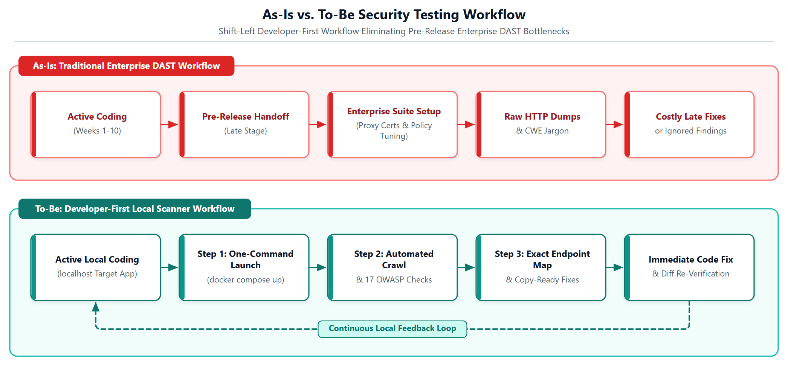

*Figure 1: Comparison of the late-stage enterprise DAST workflow (As-Is) against the proposed continuous local developer-first workflow (To-Be). Diagram source: [01_as_is_vs_to_be.mmd](../diagrams/01_as_is_vs_to_be.mmd).*

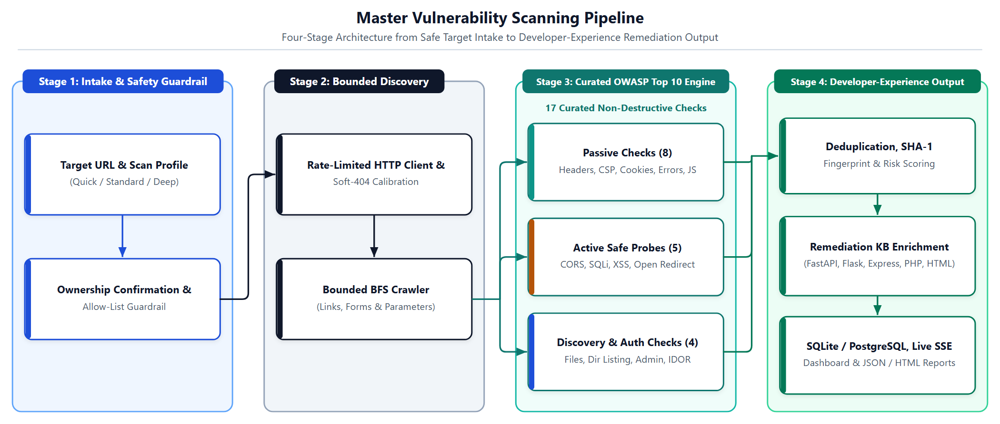

*Figure 2: Four-stage master execution pipeline from target intake and safety guardrail enforcement through bounded discovery, curated 17-check execution, and developer-experience output generation. Diagram source: [02_master_scanner_pipeline.mmd](../diagrams/02_master_scanner_pipeline.mmd).*

Complementing the four-stage architectural pipeline above, Figure 19 presents the classic ISO 5807 top-down decision-flow representation of the entire system, making explicit every runtime branch condition, bounded loop termination criterion, profile-driven check selection, and cooperative cancellation path from initial target submission through final report delivery.

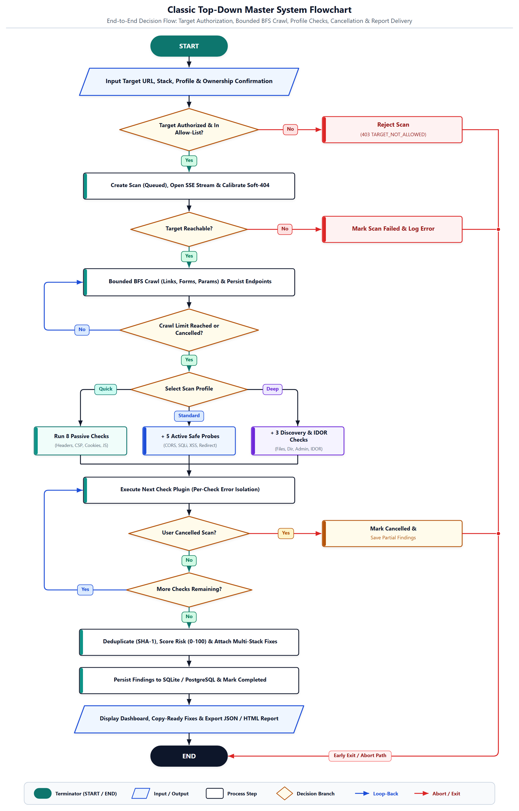

*Figure 19: Classic top-down master system flowchart illustrating end-to-end target authorization, reachability validation, bounded BFS crawling, profile-driven OWASP check execution, cancellation handling, risk scoring, and developer report delivery. (Mermaid source: [19_master_system_flowchart.mmd](../diagrams/19_master_system_flowchart.mmd))*

---

## 1.9 Definitions and Glossary

Table 1.6 standardizes the domain terminology, security acronyms, and architectural concepts referenced throughout this Software Architecture Document.

| Term / Acronym | Definition |
| :--- | :--- |
| **Allow-list** | An explicit, deny-by-default list of permitted target hostnames and private IP ranges (`localhost`, `127.0.0.1`, `host.docker.internal`, RFC1918 private networks, and local testbench services `dvwa`, `juice-shop`, `vulnbench`). Requests resolving outside this boundary are blocked prior to transmission. |
| **Attack Surface** | The enumerated set of reachable entry points exposed by a target web application—comprising normalized URL paths, HTTP methods (`GET`/`POST`), query parameters, HTML form inputs, and HTTP headers—discovered by the bounded BFS crawler. |
| **BFS (Breadth-First Search)** | Level-order graph traversal algorithm used by the web crawler to discover pages systematically up to a profile-configured depth (`max_depth`) and page budget (`max_pages`), preventing infinite traversal loops. |
| **CORS (Cross-Origin Resource Sharing)** | HTTP header policy (`Access-Control-Allow-Origin`, `Access-Control-Allow-Credentials`) controlling cross-origin browser reads; overly permissive reflection with credentials enables unauthorized cross-site data access. |
| **CSP (Content-Security-Policy)** | Security response header restricting trusted script, style, and frame origins to mitigate XSS and content-injection attacks. |
| **CSRF (Cross-Site Request Forgery)** | Vulnerability occurring when state-changing `POST` forms omit an unpredictable anti-CSRF token, enabling cross-site forged requests using an authenticated user's session cookie. |
| **CWE (Common Weakness Enumeration)** | Standardized software weakness taxonomy (e.g., `CWE-89` SQL Injection, `CWE-79` XSS) linked to findings for academic reference alongside plain-language explanations. |
| **DAST (Dynamic Application Security Testing)** | Black-box testing technique that probes a running web application over HTTP/HTTPS to identify runtime misconfigurations and injection vulnerabilities without static source-code analysis. |
| **Fingerprint** | A deterministic **SHA-1** digest computed from `(check_id, normalized_url, http_method, parameter_name)` that stably identifies a finding across repeated scans to classify changes as `New`, `Fixed`, or `Unchanged`. |
| **IDOR (Insecure Direct Object Reference)** | Access control vulnerability (OWASP A01) where modifying a predictable object identifier in a request exposes unauthorized records belonging to another user. |
| **MoSCoW** | Requirements prioritization scale classifying requirements into **Must**, **Should**, **Could**, and **Won't** have within the target project scope. |
| **NIST SSDF (SP 800-218)** | National Institute of Standards and Technology Secure Software Development Framework defining core practices (`PO`, `PS`, `PW`, `RV`) for integrating security early across the software lifecycle. |
| **OWASP Top 10 (2021)** | Industry-standard taxonomy cataloging the ten most critical web application security risk categories (`A01`–`A10`), providing the conceptual foundation for the scanner's 17 curated checks. |
| **Soft-404** | Server behavior in which non-existent routes return HTTP `200 OK` (such as a fallback error template or SPA shell) rather than `404 Not Found`. Calibrating against random nonexistent paths suppresses false positives in discovery checks. |
| **SQLi (SQL Injection)** | Injection flaw (OWASP A03) caused by concatenating untrusted user input into SQL statements; detected non-destructively via error-signature matching and boolean-differential probing. |
| **SSE (Server-Sent Events)** | Lightweight unidirectional HTTP streaming mechanism (`text/event-stream`) used by `GET /api/scans/{id}/stream` to deliver real-time crawl progress, check execution updates, and live finding counts to the dashboard. |
| **Triage** | Developer review process assigning each finding one of four lifecycle states (`open`, `fixed`, `false_positive`, `accepted`), automatically excluding `false_positive` entries from the scan risk score. |
| **WAL (Write-Ahead Logging)** | SQLite concurrency mode (`PRAGMA journal_mode=WAL`) enabling concurrent background worker writes and FastAPI dashboard/SSE reads without database locking errors. |
| **XSS (Cross-Site Scripting)** | Injection flaw (OWASP A03) in which untrusted input is reflected into HTML responses without context-aware encoding; detected safely via benign unique canary tokens. |

---

## 1.10 Chapter Summary

This chapter established the motivation, problem statement, formal aim and objectives, competitive positioning, stakeholder and team structure, explicit scope boundaries, research questions, and end-to-end developer workflow for the Lightweight OWASP Top 10 Vulnerability Scanner. Anchored in Shift-Left engineering and NIST SSDF principles, the proposed architecture directly resolves the setup friction and alert-comprehension barriers of enterprise DAST suites by pairing a zero-configuration local Docker/Python runtime and mandatory ethical guardrails with 17 curated OWASP checks and copy-ready five-stack remediation fixes. Chapter 2 translates these objectives and stakeholder needs into a formal System Requirements Specification comprising functional requirements, measurable non-functional requirements, use cases, and full requirements traceability.

---

# Chapter 2: System Requirements Specification

## 2.1 Functional Requirements Catalogue

The functional requirements define all externally observable behaviors of the Lightweight OWASP Top 10 Vulnerability Scanner across project registration, ethical scope enforcement, bounded web crawling, curated OWASP Top 10 (2021) vulnerability detection, live progress streaming, developer remediation guidance, triage, and reporting. Table 2.1 specifies `FR-01` through `FR-15` using MoSCoW prioritization and objective acceptance criteria.

| ID | Requirement | Category | MoSCoW Priority | Acceptance Criterion |
| :--- | :--- | :--- | :--- | :--- |
| **FR-01** | **Project Creation and Explicit Ownership Confirmation** — The system shall allow a developer to register a target web project (`name`, `base_url`, optional `description`, and `ownership_confirmed` boolean) and shall reject creation unless ownership confirmation is explicitly asserted. | Project Management & Ethics | **Must** | `POST /api/projects` returns HTTP `201 Created` when `ownership_confirmed=true` and `base_url` is valid; returns HTTP `422` or `400` if `ownership_confirmed=false` or URL syntax is malformed. |
| **FR-02** | **Mandatory Allow-List and Scope Guardrail Enforcement** — The system shall validate every target URL, pre-request resolved DNS IP address, and HTTP redirect destination against a hardcoded local/private allow-list (`localhost`, `127.0.0.1`, `host.docker.internal`, RFC1918 private networks, `dvwa`, `juice-shop`, `vulnbench`) before transmitting any outbound probe. | Safety & Scope Control | **Must** | Attempting to register or scan a public internet host (e.g., `https://example.com`) or a hostname resolving to a public IP is rejected with HTTP `403`/`400` and zero outbound scan requests transmitted. |
| **FR-03** | **Configurable Scan Profiles (`Quick`, `Standard`, `Deep`)** — The system shall support three predefined scan profiles governing crawl depth, page budget, and enabled checks: `Quick` (passive checks and shallow crawl), `Standard` (passive, active safe, and discovery checks), and `Deep` (all 17 checks including `idor_heuristic` with expanded crawl budget). | Scan Configuration | **Must** | Submitting `POST /api/projects/{id}/scans` with `profile` in `{quick, standard, deep}` configures the corresponding `max_depth`, `max_pages`, and check set, persisted on the scan record. |
| **FR-04** | **Bounded BFS Web Crawler and Attack-Surface Discovery** — The system shall crawl same-origin HTML pages using Breadth-First Search up to profile limits, extracting normalized URLs, HTTP methods, query parameters, HTML `<form>` fields, and script tags while skipping destructive/logout routes and calibrating Soft-404 responses. | Discovery Engine | **Must** | Crawling `VulnBench` enumerates all seeded links, query endpoints, and `POST` form fields within the configured page cap without leaving the target origin or invoking `/logout` or `/delete` paths. |
| **FR-05** | **Curated 17-Check OWASP Top 10 (2021) Engine** — The system shall execute 17 modular vulnerability checks across Passive (8: `missing_security_headers`, `weak_csp`, `server_banner_leak`, `verbose_error_pages`, `insecure_cookies`, `insecure_transport`, `csrf_missing_token`, `outdated_js_components`), Active Safe (5: `cors_misconfig`, `sqli_error_based`, `sqli_boolean_diff`, `xss_reflected`, `open_redirect`), Discovery (3: `sensitive_files`, `directory_listing`, `forced_browsing_admin`), and Deep Auth (1: `idor_heuristic`). | Vulnerability Detection | **Must** | Each check subclasses `BaseCheck`, executes under per-check exception isolation, maps to an OWASP Top 10 (2021) category and CWE ID, and detects its corresponding seeded vulnerability on `VulnBench`. |
| **FR-06** | **Real-Time Scan Progress Streaming via SSE** — The system shall push live scan lifecycle transitions (`queued` -> `crawling` -> `scanning` -> `completed`), completion percentage, active check identifier, discovered endpoint count, and live finding count over Server-Sent Events (`GET /api/scans/{id}/stream`). | Live Telemetry | **Must** | Connecting an `EventSource` client to `/api/scans/{id}/stream` receives ordered JSON SSE events during execution and closes cleanly upon reaching a terminal state (`completed`, `failed`, or `cancelled`). |
| **FR-07** | **Cooperative Mid-Scan Cancellation** — The system shall allow a developer to cancel any `queued`, `crawling`, or `scanning` scan via `POST /api/scans/{id}/cancel`, signaling a `threading.Event` cancellation flag to halt further HTTP probes while preserving findings already stored. | Scan Lifecycle Control | **Must** | Calling `POST /api/scans/{id}/cancel` on a running scan transitions status to `cancelled` within 5 seconds, halts outbound probing, and emits a terminal cancellation SSE event. |
| **FR-08** | **Exact Endpoint, Method, and Parameter Finding Mapping** — Every persisted finding shall record exact location coordinates: HTTP method, normalized endpoint path, affected parameter/header/field (e.g., `POST /api/login, field: user`), confidence level, and redacted non-sensitive proof-of-detection evidence. | Developer Experience | **Must** | Every finding returned by `GET /api/scans/{id}/findings` includes non-empty `endpoint_url`, `http_method`, `parameter` (when input-bound), `evidence`, `owasp_category`, `cwe_id`, and `severity`. |
| **FR-09** | **Plain-Language Explanations and Multi-Stack Copy-Ready Code Fixes** — The system shall enrich every finding from `backend/scanner/remediation/kb.json` with a jargon-free summary, root-cause explanation, impact description, and copy-ready **Before/After** code fixes for **FastAPI, Flask, Express, PHP, and HTML**. | Remediation Guidance | **Must** | Opening any finding in the Actionable Code Fix Modal displays plain-language guidance and interactive framework tabs with one-click clipboard copy for vulnerable ("Before") and patched ("After") code blocks. |
| **FR-10** | **Interactive Severity and OWASP Dashboard Charts** — The system shall provide a responsive web dashboard displaying the computed risk score (`min(100, 10*critical + 6*high + 3*medium + 1*low)`), severity breakdown charts, OWASP Top 10 category distribution charts, and filterable findings/endpoints tables. | Visualization & UI | **Must** | Dashboard loads at `GET /` with zero frontend build step, renders live Chart.js visualizations from REST API data, and filters findings by severity, OWASP category, check ID, and triage status. |
| **FR-11** | **Scan History Persistence and Fingerprint-Based Comparison** — The system shall persist historical scans in SQLAlchemy (SQLite default / PostgreSQL profile) and compute deterministic **SHA-1** finding fingerprints to compare any two scans of a project into `New`, `Fixed`, and `Unchanged` groups. | Regression Tracking | **Must** | `GET /api/scans/{id}/compare?baseline={other_id}` accurately partitions findings into `new`, `fixed`, and `unchanged` collections alongside the risk-score delta after a code patch and re-scan. |
| **FR-12** | **JSON and Standalone HTML Report Export** — The system shall export any finished scan as structured JSON (`GET /api/scans/{id}/report?format=json`) and as a self-contained, printable HTML report (`format=html`) rendered via auto-escaped Jinja2 templates including executive metrics and code fixes. | Reporting & Portability | **Must** | Downloaded JSON conforms to the documented report schema; downloaded HTML renders cleanly offline in a browser with no broken assets and properly escaped finding evidence. |
| **FR-13** | **Finding Triage and Lifecycle Status Management** — The system shall allow developers and instructors to update a finding's status (`open`, `fixed`, `false_positive`, `accepted`) with optional rationale notes via `PATCH /api/findings/{id}`, automatically recalculating the scan risk score to exclude `false_positive` entries. | Workflow & Governance | **Should** | Marking a finding `false_positive` persists across page reloads, records the triage note/timestamp, and immediately updates the parent scan's risk score. |
| **FR-14** | **Optional Authenticated Scanning (Cookie, Bearer, DVWA Helper)** — The system shall accept optional per-scan target authentication credentials (raw `Cookie` header, `Authorization: Bearer` token, or automated DVWA form-login helper) held strictly in volatile memory during the scan and never persisted in plaintext to the database. | Authenticated Discovery | **Should** | Supplying session cookies, a Bearer token, or DVWA credentials enables discovery and scanning of protected routes (e.g., DVWA `/vulnerabilities/sqli/`) while leaving database tables free of credential secrets. |
| **FR-15** | **Curated Check Catalog Discovery API** — The system shall expose a read-only `GET /api/checks` endpoint listing every registered `BaseCheck` plugin with its `check_id`, title, execution phase (`passive`, `active`, `discovery`, `deep`), OWASP category, CWE ID, default severity, and scan profile membership. | Transparency & Extensibility | **Should** | `GET /api/checks` returns HTTP `200 OK` enumerating all 17 active checks and automatically includes any newly added single-file `BaseCheck` module upon startup. |

---

## 2.2 Non-Functional Requirements

Table 2.2 establishes nine measurable non-functional requirements (`NFR-01` through `NFR-09`) governing usability, runtime performance, ethical safety, self-security, portability, extensibility, reliability, empirical accuracy, and maintainability.

| ID | Quality Attribute | Requirement Statement | Target Metric / Verification Method |
| :--- | :--- | :--- | :--- |
| **NFR-01** | **Usability and Zero-Config Onboarding** | A student developer with Docker installed shall be able to start the scanner, register a local project, and launch a first scan with zero proxy setup, zero TLS certificate installation, and zero manual configuration edits. | Time from repository clone to first live scan **< 3 minutes** via `docker compose up`, validated during Phase 6 usability evaluation. |
| **NFR-02** | **Performance and Resource Bounds** | Local scans shall execute fast enough for iterative coding while remaining well within standard student laptop resource budgets. | On local `VulnBench` (~15–25 routes): `Quick` **<= 30 s**, `Standard` **<= 120 s**, `Deep` **<= 300 s**; steady-state memory **<= 512 MB RAM**; bounded in-process `ThreadPoolExecutor` worker pool. |
| **NFR-03** | **Mandatory Safety, Ethics, and Non-Destructive Probing** | The scanner shall prevent unauthorized external scanning, avoid target overload, and execute strictly non-destructive proof-of-detection probes. | Hardcoded allow-list + pre-request DNS (`socket.getaddrinfo`) + `ipaddress` validation; manual same-origin redirect verification; default rate limit **10 req/s**; hard cap **2,000 requests/scan**; logout/delete route denylist; verified by dedicated guardrail tests. |
| **NFR-04** | **Scanner Self-Security** | The scanner backend and dashboard shall adhere to OWASP defensive coding standards so the tool itself introduces no local security exposure. | Strict Pydantic v2 validation; security headers middleware (`X-Content-Type-Options`, `X-Frame-Options`, `Referrer-Policy`, `Content-Security-Policy`); non-root Docker user (`scanner`); parameterized SQLAlchemy 2.0 queries; Jinja2 auto-escaping and safe DOM text insertion (`textContent`). |
| **NFR-05** | **Portability and Dual Runtime Support** | The platform shall run identically across Windows 10/11, macOS, and Linux via Docker Compose and natively inside a Python 3.11+/3.12 virtual environment. | Verified `docker compose up` (default SQLite + optional `--profile postgres` PostgreSQL 16 service, `host.docker.internal` host-gateway) and native `uvicorn backend.app.main:app` startup. |
| **NFR-06** | **Extensibility and Plugin Modularity** | Adding a new OWASP security check shall require authoring only a single Python module subclassing `BaseCheck` and adding its remediation entry to `kb.json`, without editing core orchestration code. | Dynamic plugin auto-registry discovers `BaseCheck` subclasses at startup; verified by a unit test loading a mock check without modifying `ScanOrchestrator`. |
| **NFR-07** | **Reliability and Per-Check Error Isolation** | An unhandled exception, malformed HTML response, or HTTP timeout in any individual check or route shall be isolated and shall never crash the scan worker or abort remaining checks. | Each check runs inside isolated `try/except` handling with explicit connect/read timeouts; SQLite WAL mode prevents read/write lock contention during concurrent SSE streaming. |
| **NFR-08** | **Detection Accuracy and Empirical Benchmark Targets** | The curated 17-check engine shall achieve strong detection recall while maintaining high precision and zero false-positive noise on clean control routes. | Automated `scripts/evaluate.py` against `VulnBench` (`testbench/ground_truth.json`) achieves **Recall >= 80%**, **Precision >= 85%**, and **0 false positives** on clean control routes; supplementary evaluation on DVWA and OWASP Juice Shop. |
| **NFR-09** | **Maintainability and Automated Verification** | The repository shall maintain strict separation between the FastAPI web layer (`backend/app/`) and the pure scanner engine (`backend/scanner/`), verified by automated tests and static linting. | Automated `pytest` suite covering unit, guardrail, crawler, check, REST/SSE API, and E2E integration tests passes with zero failures and zero `ruff` lint errors. |

---

## 2.3 System Use Case Diagram

Figure 3 models the system boundary, external actors (`Student / Web Developer` and `Team Lead / Capstone Instructor`), six core use cases (`UC-01` through `UC-06`), and UML `«include»` and `«extend»` behavioral relationships.

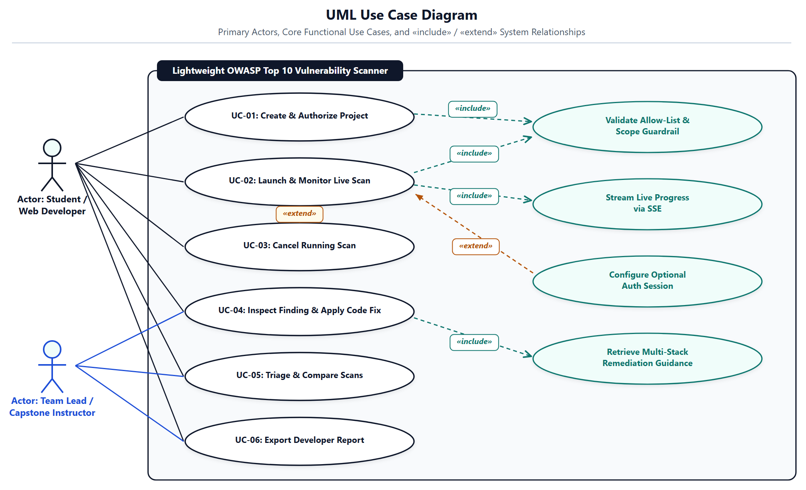

*Figure 3: System Use Case Diagram depicting system actors, primary use cases (UC-01 through UC-06), mandatory include dependencies, and optional authentication and cancellation extensions. Diagram source: [03_use_case_diagram.mmd](../diagrams/03_use_case_diagram.mmd).*

---

## 2.4 Detailed Use Case Specifications

The six primary use cases illustrated in Figure 3 are specified below to define preconditions, nominal interaction flows, exception handling, postconditions, and requirement links.

### UC-01: Create and Authorize Project

| Field | Specification |
| :--- | :--- |
| **Use Case ID & Name** | `UC-01`: Create and Authorize Project |
| **Primary Actor** | Student / Web Developer |
| **Secondary Actors** | None (Scope Guardrail invoked internally) |
| **Description** | The developer registers a local or testbench web application as a scannable project and explicitly confirms authorization to test the target. |
| **Preconditions** | The scanner web service (`http://localhost:8000`) is running and reachable; the target application URL is known. |
| **Trigger** | The developer clicks **New Project** in the dashboard or sends `POST /api/projects`. |
| **Main Success Scenario** | **1.** The developer enters project `name`, target `base_url` (e.g., `http://host.docker.internal:5050`), and optional `description`. **2.** The developer checks the mandatory ownership confirmation box affirming authorization to test the local/lab target. **3.** The frontend sends `POST /api/projects` with `ownership_confirmed: true`. **4.** FastAPI validates the payload schema via Pydantic v2. **5.** The Scope Guardrail verifies URL scheme (`http`/`https`), host allow-list membership, and resolved IP safety (`«include» Validate Allow-List & Scope Guardrail`). **6.** The system persists the new `Project` record in SQLAlchemy and returns HTTP `201 Created`. **7.** The dashboard displays the newly registered project card ready for scanning. |
| **Alternative & Exception Flows** | **A1 — Ownership Unchecked:** The frontend prevents submission; direct API requests with `ownership_confirmed: false` are rejected with HTTP `422 Unprocessable Entity`. **A2 — Target Outside Allow-List:** The Scope Guardrail detects a public domain or non-allowlisted IP and returns HTTP `403 Forbidden` with an ethical-use explanation; no project is created. **A3 — Malformed URL:** Pydantic validation returns HTTP `422` detailing the invalid URL format. |
| **Postconditions** | A validated `Project` record exists in the database and is eligible for scan execution. |
| **Related Requirements** | `FR-01`, `FR-02`, `NFR-01`, `NFR-03`, `NFR-04` |

### UC-02: Launch and Monitor Live Scan

| Field | Specification |
| :--- | :--- |
| **Use Case ID & Name** | `UC-02`: Launch and Monitor Live Scan |
| **Primary Actor** | Student / Web Developer |
| **Secondary Actors** | Target Local Web Application |
| **Description** | The developer selects a scan profile (`Quick`, `Standard`, or `Deep`), optionally provides session credentials, initiates an asynchronous scan, and monitors live progress in the browser. |
| **Preconditions** | The target project exists (`UC-01`); the target local application is running and listening on its configured port. |
| **Trigger** | The developer clicks **Start Scan** in the Scan Launcher view or sends `POST /api/projects/{id}/scans`. |
| **Main Success Scenario** | **1.** The developer selects a scan profile (`Quick`, `Standard`, or `Deep`) and optionally configures Cookie/Bearer/DVWA credentials (`«extend» Configure Optional Auth Session`). **2.** The frontend sends `POST /api/projects/{id}/scans`. **3.** The Scope Guardrail re-validates target URL and DNS resolution (`«include» Validate Allow-List & Scope Guardrail`). **4.** The backend inserts a `Scan` row with status `queued`, registers a `threading.Event` cancel handle, submits execution to the bounded `ThreadPoolExecutor`, and returns HTTP `202 Accepted`. **5.** The dashboard opens an `EventSource` stream on `GET /api/scans/{id}/stream` (`«include» Stream Live Progress via SSE`). **6.** The worker transitions through `crawling` and `scanning`: calibrating Soft-404, crawling links/forms via bounded BFS, running profile checks inside isolated `try/except` blocks, enriching findings from `kb.json`, computing SHA-1 fingerprints and risk score, and persisting `Endpoint` and `Finding` rows. **7.** The dashboard updates the progress bar, active check label, discovered endpoint tally, and severity counters in real time. **8.** Upon completion, scan status becomes `completed`, the SSE stream closes cleanly, and the dashboard loads the Findings Explorer. |
| **Alternative & Exception Flows** | **A1 — Target Unreachable:** Initial connectivity check fails; the scan transitions to `failed` with an actionable hint (e.g., verify `host.docker.internal` or target port). **A2 — Single Check Exception:** The orchestrator logs the fault, isolates the failure, and continues executing remaining checks. **A3 — Request Cap Reached:** Reaching 2,000 requests halts further probing cleanly, persists collected findings, and marks the scan `completed` with a cap-reached notice. **A4 — Developer Cancels:** Invokes `UC-03` (`«extend»`). |
| **Postconditions** | Completed `Scan`, discovered `Endpoint` records, enriched `Finding` rows, and calculated risk score are persisted in the database. |
| **Related Requirements** | `FR-02`, `FR-03`, `FR-04`, `FR-05`, `FR-06`, `FR-08`, `FR-14`, `NFR-02`, `NFR-03`, `NFR-07` |

### UC-03: Cancel Running Scan

| Field | Specification |
| :--- | :--- |
| **Use Case ID & Name** | `UC-03`: Cancel Running Scan |
| **Primary Actor** | Student / Web Developer |
| **Secondary Actors** | None |
| **Description** | The developer terminates an active or queued scan cleanly without discarding endpoints and findings already persisted. |
| **Preconditions** | A scan exists in state `queued`, `crawling`, or `scanning`. |
| **Trigger** | The developer clicks **Cancel Scan** in the Live SSE Progress view or sends `POST /api/scans/{id}/cancel`. |
| **Main Success Scenario** | **1.** The frontend sends `POST /api/scans/{id}/cancel`. **2.** The API retrieves the scan's active `threading.Event` handle from the cancellation registry and sets the event. **3.** The crawler loop and check orchestrator observe `cancel_event.is_set()` prior to the next HTTP request or check invocation and exit cleanly. **4.** The worker flushes already-collected findings, computes the partial risk score, updates scan status to `cancelled` with a `finished_at` timestamp, and emits a terminal `cancelled` SSE event. **5.** The dashboard displays the `Cancelled` badge and enables inspection of partial findings. |
| **Alternative & Exception Flows** | **A1 — Already Terminal:** If the scan has already entered `completed`, `failed`, or `cancelled`, the API returns HTTP `409 Conflict` indicating the terminal state. |
| **Postconditions** | Outbound scan traffic ceases within 5 seconds; the scan is stored as `cancelled` with partial findings retained. |
| **Related Requirements** | `FR-06`, `FR-07`, `NFR-07` |

### UC-04: Inspect Finding and Apply Code Fix

| Field | Specification |
| :--- | :--- |
| **Use Case ID & Name** | `UC-04`: Inspect Finding and Apply Code Fix |
| **Primary Actor** | Student / Web Developer |
| **Secondary Actors** | Team Lead / Capstone Instructor |
| **Description** | The actor filters findings on the dashboard, inspects exact endpoint and parameter coordinates, reviews the plain-language explanation, and copies a framework-matched Before/After code fix. |
| **Preconditions** | At least one scan has generated findings (`UC-02`). |
| **Trigger** | The actor selects a finding row in the Findings and Endpoints Explorer view. |
| **Main Success Scenario** | **1.** The actor filters findings by severity (`critical`/`high`/`medium`/`low`), OWASP Top 10 category, or triage status (`GET /api/scans/{id}/findings`). **2.** The actor selects a finding row (e.g., `SQL Injection (Error-Based)` on `POST /api/login, field: user`). **3.** The frontend requests full finding details and remediation guidance (`«include» Retrieve Multi-Stack Remediation Guidance`) via `GET /api/findings/{id}`. **4.** The Actionable Code Fix Modal displays exact HTTP method, normalized endpoint, parameter/header, redacted proof-of-detection evidence, plain-language root-cause summary, and framework tabs (**FastAPI, Flask, Express, PHP, HTML**). **5.** The developer selects the matching framework tab, compares the vulnerable **Before** snippet against the secure **After** snippet, and clicks **Copy Fix**. **6.** The developer applies the patch directly in the local codebase. |
| **Alternative & Exception Flows** | **A1 — Stack Not Listed:** The developer consults the generic HTTP/HTML or closest backend framework snippet alongside the plain-language explanation and CWE/OWASP reference. **A2 — Malicious Target Evidence:** All target response excerpts are inserted strictly via safe DOM text nodes (`textContent`), preventing stored XSS inside the scanner UI. |
| **Postconditions** | The developer identifies the exact vulnerable field and obtains a copy-ready remediation patch for local implementation. |
| **Related Requirements** | `FR-08`, `FR-09`, `FR-10`, `FR-15`, `NFR-04` |

### UC-05: Triage and Compare Scans

| Field | Specification |
| :--- | :--- |
| **Use Case ID & Name** | `UC-05`: Triage and Compare Scans |
| **Primary Actor** | Student / Web Developer |
| **Secondary Actors** | Team Lead / Capstone Instructor |
| **Description** | The actor updates finding triage statuses (`open`, `fixed`, `false_positive`, `accepted`) and compares two scans of the same project via SHA-1 fingerprints to verify remediation progress. |
| **Preconditions** | A project has at least one scan (for triage) or at least two completed scans (for comparison). |
| **Trigger** | The actor updates a finding status control or selects two scans in the **Compare Scans** view. |
| **Main Success Scenario** | **1.** To triage a finding, the actor chooses a new status (`fixed`, `false_positive`, `accepted`, or `open`), enters an optional justification note, and submits `PATCH /api/findings/{id}`. **2.** The backend validates the status enum, persists the update, recalculates the parent scan's risk score excluding `false_positive` entries, and returns the updated record and score. **3.** After patching code locally and executing a follow-up scan (`UC-02`), the actor opens **Compare Scans** and chooses a baseline scan and target scan. **4.** The frontend invokes `GET /api/scans/{id}/compare?baseline={other_id}`. **5.** The backend matches SHA-1 fingerprints between both scans and returns partitioned `New`, `Fixed`, and `Unchanged` finding sets alongside the risk-score delta. **6.** The dashboard renders resolved `Fixed` items, newly introduced `New` regressions, and persistent `Unchanged` findings clearly. |
| **Alternative & Exception Flows** | **A1 — Cross-Project Comparison Attempt:** If the two scan IDs belong to different projects, the API returns HTTP `400 Bad Request`. **A2 — Invalid Status Enum:** Pydantic rejects unrecognized triage values with HTTP `422 Unprocessable Entity`. |
| **Postconditions** | Triage decisions are persisted, risk scores reflect triaged reality, and remediation progress between iterations is objectively verified. |
| **Related Requirements** | `FR-10`, `FR-11`, `FR-13`, `NFR-04` |

### UC-06: Export Developer Report

| Field | Specification |
| :--- | :--- |
| **Use Case ID & Name** | `UC-06`: Export Developer Report |
| **Primary Actor** | Student / Web Developer |
| **Secondary Actors** | Team Lead / Capstone Instructor |
| **Description** | The actor exports scan summary metrics, discovered endpoints, findings, triage notes, and multi-stack remediation guidance as a structured JSON file or standalone printable HTML report. |
| **Preconditions** | The target scan exists in a terminal state (`completed` or `cancelled`). |
| **Trigger** | The actor clicks **Export JSON** or **Export HTML** on the dashboard or requests `GET /api/scans/{id}/report?format={json|html}`. |
| **Main Success Scenario** | **1.** The actor selects either `JSON` (for archival or automated evaluation) or `HTML` (for academic submission and PDF printing). **2.** The frontend requests `GET /api/scans/{id}/report?format=json` or `format=html`. **3.** The backend loads scan metadata, risk score, severity/OWASP tallies, endpoints, and enriched findings from SQLAlchemy. **4.** For `json`, the backend serializes the structured Pydantic report payload with `Content-Disposition: attachment`. **5.** For `html`, the backend renders a self-contained Jinja2 report template with strict auto-escaping, inline print styles, executive summary, finding cards, and Before/After code snippets. **6.** The browser downloads the report cleanly for offline review, milestone grading, or printing. |
| **Alternative & Exception Flows** | **A1 — Scan Still Active:** Requesting a report while status is `queued`, `crawling`, or `scanning` returns HTTP `409 Conflict` advising the user to wait or cancel first. **A2 — Unsupported Format:** Any `format` value outside `{json, html}` returns HTTP `400`/`422`. |
| **Postconditions** | A complete, accurate, safely escaped JSON or standalone HTML report file is delivered to the user's workstation. |
| **Related Requirements** | `FR-08`, `FR-09`, `FR-12`, `NFR-04` |

---

## 2.5 Requirements Traceability Matrix

Table 2.3 provides full forward and backward traceability linking every functional requirement (`FR-01` through `FR-15`) to its corresponding Use Cases, Architecture Components (Chapters 3 and 4), primary API/UI surfaces, and automated verification tests (Chapter 6).

| Req ID | Requirement Summary | Use Case(s) | Architecture Component(s) | Primary API / UI Surface | Verification Test(s) |
| :--- | :--- | :--- | :--- | :--- | :--- |
| **FR-01** | Project creation & ownership confirmation | `UC-01` | FastAPI Projects Router, Pydantic v2 Schemas, SQLAlchemy `Project` ORM | `POST /api/projects`, Projects Dashboard View | `test_projects_api.py::test_create_project_requires_ownership` (`TC-01`) |
| **FR-02** | Mandatory allow-list & DNS/redirect scope guardrail | `UC-01`, `UC-02` | `ScopeGuardrail` (`backend/scanner/guardrail.py`), `SafeHTTPClient` | `POST /api/projects`, `POST /api/projects/{id}/scans` | `test_guardrail.py` (`TC-02`, `TC-03`, `TC-04`) |
| **FR-03** | Configurable scan profiles (`Quick`, `Standard`, `Deep`) | `UC-02` | `ScanProfile` Config, `ScanOrchestrator`, `CheckRegistry` | `POST /api/projects/{id}/scans`, Scan Launcher View | `test_orchestrator.py::test_profile_check_selection` (`TC-05`) |
| **FR-04** | Bounded BFS web crawler & Soft-404 calibration | `UC-02` | `BFSCrawler` (`BeautifulSoup4` + `lxml`), `Soft404Calibrator` | `GET /api/scans/{id}/endpoints`, Endpoints Explorer | `test_crawler.py` (`TC-06`) |
| **FR-05** | Curated 17-check OWASP Top 10 (2021) engine | `UC-02` | `BaseCheck` Plugin Registry (`backend/scanner/checks/*`), `ScanOrchestrator` | `GET /api/scans/{id}/findings`, `GET /api/checks` | `test_checks_*.py` + `scripts/evaluate.py` (`TC-07`, `TC-08`) |
| **FR-06** | Real-time scan progress streaming via SSE | `UC-02`, `UC-03` | In-Process `ThreadPoolExecutor`, SSE Event Broker, FastAPI `StreamingResponse` | `GET /api/scans/{id}/stream`, Live SSE Progress View | `test_scans_sse.py::test_sse_progress_stream_lifecycle` (`TC-09`) |
| **FR-07** | Cooperative mid-scan cancellation | `UC-03` | Cancellation Registry (`threading.Event`), `ScanOrchestrator` | `POST /api/scans/{id}/cancel`, Live Progress Cancel Button | `test_scans_api.py::test_cancel_running_scan` (`TC-10`) |
| **FR-08** | Exact endpoint, method & parameter finding mapping | `UC-02`, `UC-04`, `UC-06` | `RawFinding` / `EnrichedFinding` Models, SQLAlchemy `Finding` ORM | `GET /api/scans/{id}/findings`, Findings Explorer View | `test_findings_api.py::test_finding_coordinates` (`TC-07`) |
| **FR-09** | Plain-language explanation & 5-stack copy-ready code fixes | `UC-04`, `UC-06` | Remediation Enricher + `backend/scanner/remediation/kb.json` | `GET /api/findings/{id}`, Actionable Code Fix Modal | `test_remediation_kb.py` (`TC-11`) |
| **FR-10** | Interactive severity & OWASP dashboard charts | `UC-04`, `UC-05` | Risk Scorer, Modular Vanilla JS + Tailwind CSS + Chart.js Frontend | `GET /`, `GET /api/scans/{id}`, Dashboard View | `test_health.py::test_dashboard_served` + `test_scans_api.py` (`TC-12`) |
| **FR-11** | Scan history & SHA-1 fingerprint comparison (`New`/`Fixed`/`Unchanged`) | `UC-05` | Fingerprint Engine (SHA-1), Scan Diff Service, SQLAlchemy Persistence | `GET /api/scans/{id}/compare?baseline={other_id}`, Compare Scans View | `test_compare_scans.py::test_new_fixed_unchanged_diff` (`TC-13`) |
| **FR-12** | JSON & standalone HTML report export | `UC-06` | Report Generator (`Jinja2` auto-escaped template + JSON serializer) | `GET /api/scans/{id}/report?format={json\|html}`, Export Controls | `test_reports_api.py` (`TC-14`) |
| **FR-13** | Finding triage (`open`/`fixed`/`false_positive`/`accepted`) & score update | `UC-05` | Findings Router, Risk Score Recalculator, SQLAlchemy `Finding` ORM | `PATCH /api/findings/{id}`, Triage Controls | `test_findings_api.py::test_triage_updates_risk_score` (`TC-13`) |
| **FR-14** | Optional authenticated scanning (Cookie, Bearer, DVWA helper) | `UC-02` | `SafeHTTPClient` Auth Injector, In-Memory Scan Auth Context | `POST /api/projects/{id}/scans` (`auth` payload), Launcher Auth Panel | `test_auth_scanning.py` (`TC-15`) |
| **FR-15** | Curated check catalog discovery API | `UC-04` | `CheckRegistry` Auto-Discovery, Checks Metadata Router | `GET /api/checks`, Dashboard Check Info View | `test_checks_api.py::test_list_all_17_registered_checks` (`TC-05`) |

---

## 2.6 Chapter Summary

This chapter established the complete System Requirements Specification for the Lightweight OWASP Top 10 Vulnerability Scanner. Fifteen prioritized functional requirements (`FR-01` through `FR-15`) and nine measurable non-functional requirements (`NFR-01` through `NFR-09`) codify the operational, safety, usability, accuracy, and extensibility expectations of the platform. The System Use Case Diagram (Figure 3), six detailed use case specifications (`UC-01` through `UC-06`), and the bidirectional Requirements Traceability Matrix ensure that every developer workflow and faculty evaluation criterion is directly linked to concrete architectural components and automated verification suites. Chapter 3 builds upon this specification by detailing the multi-view software architecture, data flow trust boundaries, deployment topology, behavioral lifecycles, and object-oriented plugin structure.

---

# Chapter 3: Software Architecture and Multi-View Design

This chapter presents the multi-view architectural design of the **Lightweight OWASP Top 10 Vulnerability Scanner — Tailored for Web Developers and Student Projects**. Grounded in IEEE Std 42010 and the C4 architectural modeling methodology, the system is specified across structural views (C4 Levels 1 through 3 and an object-oriented UML class view), data-flow views (DFD Levels 0 and 1 with explicit trust boundaries), a deployment and networking view (Docker Compose and isolated testbench topology), and dynamic behavioral views (sequence diagrams, a finite state machine, and a cross-component swimlane activity model). Every architectural boundary is engineered to satisfy the project's Developer-Experience (DevEx) mandate: zero-configuration local execution, non-destructive safety guarantees, real-time telemetry, and stack-specific remediation guidance.

---

## 3.1 Architectural Style and Design Principles

The system implements a **Four-Layer Modular Monolith with a Pure Decoupled Scanning Engine** paired with an **In-Process Asynchronous Execution Model**. Rather than introducing distributed runtime dependencies (such as external message brokers like Redis or RabbitMQ, distributed Celery worker clusters, or client-side Node.js bundler toolchains), the architecture consolidates four distinct logical layers—(1) Presentation Layer (HTML5, Tailwind CSS, Modular Vanilla JS, and Chart.js), (2) Application and API Layer (FastAPI, Pydantic v2, Uvicorn, and SSE streaming), (3) Pure Scanning Engine Layer (`backend/scanner/`), and (4) Persistence Layer (SQLAlchemy 2.0 with SQLite WAL default and optional PostgreSQL 16)—into a single lightweight container or native Python virtual environment. Table 3.1 maps the core architectural principles to their concrete implementation mechanisms and satisfied Non-Functional Requirements (NFRs).

### Table 3.1: Core Architectural Principles and Design Mechanisms

| Design Principle | Concrete Implementation Mechanism | Primary Quality Attribute / NFR Satisfied |
| :--- | :--- | :--- |
| **Zero-Friction Local Deployment** | Single-command `docker compose up` startup with native Python 3.11+/3.12 `venv` parity; SQLite WAL default (`sqlite:///./data/scanner.db`) and optional PostgreSQL 16 via `--profile postgres`. | **NFR-01** (Usability under 3-minute setup), **NFR-05** (Portability) |
| **Pure Decoupled Scanner Engine** | `backend/scanner/` consists exclusively of pure Python modules (`requests`, `BeautifulSoup4`, `lxml`, standard library) with zero imports from FastAPI, Uvicorn, or SQLAlchemy. Communication with the API layer occurs strictly through typed dataclasses and callback hooks. | **NFR-06** (Extensibility), **NFR-09** (Maintainability and isolated unit testing) |
| **Single-File Plugin Auto-Registry** | Each vulnerability check subclasses `BaseCheck` (or a specialized category base) and registers automatically via `CheckRegistry`. Introducing a new OWASP check requires one Python module and a matching entry in `kb.json`. | **NFR-06** (Extensibility) |
| **In-Process Bounded Worker and SSE** | FastAPI dispatches scan jobs to a bounded `concurrent.futures.ThreadPoolExecutor` coordinated with an in-memory `threading.Event` cancellation registry and Server-Sent Events (`GET /api/scans/{id}/stream`), eliminating external broker complexity. | **NFR-01** (Operational simplicity), **NFR-02** (Responsiveness and live telemetry) |
| **Per-Check Fault Isolation** | Each of the 17 vulnerability checks executes inside a guarded `try/except` boundary in `ScanOrchestrator`. A target timeout or parsing exception in one plugin emits a non-fatal `check_warning` SSE event while subsequent checks continue uninterrupted. | **NFR-07** (Reliability and graceful degradation) |
| **Defense-in-Depth Scope Guardrail** | All outbound HTTP traffic traverses `SafeHttpClient` and `ScopeGuardrail`, enforcing local/testbench host allow-lists, pre-request DNS IP validation, manual same-origin redirects, destructive route denylists, a 10 req/s rate limit, and a 2,000-request cap. | **NFR-03** (Mandatory Safety and Ethical Operation) |
| **SPA-Free Developer Dashboard** | The frontend utilizes HTML5, Tailwind CSS, Modular Vanilla JS (ES Modules), and Chart.js served directly by FastAPI, eliminating Node.js build dependencies while delivering six structured developer workflows. | **NFR-01** (Zero-configuration build), **NFR-04** (Reduced attack surface) |

---

## 3.2 C4 Level 1 — System Context

The C4 Level 1 System Context view defines the system boundary between the vulnerability scanner, its human stakeholders, and the external web applications and output artifacts with which it exchanges data. By design, the scanner operates solely within the developer's local workstation or an isolated academic testbench network rather than as an open internet-facing service.

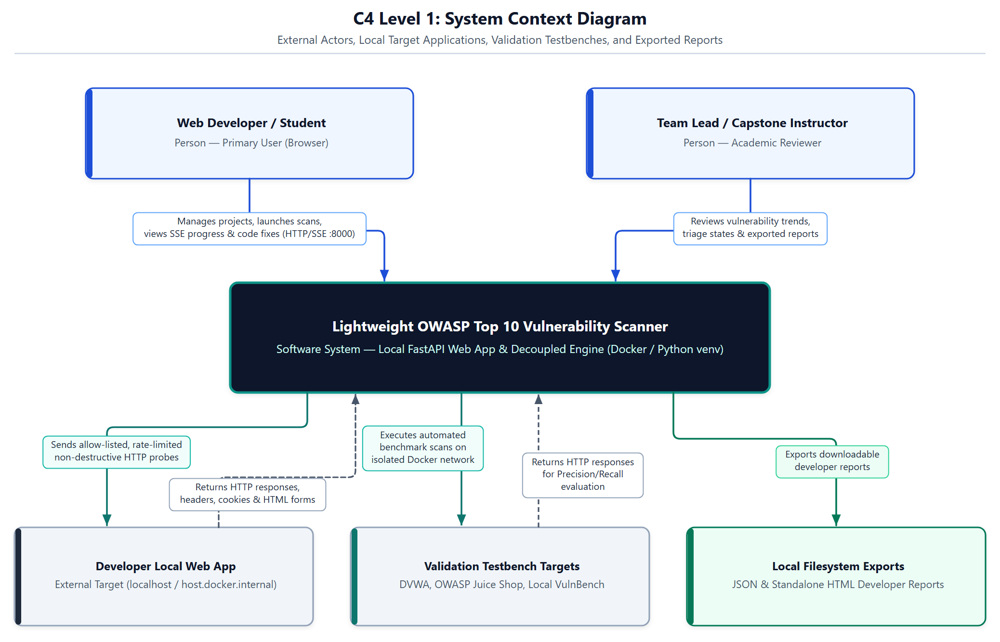

*Figure 4: C4 Level 1 — System Context Diagram (Source: [04_c4_l1_context.mmd](../diagrams/04_c4_l1_context.mmd)).*

### Table 3.2: System Context Actors and External Systems

| Entity | Classification | Interaction Protocol | Responsibilities and Operational Constraints |
| :--- | :--- | :--- | :--- |
| **Web Developer / Student** | Primary Human Actor | HTTP / SSE (`localhost:8000`) | Registers local projects, confirms target ownership, launches Quick/Standard/Deep scans, monitors live SSE progress, inspects exact endpoint/parameter mappings, applies copy-ready code fixes, triages findings, and compares scan history. |
| **Team Lead / Capstone Instructor** | Secondary Human Actor | HTTP (`localhost:8000`) and Offline Reports | Audits project security posture, reviews developer triage decisions (`fixed`, `false_positive`, `accepted`), and evaluates standalone HTML and JSON deliverables. |
| **Developer Local Web App** | Authorized Target System | HTTP/HTTPS (Scoped, <= 10 req/s) | Student or developer application hosted on `localhost`, `127.0.0.1`, or via `host.docker.internal`, subjected strictly to non-destructive crawling and safe proof-of-detection checks. |
| **Validation Testbench Targets** | Authorized Benchmark Systems | Docker Bridge HTTP (`testbench_net`) | Containerized DVWA, OWASP Juice Shop, and local deterministic VulnBench instances utilized for reproducible Precision, Recall, and regression benchmarking. |
| **Local Filesystem Exports** | External Output Sink | Browser Download / Local Volume | Portable, self-contained HTML developer reports and structured JSON audit bundles stored locally for grading or continuous integration archiving. |

---

## 3.3 C4 Level 2 — Container Architecture

Decomposing the scanner system into logical containers and runtime units demonstrates how the browser presentation tier, FastAPI control plane, in-process background worker pool, pure scanner engine, remediation knowledge base, report generator, and SQLAlchemy persistence layer collaborate within a self-contained footprint.

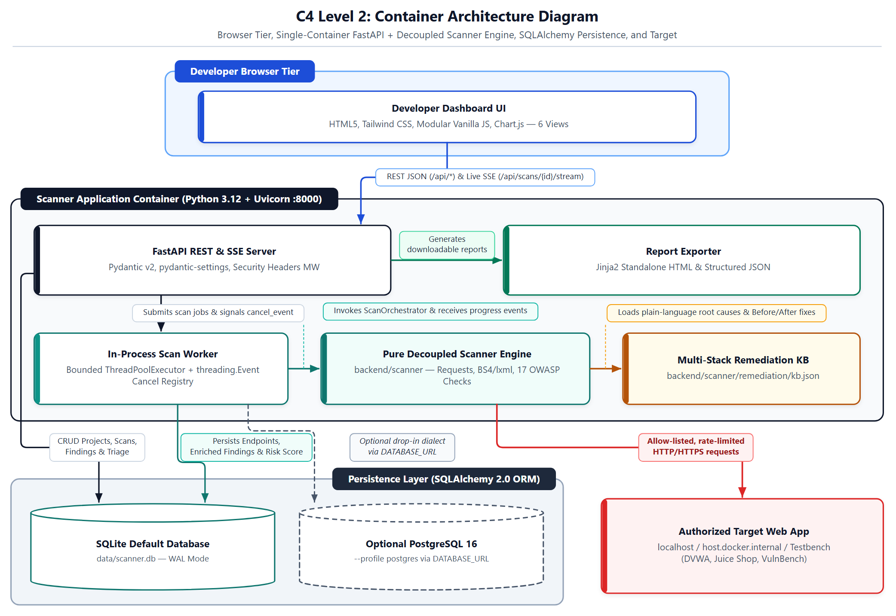

*Figure 5: C4 Level 2 — Container Architecture Diagram (Source: [05_c4_l2_containers.mmd](../diagrams/05_c4_l2_containers.mmd)).*

### Table 3.3: Container and Runtime Subsystem Specifications

| Container / Subsystem | Technology Stack | Primary Responsibilities |
| :--- | :--- | :--- |
| **Developer Dashboard UI** | HTML5, Tailwind CSS, Modular Vanilla JS (ES Modules), Chart.js | Implements six dedicated views: (1) Projects and Overview Dashboard (risk trend and OWASP distribution charts), (2) Scan Launcher (profile selection, optional auth configuration, and mandatory ownership confirmation), (3) Live SSE Progress Monitor (phase stepper, live finding feed, and Cancel control), (4) Findings and Endpoints Explorer (multi-facet filtering), (5) Actionable Code Fix Modal (exact endpoint/parameter badge, plain-language root cause, and tabbed FastAPI/Flask/Express/PHP/HTML Before/After snippets), and (6) Compare Scans and Export View (New/Fixed/Unchanged diffing and JSON/HTML export). |
| **FastAPI REST and SSE Server** | Python 3.12, FastAPI, Uvicorn, Pydantic v2, `pydantic-settings` | Exposes typed `/api/*` REST routes, enforces strict schema validation, injects scanner self-security headers (`CSP`, `X-Frame-Options`, `X-Content-Type-Options`, `Referrer-Policy`), serves static dashboard assets at `/`, and streams real-time scan telemetry via Server-Sent Events. |
| **In-Process Scan Worker** | Python stdlib `ThreadPoolExecutor`, `threading.Event`, per-scan `queue.Queue` | Executes scans off the ASGI event loop in a bounded thread pool (default `max_workers=2` to preserve local workstation resources), manages cooperative cancellation flags keyed by `scan_id`, and relays engine events to active SSE subscribers. |
| **Pure Decoupled Scanner Engine** | Python 3.12, `requests.Session`, `BeautifulSoup4`, `lxml` | Performs Soft-404 baseline calibration, breadth-first crawling, guardrail validation, execution of all 17 curated OWASP Top 10 checks, SHA-1 deduplication, remediation enrichment, and weighted risk scoring. |
| **Multi-Stack Remediation KB** | Versioned JSON (`backend/scanner/remediation/kb.json`) | Maps each canonical `check_id` to plain-language root causes, verification steps, and copy-ready Before/After code fixes across **FastAPI**, **Flask**, **Express**, **PHP**, and **HTML**. |
| **Report Exporter** | Jinja2 (strict autoescaping) and JSON serializer | Produces portable, standalone HTML developer reports and machine-readable JSON audit exports directly from persisted scan records. |
| **Persistence Layer** | SQLAlchemy 2.0 ORM (SQLite WAL default / optional `psycopg` PostgreSQL 16) | Persists projects, scans, discovered endpoints, findings, SHA-1 fingerprints, and triage history with strict foreign-key integrity and dialect-agnostic schema portability. |

---

## 3.4 C4 Level 3 — Scanner Engine Component Architecture

Inspecting the internal structure of the pure `backend/scanner/` package reveals four cohesive sub-pipelines that convert an authorized target URL into deduplicated, remediation-enriched findings: (1) Orchestration and Safety Controls, (2) Attack Surface Discovery, (3) the 17-Check Plugin Auto-Registry, and (4) Enrichment and Risk Scoring.

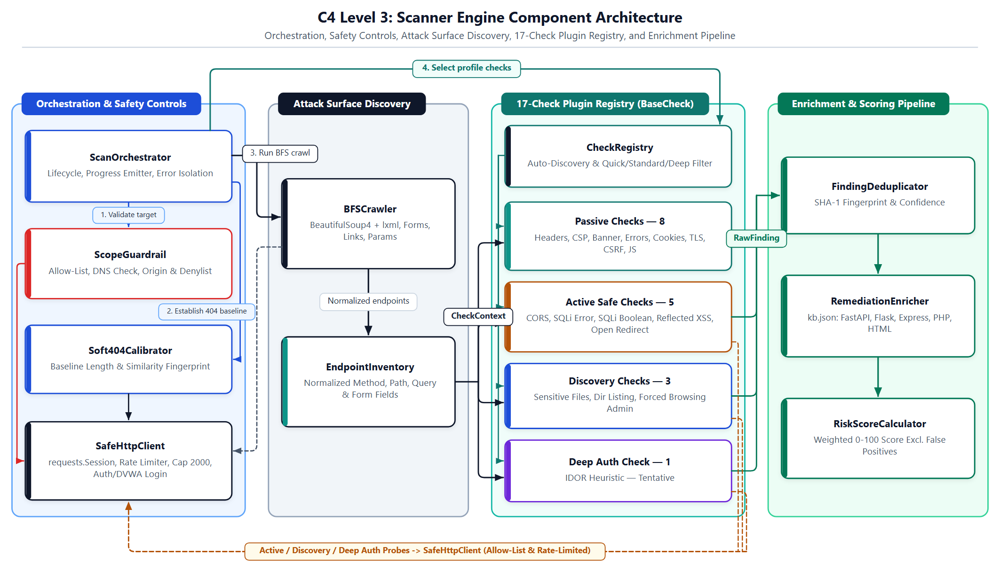

*Figure 6: C4 Level 3 — Scanner Engine Component Architecture (Source: [06_c4_l3_scanner_components.mmd](../diagrams/06_c4_l3_scanner_components.mmd)).*

### Table 3.4: Internal Scanner Engine Component Specifications

| Component | Module Path | Key Algorithmic and Engineering Responsibilities |
| :--- | :--- | :--- |
| **`ScanOrchestrator`** | `backend/scanner/orchestrator.py` | Coordinates the four-stage scan lifecycle (pre-flight calibration, BFS crawl, fault-isolated check execution, and enrichment/scoring), polls `cancel_event`, enforces scan time budgets, and emits structured progress callbacks. |
| **`ScopeGuardrail`** | `backend/scanner/safety/guardrail.py` | Restricts outbound targets to allow-listed hosts (`localhost`, `127.0.0.1`, `host.docker.internal`, RFC1918 private ranges, `dvwa`, `juice-shop`, `vulnbench`), executes pre-request DNS resolution (`socket.getaddrinfo`) verified via `ipaddress` to mitigate DNS rebinding, validates same-origin redirects manually, and blocks destructive paths (`/logout`, `/signout`, `/delete`, `/remove`). |
| **`SafeHttpClient`** | `backend/scanner/http_client.py` | Encapsulates `requests.Session` with token-bucket rate limiting (default `10 req/s`), a hard per-scan cap (`2,000` requests), bounded connect/read timeouts, `allow_redirects=False` manual redirect inspection, transient Cookie/Bearer header injection, and optional automated DVWA login bootstrapping. |
| **`Soft404Calibrator`** | `backend/scanner/soft404.py` | Issues 2–3 randomized nonexistent path probes (e.g., `/__devscan_not_found_<uuid>`) prior to discovery checks to capture baseline status codes, normalized response lengths, and structural similarity signatures, eliminating false positives on custom 200-OK error handlers and single-page applications. |
| **`BFSCrawler` and `EndpointInventory`** | `backend/scanner/crawler.py` | Executes breadth-first traversal bounded by profile depth and page limits (Quick: depth 1 / 25 pages; Standard: depth 3 / 100 pages; Deep: depth 4 / 200 pages), parsing `<a href>`, `<form action/method/input>`, `<script src>`, and query strings via `BeautifulSoup4` + `lxml`, while normalizing paths and deduplicating routes. |
| **`CheckRegistry`** | `backend/scanner/checks/registry.py` | Auto-discovers all `BaseCheck` subclasses across passive (8), active-safe (5), discovery (3), and deep-auth (1) packages, filters applicable checks by scan profile (`quick`, `standard`, `deep`), and supplies live metadata to `GET /api/checks`. |
| **`FindingDeduplicator`** | `backend/scanner/enrichment/dedup.py` | Computes canonical SHA-1 fingerprints over `(check_id, http_method, normalized_path, parameter_name)` so duplicate detections across multiple crawl paths collapse cleanly while retaining the highest-confidence evidence excerpt. |
| **`RemediationEnricher`** | `backend/scanner/enrichment/remediation.py` | Joins each `RawFinding` with `backend/scanner/remediation/kb.json`, attaching plain-language root-cause narratives, verification steps, and stack-specific Before/After code fixes prioritized according to the project's `framework_hint`. |
| **`RiskScoreCalculator`** | `backend/scanner/enrichment/scoring.py` | Computes the bounded `0–100` scan risk score (`min(100, 10*critical + 6*high + 3*medium + 1*low)`), strictly excluding findings triaged as `false_positive`. |

---

## 3.5 Data Flow Diagrams (DFD Level 0 and Level 1 with Trust Boundaries)

Explicit data-flow modeling establishes how untrusted client inputs and untrusted target HTTP responses are validated, sanitized, and isolated across trust boundaries throughout the scan lifecycle.

### 3.5.1 DFD Level 0 — System Context Data Flow

At Level 0, the entire scanner is represented as Process `0.0`, exchanging configuration, live telemetry, and reports with the developer while exchanging scoped, rate-limited HTTP traffic with the authorized local or testbench target application.

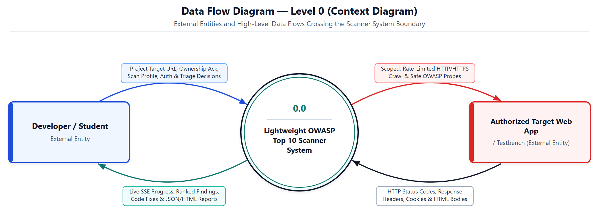

*Figure 7: Data Flow Diagram Level 0 — System Context (Source: [07_dfd_l0_context.mmd](../diagrams/07_dfd_l0_context.mmd)).*

### 3.5.2 DFD Level 1 — Internal Processes and Trust Boundaries

Level 1 decomposes Process `0.0` into six internal processes (`1.0` through `6.0`) and three logical data stores (`D1` Projects and Scans, `D2` Endpoints and Findings, and `D3` Remediation KB) partitioned across three explicit Trust Boundaries: **TB1 (Developer Browser)**, **TB2 (Scanner Application Process)**, and **TB3 (Target Network Perimeter)**.

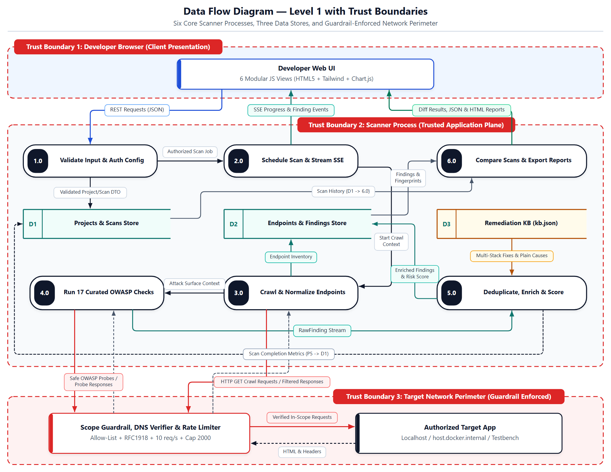

*Figure 8: Data Flow Diagram Level 1 — Internal Processes and Trust Boundaries (Source: [08_dfd_l1_trust_boundaries.mmd](../diagrams/08_dfd_l1_trust_boundaries.mmd)).*

### Table 3.5: Trust Boundary Threat Mitigation Matrix

| Trust Boundary Crossing | Identified Threat | Enforced Architectural Control |
| :--- | :--- | :--- |
| **TB1 -> TB2** (Browser to FastAPI) | Malformed payloads, Server-Side Request Forgery (SSRF) targeting unauthorized hosts, and stored XSS via project names or triage notes. | Strict Pydantic v2 schema validation, mandatory `ownership_confirmed=true` check, `ScopeGuardrail` allow-list pre-validation, parameterized SQLAlchemy ORM queries, and output encoding in DOM rendering and Jinja2 templates. |
| **TB2 -> TB3** (Scanner to Target Network) | Out-of-scope scanning of external internet infrastructure, DNS rebinding bypasses, local target overload, or accidental state deletion. | Pre-request `socket.getaddrinfo` resolution checked against private/loopback IP ranges, manual same-origin redirect verification, destructive/logout path denylist, 10 req/s rate limit, 2,000-request cap, and strictly non-destructive proof-of-detection payloads. |
| **TB3 -> TB2** (Target Responses to Scanner) | Malicious or malformed HTML/JavaScript reflected from target applications executing inside the scanner UI or exported HTML reports. | Response body truncation, sanitized evidence snippet extraction (<= 500 chars), strict `Content-Security-Policy` headers on the scanner web application, and mandatory HTML entity escaping across all UI views and report templates. |
| **TB2 Internal Data Stores (D1–D3)** | Persistence of transient authentication credentials (session cookies or Bearer tokens) in scan configuration logs. | Session credentials reside strictly in volatile worker memory for the duration of a single scan; `SCANS.config_snapshot` records only redacted configuration metadata (e.g., `auth_mode: "bearer"`). |

---

## 3.6 Deployment and Network Topology View

To support both everyday student development and repeatable empirical benchmarking, the deployment architecture defines two modular Docker Compose topologies alongside a zero-Docker native Python `venv` mode:

1. **Core Local Stack (`docker-compose.yml`):** Provisions the non-root `scanner` container (`python:3.12-slim`, Uvicorn bound to port `8000`) backed by a named `scanner_data` volume storing the SQLite WAL database (`/app/data/scanner.db`). Declaring `extra_hosts: ["host.docker.internal:host-gateway"]` enables seamless host-loopback reachability across Windows, macOS, and Linux so developers can scan locally running apps (e.g., `http://host.docker.internal:5000`). Activating `--profile postgres` attaches an optional PostgreSQL 16 service (`postgres_data` volume) configured through `DATABASE_URL`.
2. **Validation Testbench Stack (`docker-compose.testbench.yml`):** Provisions three intentionally vulnerable targets bound exclusively to host loopback (`127.0.0.1`) on an isolated `testbench_net` bridge network: **DVWA** (`vulnerables/web-dvwa:latest` on `127.0.0.1:8080:80`), **OWASP Juice Shop** (`bkimminich/juice-shop:latest` on `127.0.0.1:3000:3000`), and the local deterministic **VulnBench** (`127.0.0.1:5050:5050`).

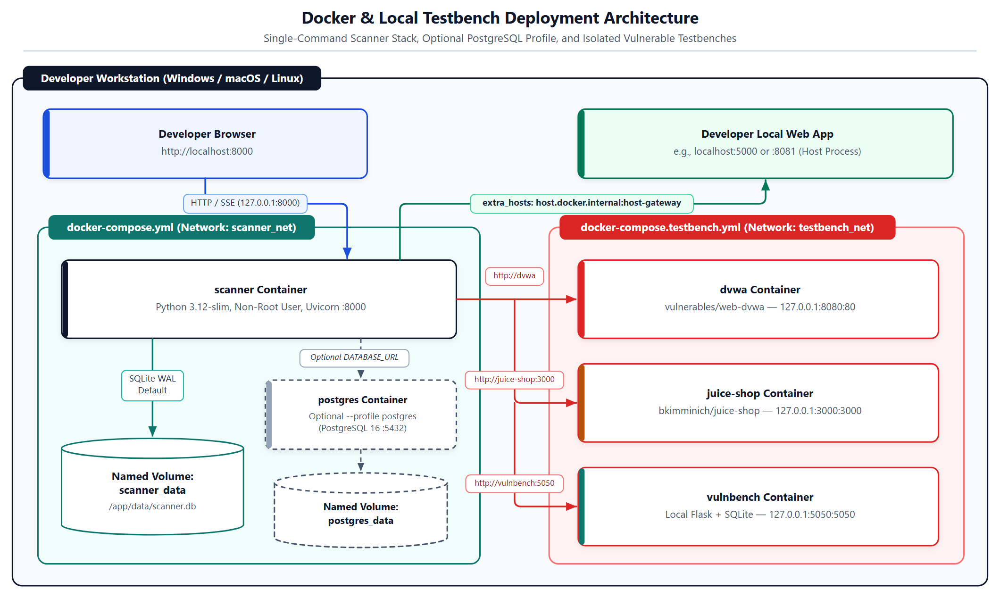

*Figure 9: Docker Compose Deployment and Network Topology (Source: [09_docker_deployment.mmd](../diagrams/09_docker_deployment.mmd)).*

### Table 3.6: Supported Deployment Profiles

| Deployment Mode | Startup Command | Database Engine | Target Reachability | Intended Operational Scenario |
| :--- | :--- | :--- | :--- | :--- |
| **Default Docker (Recommended)** | `docker compose up --build` | SQLite WAL (`scanner_data` volume) | `host.docker.internal:<port>` and Docker service names | Everyday local development and student capstone testing (< 3-minute setup) |
| **Docker + PostgreSQL Profile** | `docker compose --profile postgres up --build` | PostgreSQL 16 (`postgres_data` volume) | Same as Default Docker | Multi-project persistence validation and relational dialect verification |
| **Testbench Evaluation Stack** | `docker compose -f docker-compose.yml -f docker-compose.testbench.yml up` | SQLite WAL or PostgreSQL 16 | `http://dvwa`, `http://juice-shop:3000`, `http://vulnbench:5050` | Automated Precision, Recall, and regression benchmarking |
| **Native Python Virtual Env** | `uvicorn backend.app.main:app --port 8000` | SQLite WAL (`./data/scanner.db`) | Direct `http://127.0.0.1:<port>` and `http://localhost:<port>` | Workstations without Docker Desktop or interactive IDE debugging |

---

## 3.7 Behavioral and Dynamic Views

Static component boundaries alone do not guarantee responsive UI updates, safe user-initiated cancellation, or runtime resilience against unstable student applications. The four behavioral views below specify exact interaction sequences, fault-isolation boundaries, finite state transitions, and cross-component activity flows.

### 3.7.1 End-to-End Scan Lifecycle Sequence

Upon receiving `POST /api/projects/{id}/scans`, FastAPI validates the request schema and target allow-list, persists a `queued` scan record, submits execution to the bounded `ThreadPoolExecutor`, and immediately returns `202 Accepted`. The browser connects to `GET /api/scans/{id}/stream` via `EventSource` to receive real-time phase transitions, crawl counts, enriched finding summaries, and final risk-score completion telemetry.

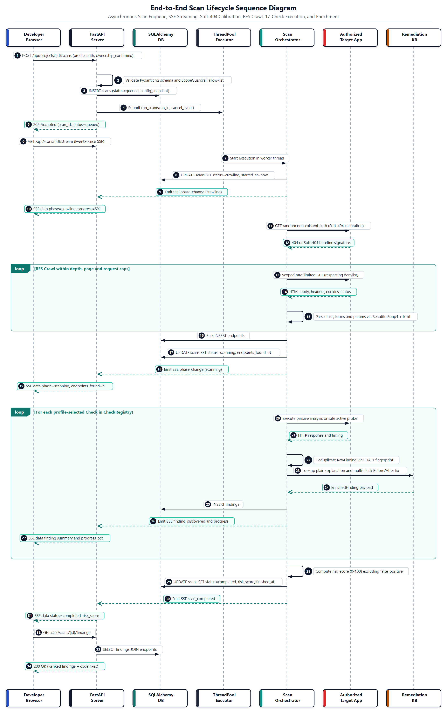

*Figure 10: End-to-End Scan Lifecycle Sequence Diagram (Source: [10_scan_lifecycle_sequence.mmd](../diagrams/10_scan_lifecycle_sequence.mmd)).*

### 3.7.2 Scan Cancellation and Per-Check Error Isolation Sequence

Web applications under active student development frequently exhibit unhandled 500 errors, hung database queries, or mid-scan restarts. Figure 11 specifies two essential runtime resilience patterns: (1) **Per-Check Error Isolation**, wrapping every plugin invocation inside a structured `try/except` boundary that emits a non-fatal `check_warning` SSE event without aborting the scan, and (2) **Cooperative User Cancellation**, allowing `POST /api/scans/{id}/cancel` to signal a per-scan `threading.Event` so the orchestrator halts probing gracefully, preserves all previously committed findings, recomputes a partial risk score, and transitions the scan to `cancelled`.

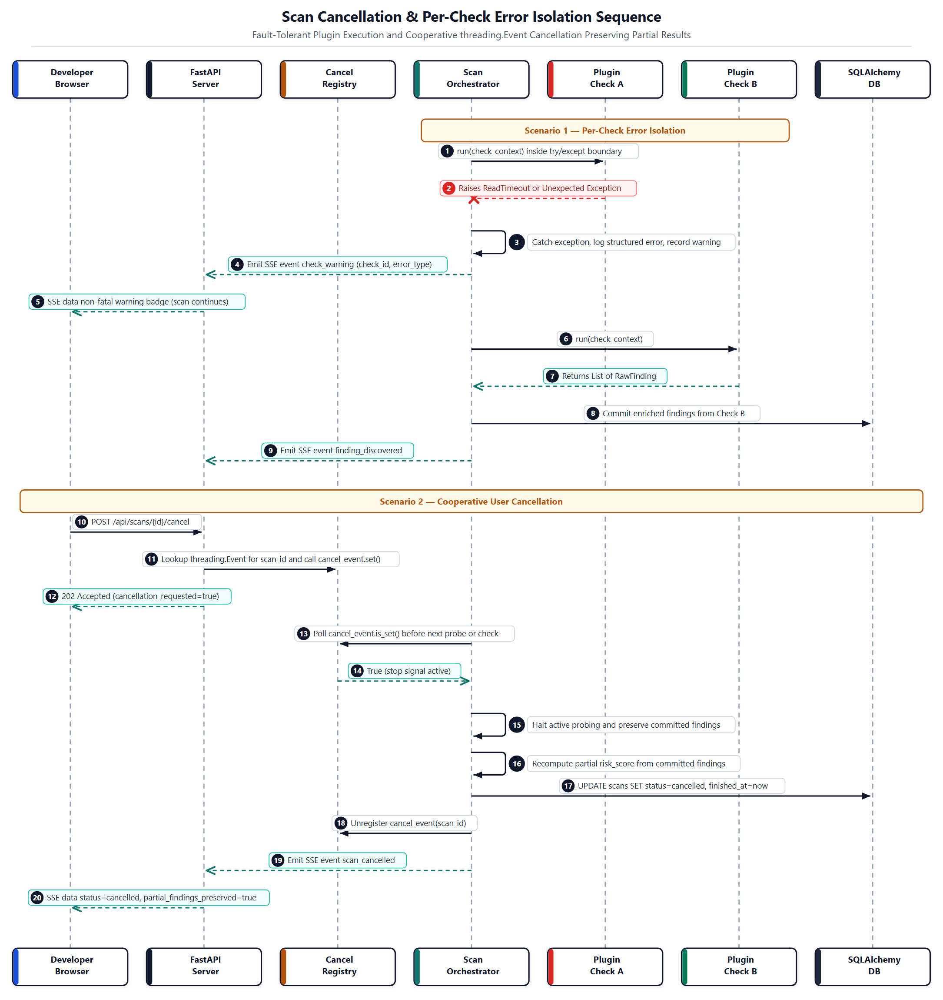

*Figure 11: Scan Cancellation and Per-Check Error Isolation Sequence (Source: [11_cancel_error_isolation_sequence.mmd](../diagrams/11_cancel_error_isolation_sequence.mmd)).*

### 3.7.3 Scan Execution Lifecycle State Machine

Every scan row in `SCANS` adheres to a deterministic six-state finite state machine (`queued`, `crawling`, `scanning`, `completed`, `failed`, `cancelled`). Terminal states (`completed`, `cancelled`, `failed`) are immutable once persisted, guaranteeing consistent historical trends and deterministic cross-scan diff comparisons.

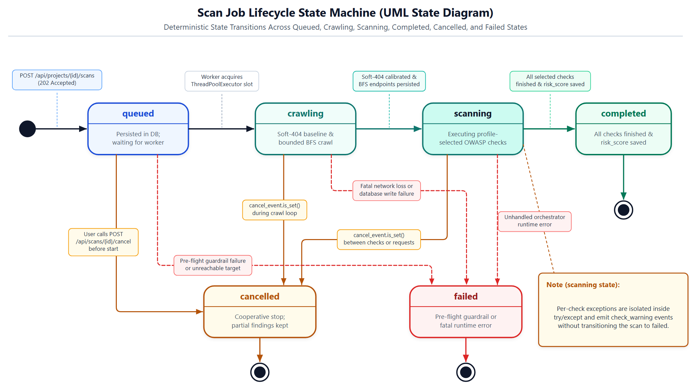

*Figure 12: Scan Execution Lifecycle State Machine (Source: [12_scan_state_machine.mmd](../diagrams/12_scan_state_machine.mmd)).*

### Table 3.7: Scan Lifecycle State Transition and Invariant Specification

| State | Terminal? | Entry Condition | Persisted Fields Updated | Permitted Outgoing Transitions |
| :--- | :--- | :--- | :--- | :--- |
| **`queued`** | No | Valid `POST /api/projects/{id}/scans` accepted | `status='queued'`, `progress_pct=0`, `created_at` | `crawling`, `cancelled`, `failed` |
| **`crawling`** | No | Worker thread begins `ScanOrchestrator` execution | `status='crawling'`, `started_at`, `current_phase='crawling'` | `scanning`, `cancelled`, `failed` |
| **`scanning`** | No | Soft-404 calibration and BFS endpoint inventory committed | `status='scanning'`, `endpoints_found`, `current_phase=<check_id>` | `completed`, `cancelled`, `failed` |
| **`completed`** | Yes | All profile-selected checks executed | `status='completed'`, `progress_pct=100`, `risk_score`, severity counts, `finished_at` | None |
| **`cancelled`** | Yes | Cooperative `cancel_event` observed by orchestrator | `status='cancelled'`, partial `risk_score` and counts preserved, `finished_at` | None |
| **`failed`** | Yes | Unrecoverable pre-flight, connectivity, or persistence error | `status='failed'`, sanitized `error_message`, `finished_at` | None |

### 3.7.4 Cross-Component Swimlane Activity View

The swimlane activity diagram coordinates responsibilities across all four operational lanes—Developer, FastAPI API, Scanner Engine, and Database and Remediation KB—illustrating the continuous iterative local security workflow (configure, scan, monitor, remediate, re-scan, compare, and export).

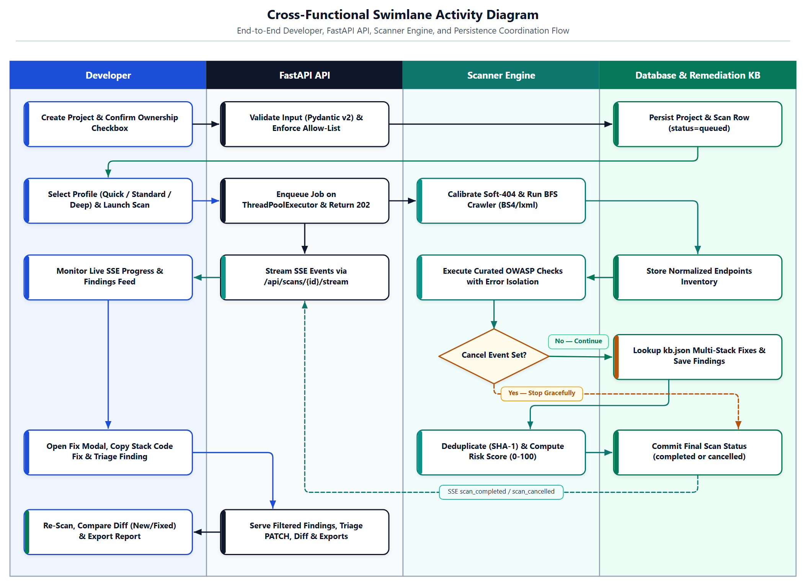

*Figure 13: Cross-Component Swimlane Activity Diagram (Source: [13_swimlane_activity.mmd](../diagrams/13_swimlane_activity.mmd)).*

---

## 3.8 Static Object-Oriented View — Scanner Plugin Class Diagram

To satisfy **NFR-06 (Extensibility)** without coupling detection logic to orchestration or database persistence, the check subsystem applies the Strategy and Template Method design patterns around the abstract `BaseCheck` interface. Four intermediate abstract classes (`PassiveCheck`, `ActiveSafeCheck`, `DiscoveryCheck`, and `DeepAuthCheck`) encapsulate category-specific utilities—such as header/body analysis, safe non-destructive probe dispatching, Soft-404 wordlist filtering, and authenticated object-identifier comparison—while keeping each of the 17 concrete checks isolated in a single self-contained Python file.

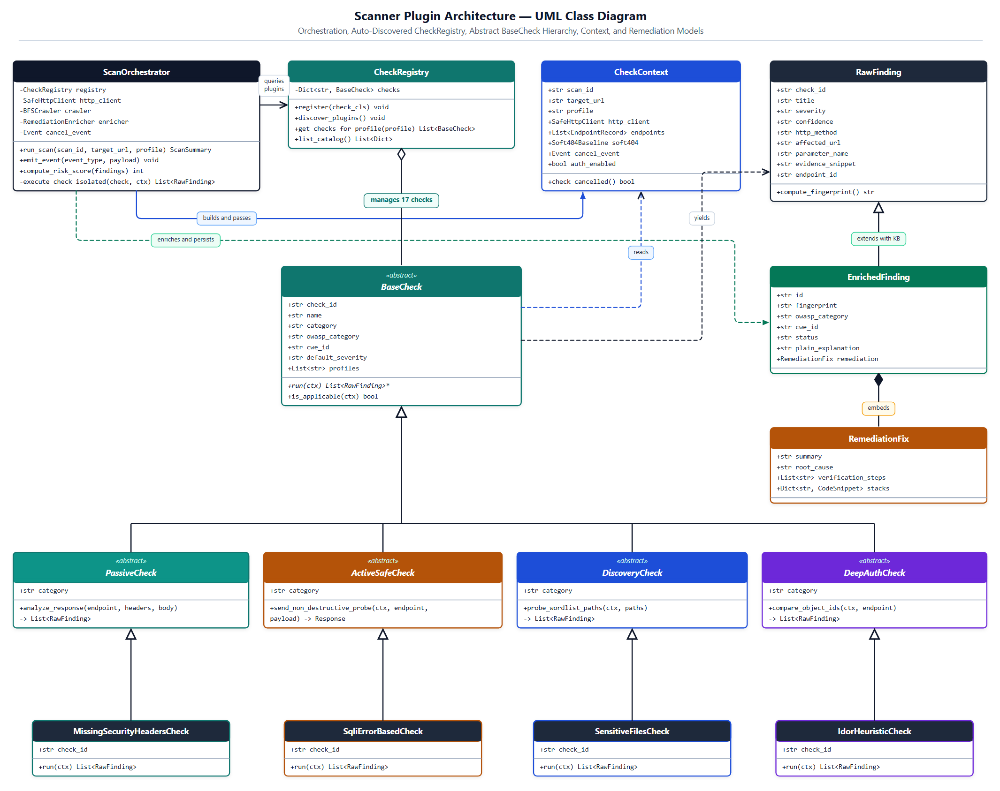

*Figure 14: Scanner Plugin Architecture Class Diagram (Source: [14_scanner_plugin_class_diagram.mmd](../diagrams/14_scanner_plugin_class_diagram.mmd)).*

### Single-File Plugin Authoring Contract

Extending the scanner with a new OWASP detection check requires zero modifications to `ScanOrchestrator`, API routers, or database models:

1. **Module Creation:** Create one Python file under `backend/scanner/checks/{passive|active|discovery|deep_auth}/<check_id>.py` subclassing `PassiveCheck`, `ActiveSafeCheck`, `DiscoveryCheck`, or `DeepAuthCheck`.
2. **Metadata Declaration:** Define canonical class attributes: `check_id`, `name`, `owasp_category`, `cwe_id`, `default_severity`, and `profiles` (e.g., `["standard", "deep"]`).
3. **Isolated Execution Contract:** Implement `run(ctx: CheckContext) -> list[RawFinding]`, checking `ctx.check_cancelled()` between probes, routing all HTTP traffic exclusively through `ctx.http_client`, and returning `RawFinding` instances populated with exact `http_method`, `affected_url`, `parameter_name`, and sanitized `evidence_snippet`.
4. **Knowledge Base Registration:** Append a matching key to `backend/scanner/remediation/kb.json` containing a plain-language root cause, verification steps, and Before/After code snippets for FastAPI, Flask, Express, PHP, and HTML. Upon startup, `CheckRegistry.discover_plugins()` automatically registers the plugin and publishes its metadata through `GET /api/checks`.

---

## 3.9 Chapter Summary

This chapter established the complete multi-view software architecture of the Lightweight OWASP Top 10 Vulnerability Scanner across C4 Levels 1–3, DFD Levels 0–1 with explicit trust boundaries, Docker Compose and testbench deployment topologies, runtime sequence and state-machine specifications, cross-component swimlane workflows, and the `BaseCheck` plugin object model. By combining a four-layer modular monolith, a pure decoupled scanning engine (`backend/scanner/`), an in-process bounded `ThreadPoolExecutor` with cooperative `threading.Event` cancellation and SSE streaming, and a single-file plugin auto-registry, the architecture fulfills its zero-configuration local usability goals without compromising fault isolation, safety guardrails, or long-term extensibility. Chapter 4 builds directly upon these structural and behavioral seams to specify the 3NF relational schema, deterministic scoring and deduplication formulas, REST/SSE API contracts, and multi-stack remediation knowledge base.

---

## References

[1] OWASP Foundation, *OWASP Top 10:2021 — The Ten Most Critical Web Application Security Risks*, 2021. [Online]. Available: https://owasp.org/Top10/

[2] OWASP Foundation, *OWASP Web Security Testing Guide (WSTG)*, Version 4.2, 2023. [Online]. Available: https://owasp.org/www-project-web-security-testing-guide/

[3] OWASP Foundation, *OWASP Application Security Verification Standard (ASVS)*, Version 4.0.3, 2021. [Online]. Available: https://owasp.org/www-project-application-security-verification-standard/

[4] M. Souppaya, K. Scarfone, and D. Dodson, *Secure Software Development Framework (SSDF) Version 1.1: Recommendations for Mitigating the Risk of Software Vulnerabilities*, National Institute of Standards and Technology (NIST), Special Publication 800-218, Feb. 2022. [Online]. Available: https://csrc.nist.gov/publications/detail/sp/800-218/final

[5] OWASP Foundation, *OWASP Cheat Sheet Series*, 2025. [Online]. Available: https://cheatsheetseries.owasp.org/

[6] Checkmarx / ZAP Community, *Zed Attack Proxy (ZAP) User Guide and Documentation*, 2025. [Online]. Available: https://www.zaproxy.org/docs/

[7] PortSwigger Ltd., *Burp Suite Documentation — Web Application Security Testing*, 2025. [Online]. Available: https://portswigger.net/burp/documentation

[8] N. Surribas, *Wapiti — Web-Application Vulnerability Scanner Documentation*, 2025. [Online]. Available: https://wapiti-scanner.github.io/

[9] ProjectDiscovery Inc., *Nuclei — Fast and Customizable Template-Based Vulnerability Scanner Documentation*, 2025. [Online]. Available: https://docs.projectdiscovery.io/tools/nuclei/overview

[10] R. Dewhurst and DVWA Contributors, *Damn Vulnerable Web Application (DVWA)*, 2025. [Online]. Available: https://github.com/digininja/DVWA

[11] B. Kimminich and OWASP Contributors, *OWASP Juice Shop — Probably the Most Modern and Sophisticated Insecure Web Application*, 2025. [Online]. Available: https://owasp.org/www-project-juice-shop/

[12] S. Ramírez, *FastAPI Framework Documentation*, and M. Bayer, *SQLAlchemy 2.0 Documentation*, 2025. [Online]. Available: https://fastapi.tiangolo.com/ and https://docs.sqlalchemy.org/en/20/

---

## Semester 1 Sign-Off Summary

This Semester 1 Graduation Project Book (Chapters 1–3, Figures 1–14 and Figure 19) serves as the formal first-semester academic submission covering Problem Scope, System Requirements Specification, and Multi-View Software Architecture.

| Document Attribute | Details |
| :--- | :--- |
| **Document Edition** | GRADUATION PROJECT BOOK – SEMESTER 1 (SAD_Semester1_Book) |
| **Project Title** | Developing a Lightweight OWASP Top 10 Vulnerability Scanner — Tailored for Web Developers and Student Projects (Developer-Experience Focus) |
| **Department** | Department of Cyber Security |
| **Academic Year** | 2026–2027 |
| **Prepared For (Project Supervisor)** | **Dr. Samar**, Project Supervisor |
| **Review Milestone** | First Semester Milestone — Requirements Analysis & System Architecture Approval |

### Project Team Sign-Off

| # | Student Name | Student ID | Primary Architectural Ownership | Sign-Off Status |
| :---: | :--- | :---: | :--- | :--- |
| 1 | Ahmed Ashraf Ammar | `235204` | System Architecture, Orchestrator & FastAPI Core | Approved — Semester 1 v1.1 |
| 2 | Islam Mohammed | `235164` | Scope Guardrail, HTTP Client & BFS Crawler | Approved — Semester 1 v1.1 |
| 3 | Abdelrhman Mohamed AbdEl-latif | `235216` | Passive OWASP Checks & Soft-404 Calibration | Approved — Semester 1 v1.1 |
| 4 | Ahmed Waleed Mokthar | `235052` | Active Safe Injection & Access Control Checks | Approved — Semester 1 v1.1 |
| 5 | Mohamed Waleed Mokthar | `235051` | SQLAlchemy Persistence, Diffing & Report Export | Approved — Semester 1 v1.1 |
| 6 | Mohamed Ibrahim Elsayed | `235401` | Developer Dashboard UI (HTML5/Tailwind/Vanilla JS & SSE) | Approved — Semester 1 v1.1 |
| 7 | Ali Ibrahim Elsayed | `235332` | Remediation KB, `VulnBench` Testbench & Evaluation Suite | Approved — Semester 1 v1.1 |

### Academic Supervisor Review

| Reviewer Role | Name | Review Decision | Signature / Date |
| :--- | :--- | :--- | :--- |
| **Project Supervisor** | **Dr. Samar** | `[ ] Approved` / `[ ] Approved with Revisions` | `_______________________` / `____-__-__` |
